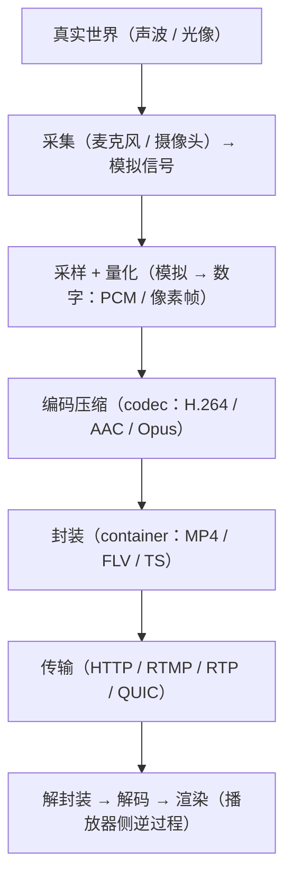

# 01 · 数字化全流程

> 📍 阶段一 · 知识整理 01 ｜ 建议配合概览页知识点清单打卡

## 一条音视频的旅程

任何一段音视频，从产生到被看见、被听见，都遵循同一条流水线：

记住这条流水线。后面所有协议与架构知识，本质上都在回答同一个问题：**其中某个环节怎么做得更快、更稳、时延更低**。

## 每个环节在做什么

| 环节 | 职责 | 关键概念 |
| --- | --- | --- |
| 采集 | 把声波/光像变成电信号 | 麦克风、摄像头；回声的源头（阶段三 AEC） |
| 采样/量化 | 模拟信号 → 数字信号 | 采样率、位深、帧、像素 |
| 编码 | 压缩体积 | 冗余、码率、I/P/B 帧 |
| 封装 | 多轨数据 + 元数据打包 | 容器、时间戳、索引 |
| 传输 | 把数据从 A 搬到 B | 协议、时延、可靠性（本站主线） |
| 解封装/解码/渲染 | 播放器侧逆过程 | jitter buffer、音画同步 |

## 为什么能压缩——三种冗余

原始音视频数据大得离谱（02、03 章会算具体数字），能压缩是因为存在冗余：

1. **空间冗余**：一帧图像内相邻像素往往相似（蓝天、白墙）。
2. **时间冗余**：相邻帧之间大部分内容没变（背景不动，只有嘴在动）。
3. **感知冗余**：人眼看不清、听不到的信息可以直接丢掉（高频色度细节、极轻的声音）。

> 编解码算法就是围绕「如何高效利用这三类冗余」展开的——这正是本站**不深入**的部分。我们只需要知道：编码的产出是一个压缩后的**裸流**（如 H.264 流、AAC 流）。裸流不能直接传输或播放——接收方还不知道哪段是视频、哪段是音频、该从哪里开始解。这就需要**封装**（本章后续）与**传输协议**（阶段二）。

## 编码格式 vs 封装格式

初学者最容易混淆的一对概念：

- **编码格式（codec）**：定义「怎么压缩一帧画面 / 一段声音」。如 H.264、H.265、VP9、AV1、AAC、Opus。
- **封装格式（container）**：定义「压缩后的数据 + 字幕 + 元数据怎么装进一个文件或流」。如 MP4、MKV、FLV、TS。

同一个 codec 可以装进不同容器，同一个容器也可以装不同 codec：

| 容器 | 典型组合 | 典型场景 |
| --- | --- | --- |
| MP4 | H.264 + AAC | 点播、移动端录制 |
| FLV | H.264 + AAC | RTMP 直播 |
| TS | H.264 + AAC/AC3 | HLS 切片、广电 |
| WebM | VP9/AV1 + Opus | Web 开源方案 |

一个类比：**codec 是货物的打包方式，container 是集装箱，传输协议是物流**。三者层层解耦——这正是「不学编解码也能吃透协议」的原因。

## 为什么本站不深学编解码

- 在协议与架构层面，codec 可以当成一个「按固定码率产出固定时序数据的黑盒」。
- 排查时延、卡顿、同步问题时，瓶颈几乎都在传输、缓冲、分发与调度，而不是压缩算法本身。
- 真要深入时再回头学 H.264 码流结构、AV1/Opus 原理不迟（阶段五的后续路标里有位置）。

## 关键要点

- 音视频全流程：采集 → 数字化 → 编码 → 封装 → 传输 → 解封装 → 解码 → 渲染。
- 压缩的依据是空间 / 时间 / 感知三类冗余。
- codec 管「怎么压缩」，container 管「怎么打包」，传输协议管「怎么运」——别混。
- 本站视角：把编解码当黑盒，聚焦传输与架构。

## 延伸阅读

- [HPBN：时延与带宽入门](https://hpbn.co/primer-on-latency-and-bandwidth/)
- [雷霄骅博客（音视频基础流程类文章）](https://blog.csdn.net/leixiaohua1020)

---

← [阶段一总览](/roadmap/stage-1/) ｜ 下一章：[02 音频基础](/roadmap/stage-1/02-audio-basics)
