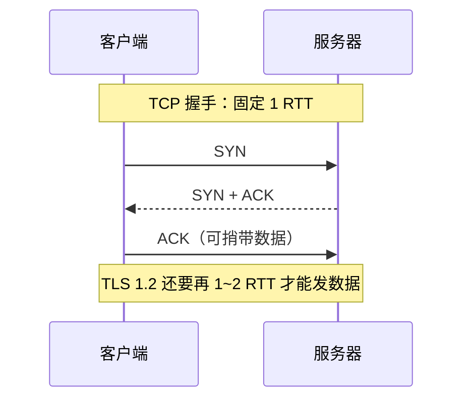
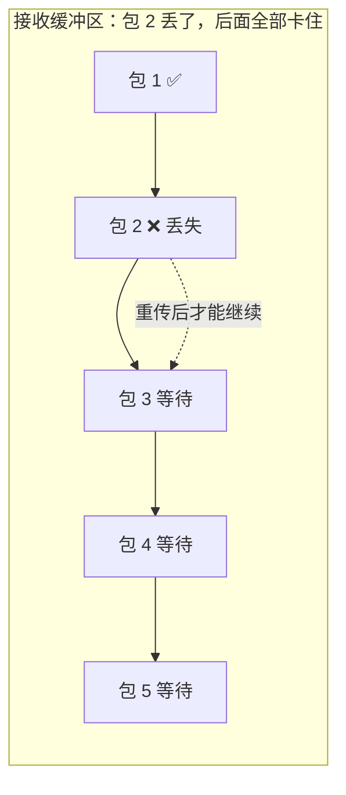

# 01 · 网络基础：TCP vs UDP

> 📍 阶段二 · 知识整理 01 ｜ 建议配合概览页知识点清单打卡

## 一句话定位

所有流媒体协议，底层都逃不开一个问题：**用 TCP 还是 UDP？**

- 选 TCP：省心（内核帮你做可靠、有序、拥塞控制），但时延不可控。
- 选 UDP：轻快（想发就发），但一切可靠性与拥塞控制都要自己建。

本章把这对选择的「为什么」讲透——它是理解后面所有协议设计的第一把钥匙。

## TCP：可靠但「有脾气」

### 头部开销

TCP 头部 **20 字节起**，带选项（如时间戳、SACK）最多 60 字节。关键字段：

| 字段 | 大小 | 作用 |
| --- | --- | --- |
| 源端口 / 目的端口 | 各 2B | 定位应用 |
| 序号（Sequence Number） | 4B | 实现「有序 + 可靠」的核心 |
| 确认号（ACK） | 4B | 告诉对方「我收到了哪里」 |
| 标志位（SYN/ACK/FIN/RST/PSH） | 6 bit | 连接与状态控制 |
| 窗口（Window） | 2B | 流量控制 |

### 建连成本：1 个 RTT

TCP 三次握手（SYN → SYN+ACK → ACK）在第三个包就可以捎带数据，因此建连固定消耗 **1 个 RTT**。若再叠加 TLS 1.2 握手，需额外 1~2 个 RTT；这就是为什么 HTTPS 页面首包慢，也是 QUIC（阶段四）想解决的问题。

### 两个对实时致命的特性

**1. 重传等待**：丢包后，TCP 会停下来重传并等待确认，期间后续所有数据都在排队——哪怕那些数据早已「过期」。

**2. 队头阻塞（Head-of-Line Blocking）**：TCP 保证字节流严格有序。假设发送方按顺序发出包 1、2、3、4、5，其中包 2 在网络中丢了：

包 3、4、5 明明已经到达接收方，应用层却拿不到——必须等包 2 重传到位。在弱网（1% 丢包很常见）下，一次丢包可能造成 **几十到几百毫秒的卡顿**，而音视频里这几百毫秒足够让通话「感觉卡了」。

> 💡 具体算一笔账：RTT = 50ms 时丢一个包，重传至少增加 1 RTT ≈ 50ms 等待；若快速重传判定失败触发超时（RTO，通常 ≥ 200ms 且指数退避），单次卡顿可达 1 秒以上。对 400ms 时延预算的 RTC 来说完全不可接受。

## UDP：极简但「全靠自己」

### 头部只有 8 字节

| 字段 | 大小 | 作用 |
| --- | --- | --- |
| 源端口 | 2B | 回包定位（可填 0） |
| 目的端口 | 2B | 定位应用 |
| 长度 | 2B | 头 + 数据总长 |
| 校验和 | 2B | 可选校验（IPv4 下甚至可以不算） |

没有序号、没有 ACK、没有拥塞窗口、没有重传——**内核几乎不干预**，发出去就完事。这给了应用层最大的自由：

- 想可靠？应用层自己做重传（SRT、QUIC 的思路）。
- 想抗丢？加前向纠错 FEC，丢 1 个包也能恢复（RTP + FEC 的思路）。
- 想控速？应用层精确控制每个包的发送时刻（pacing）。

### 为什么实时音视频偏爱 UDP：三个理由

**理由一：过期重传没有意义。** 视频第 5 秒的画面丢了，第 6 秒才重传回来——直接丢弃渲染下一帧就好，没人想看「过去」。TCP 的核心能力（可靠重传）在实时场景下反而是负资产。

**理由二：队头阻塞是致命的。** 上面算过账：TCP 一丢包就全线等待，而音视频流丢 1 个 RTP 包最多表现为一瞬间的马赛克或轻微杂音，人眼人耳几乎无感。**宁可丢一点，不要停一下**——这是实时传输的黄金法则。

**理由三：需要精细的 pacing（发送节奏）控制。** 一帧 1080p 视频可能 16KB，超过 MTU（约 1400B）要拆成十几个包。TCP 的 Nagle 算法、拥塞窗口震荡都会打乱发送节奏造成抖动；UDP 让发送端完全掌控「每个包什么时候出门」，这对音视频的平滑传输至关重要。

### 但 UDP 在公网有短板

UDP 不是免费午餐，公网环境对它不算友好：

1. **运营商 QoS 限速/丢弃**：部分运营商网络对 UDP 流量优先级较低（历史上为防 UDP 洪水攻击），高码率 UDP 流可能被悄悄丢包。
2. **NAT 穿透问题**：内网设备没有公网地址，双方无法直接互相发包。这正是阶段三 WebRTC 要用 ICE / STUN / TURN 解决的问题——先埋个伏笔。
3. **无拥塞控制**：裸 UDP 可以疯狂发包，但这会挤垮网络，运营商也会掐你。**应用层必须自己实现拥塞控制**（阶段四会学 GCC/TCC 等）。

> 💡 记忆锚点：UDP 快但「裸」，公网对 UDP 有一堆隐形门槛。所以工程上没有绝对的选择，只有**按需组合**。

## 可靠性分层按需构建

把上面的分析合成一张决策表——**不同业务对「丢」和「迟」的容忍度不同，可靠性应该分层按需构建**：

| 组合 | 代表协议 | 可靠性怎么来 | 时延 | 典型场景 |
| --- | --- | --- | --- | --- |
| TCP 系 | RTMP / HLS / HTTP-FLV | 内核 TCP 重传 + 严格有序 | 秒级 | 直播分发、点播（丢得起、等得起） |
| UDP + 应用层可靠 | SRT / QUIC / RIST | 应用层 ARQ 重传 + FEC | 1~5s | 跨公网远程制作、推流上云 |
| 裸 UDP + 少量 FEC | RTP + FEC/NACK | 只重传「还来得及」的包 | < 1s | RTC 实时互动 |

三条路线的本质区别一句话：**允许等多久，就建多强的可靠性。**

- 直播观众能接受 5~20s 时延 → 等得起 → 用 TCP 系最省心。
- 远程导播 / 云导播要求 1s 内 → 等不起但也不能丢 → UDP 上重建可靠性。
- 面对面通话要求 < 400ms → 完全等不起 → 只重传「还来得及」的包，其余用 FEC 兜底甚至直接丢。

这个思想会贯穿本站后续所有内容：阶段三 WebRTC 的 SRTP/NACK/FEC 是第三行的完整实现，阶段四 QUIC 是第二行的集大成者。

## 关键要点

- TCP 头 20~60B，握手 1 RTT；UDP 头仅 8B，内核不管事。
- TCP 对实时致命的两点：过期重传 + 队头阻塞（丢 1 个包全线等待）。
- 实时偏爱 UDP 的三理由：过期数据重传无用、队头阻塞致命、需要精细 pacing。
- UDP 公网短板：运营商 QoS、NAT 穿透、无拥塞控制需自建。
- 可靠性分层按需构建：允许等多久，就建多强的可靠性。

## 延伸阅读

- [HPBN：传输协议（TCP/UDP 章节）](https://hpbn.co/transport-protocols/)
- [RFC 9293：TCP 最新规范](https://datatracker.ietf.org/doc/html/rfc9293)（选读，看头部结构即可）
- [维基百科：用户数据报协议 UDP](https://zh.wikipedia.org/wiki/%E7%94%A8%E6%88%B7%E6%95%B0%E6%8D%AE%E6%8A%A5%E5%8D%8F%E8%AE%AE)

---

← [阶段二总览](/roadmap/stage-2/) ｜ 下一章：[02 RTMP](/roadmap/stage-2/02-rtmp)
