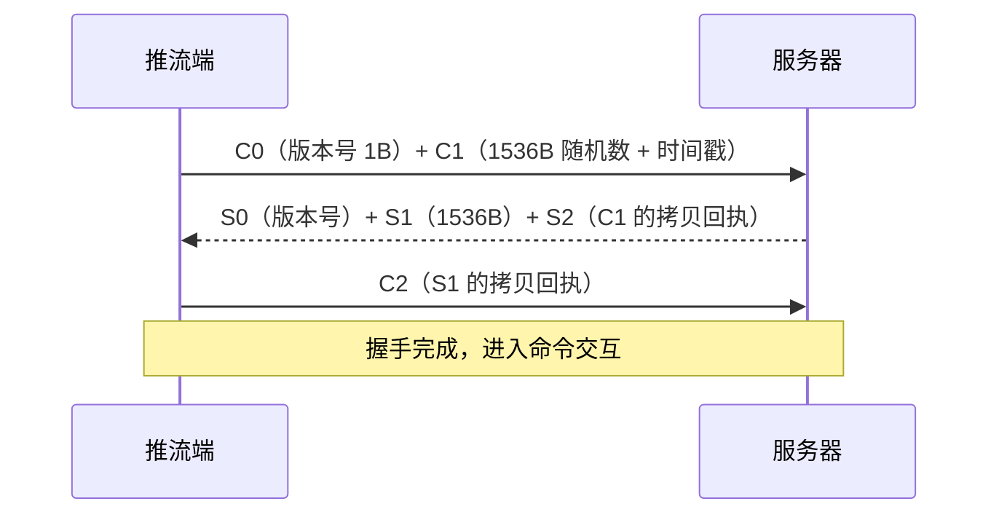
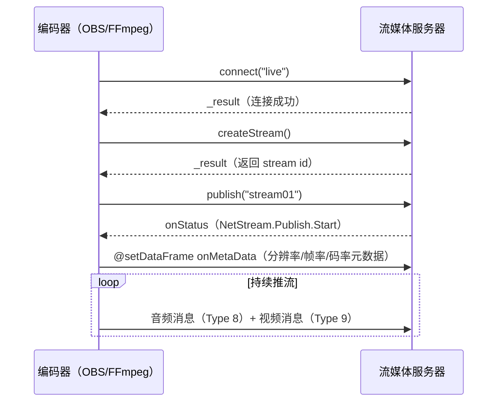
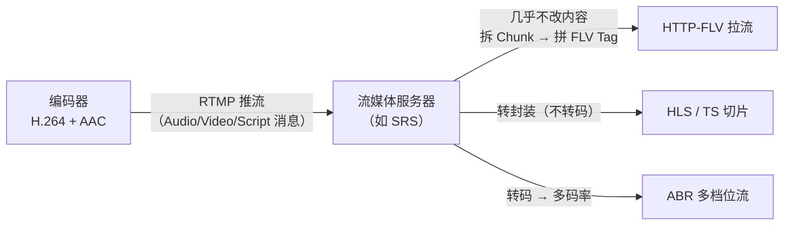

# 02 · RTMP：二十年不倒的推流之王

> 📍 阶段二 · 知识整理 02 ｜ 建议配合概览页知识点清单打卡

## 定位与历史

RTMP（Real-Time Messaging Protocol），Adobe 于 2002 年为 Flash 播放器设计。2017 年 Adobe 宣布 Flash 退役，但 RTMP 不仅没死，反而成了直播行业的**推流事实标准**——OBS、抖音直播伴侣、各大云厂商的推流入口，默认都是 RTMP。

一个协议为「已死」的生态设计，却统治了「新兴」的业务，这个反差本身就是最好的学习素材：**它到底做对了什么？**

## 基本形态

- **传输层**：TCP，默认端口 **1935**（防火墙友好的普通端口，穿透性好）。
- **URL 结构**：`rtmp://host[:port]/app/streamKey`

```bash
rtmp://push.example.com/live/stream01
#        服务器地址          app  流密钥
```

- `app`：应用名，服务器上的一个「房间目录」，通常是 `live`。
- `streamKey`：流密钥，通常就是一串随机字符串——**这就是你在直播平台「复制推流地址」时拿到的那两段**。平台用 streamKey 做鉴权（谁知道密钥谁能推流），所以它和密码一样不能泄露。

## 握手：C0/C1/C2 ↔ S0/S1/S2

TCP 连接建立后，RTMP 还有自己的应用层握手，共 6 个块：



- C1/S1 各 **1536 字节**，包含时间戳与随机数，用于校验对端存活与版本。
- C2/S2 是对端 C1/S1 的回执拷贝，相当于「我收到并认同你的随机数」。
- 标准握手 3 个来回（simple handshake），实际部署普遍用简化版（complex handshake，如 0xFF 0xFF... 的digest 校验），但**概念上记住「3 请求 3 应答」即可**。

## 命令交互：一次推流的完整流程

握手之后，RTMP 在连接上跑 **AMF 编码的命令消息**（AMF0/AMF3，一种类似 JSON 的键值序列化）。典型推流时序：



理解三个关键点：

1. **connect → createStream → publish**：先建会话，再在会话里开一条流，最后声明「我要推流」。播放端则是 `connect → createStream → play`。
2. **onMetaData**：推流正式开始前先发一条元数据（宽高、帧率、音频采样率等），播放器靠它初始化解码器——阶段一学的「参数」在这里落地。
3. **onStatus**：服务器的状态回报，推流失败排查时第一件事就是看它返回什么（如 `NetStream.Publish.BadName` 表示流名已被占用）。

## Chunk 分块机制

RTMP 把每条消息（Message）切成 **Chunk**（默认最大 128 字节，可通过 Set Chunk Size 命令调大，常见 4096）再发送。为什么？

- 一帧 1080p 视频动辄几十 KB，直接发大消息会让小消息（音频、命令）排队等很久。
- 分块后大小消息交错传输，音频不会被一整帧大视频「堵死」——这是应用层的**公平调度**思想。

每个 Chunk 头第一个字节叫 **Chunk Basic Header**，其中 Chunk Type（fmt，2 bit）有 4 种取值，决定后续头部长度（11/7/3/0 字节），后续头里最核心的是 **Chunk Stream ID（CSID）与时间戳**。类型 ID 与消息类型的约定：

| Chunk Stream ID | Message Type ID | 含义 |
| --- | --- | --- |
| 2 | 20 / 17 | 命令消息（AMF0 / AMF3） |
| 3 | 18 | 数据消息（onMetaData） |
| 4 | 8 | 音频 |
| 6（常见约定） | 9 | 视频 |

> 不需要背表，记住**分层结构即可：TCP → RTMP Connection → Message（按类型区分音/视/命令）→ Chunk（切片发送）**。排查推流问题时，抓包工具（Wireshark 过滤 `rtmpt` 或 tcp.port==1935）里看到的就是一层层 Chunk。

## 与 FLV 的同构关系

FLV 容器把数据组织成 Tag：**Audio Tag / Video Tag / Script Tag（onMetaData）**——和 RTMP 的消息类型一一对应。

这就是直播行业的经典组合拳：**RTMP 进、FLV 出**。



服务器收到 RTMP 流后拆掉 RTMP 头，把 Audio/Video 消息体原样装进 FLV Tag，就能以 HTTP 长连接方式分发给浏览器播放器（HTTP-FLV）。**转封装 = 换包装不动货物**，CPU 成本几乎为零，这是直播链路（06 章）的核心省钱手段。

## 为什么推流端至今选 RTMP：五条理由

1. **生态成熟**：OBS、FFmpeg、所有云厂商原生支持，接入成本为零。
2. **TCP 穿透性好**：走 1935/TCP，防火墙、企业网、运营商基本不拦；UDP（如裸 RTP 推流）常被丢。
3. **协议简单稳定**：握手 + 命令 + 分块，实现门槛低，调试工具多。
4. **与 CDN/转码链路解耦**：推上去之后怎么转封装、怎么分发，服务器说了算，编码器不用关心。
5. **延迟可接受**：推流上行侧时延约 1~3s（含服务器缓冲），对「推流→转分发」的架构完全够用。

## 局限与新动向

- **TCP 队头阻塞**：01 章的老问题——弱网下丢一个包，后面全部重传等待，推流上行抖动时明显卡顿。这正是 SRT（05 章）要解决的。
- **不支持新编码**：原生 RTMP 只认 H.264/AAC。HEVC/AV1/Opus 推流需要 **enhanced-rtmp** 扩展（在 Message Type ID 上加位标记），SRS、OBS 已支持，但兼容性仍需两端配合。
- **浏览器原生不支持**：没有浏览器能直接说 RTMP，必须经服务器转成 HTTP-FLV/HLS 才能进浏览器。
- **RTMPS**：RTMP over TLS（端口 443），云厂商推流入口的标配——明文推流容易被运营商劫持注入广告，生产环境务必用 RTMPS。

## 关键要点

- RTMP = TCP(1935) + 应用层握手（C0C1C2/S0S1S2）+ AMF 命令 + Chunk 分块。
- 推流时序：connect → createStream → publish → onMetaData → 持续推流。
- RTMP 消息与 FLV Tag 同构，「RTMP 进、FLV/HLS 出」的转封装是直播链路的基石。
- 推流选 RTMP 的本质：生态成熟 + TCP 穿透性好 + 简单稳定。
- 局限：TCP 队头阻塞、不认 HEVC（需 enhanced-rtmp）、浏览器不原生支持。

## 延伸阅读

- [维基百科：RTMP](https://en.wikipedia.org/wiki/Real-Time_Messaging_Protocol)（含 Adobe 官方规范下载链接）
- [SRS 文档：RTMP 详解](https://ossrs.net/lts/zh-cn/docs/v5/doc/rtmp-url-vhost)
- [enhanced-rtmp 规范（GitHub）](https://github.com/veovera/enhanced-rtmp)

---

← 上一章：[01 网络基础](/roadmap/stage-2/01-network-basics) ｜ 下一章：[03 HLS 与 LL-HLS](/roadmap/stage-2/03-hls)
