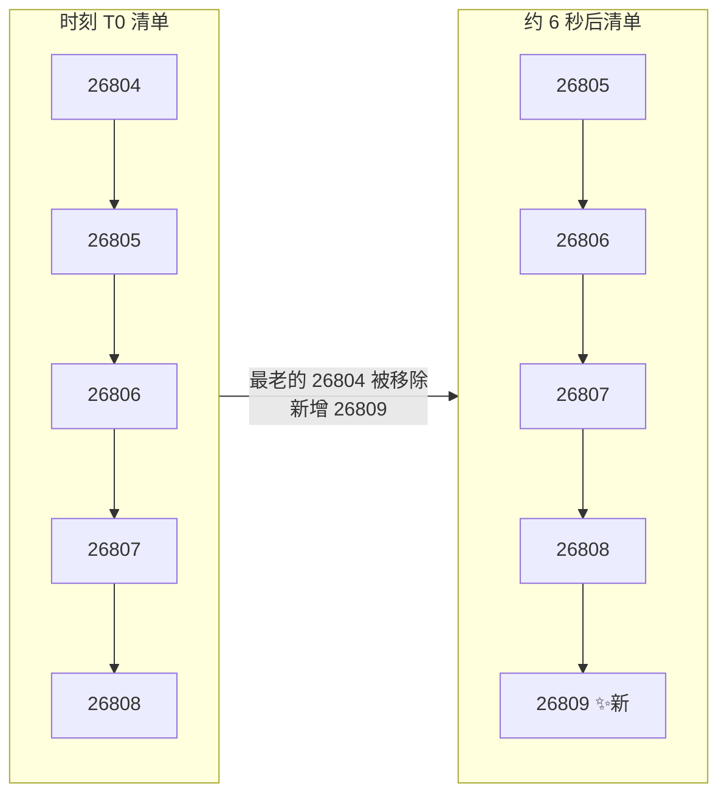

# 03 · HLS 与 LL-HLS：把直播变成 HTTP 文件

> 📍 阶段二 · 知识整理 03 ｜ 建议配合概览页知识点清单打卡

## 设计哲学：一句话讲透 HLS

HLS（HTTP Live Streaming）是 Apple 在 2009 年提出的方案，核心思想极其朴素：

> **把持续的直播流切成一个个几秒钟的小文件，放到普通 HTTP 服务器上，播放器定时来下载最新的清单即可。**

这一招解决了 RTMP 的所有分发痛点：

| | RTMP | HLS |
| --- | --- | --- |
| 传输方式 | 长连接、有状态 | 纯 HTTP 请求、无状态 |
| 需要特殊服务器 | 是（1935 端口） | 否（Nginx/CDN 直接放文件） |
| CDN 加速 | 难（需 RTMP 边缘代理） | 天然支持（就是 HTTP 静态文件） |
| 防火墙穿透 | 一般 | 极好（就是 80/443 的 HTTP） |
| 时延 | 1~3s | 10~30s（标准）|

**代价就是时延**——本章后半部分会精确推导这 10~30s 从哪来，以及 LL-HLS 怎么把它压到 2s 左右。

## 一份真实的 m3u8：逐行解析

直播媒体清单（media playlist）长这样，右侧是注释：

```text
#EXTM3U                          ← 声明这是 HLS 清单（固定第一行）
#EXT-X-VERSION:3                 ← 协议版本，决定支持的 tag 能力
#EXT-X-TARGETDURATION:6          ← 单个分片的最大时长（秒），取整向上
#EXT-X-MEDIA-SEQUENCE:26804      ← 清单里第一个分片的序号（直播会滚动）
#EXTINF:5.833,                   ← 紧随其后的分片实际时长 5.833s
live_26804.ts
#EXTINF:5.999,
live_26805.ts
#EXTINF:6.001,
live_26806.ts
#EXTINF:5.834,
live_26807.ts
#EXTINF:5.999,
live_26808.ts
```

两个播放器视角的关键规则：

1. **直播时没有 `#EXT-X-ENDLIST`**。出现这个 tag 表示「播放列表到此为止」（点播/直播结束）。播放器在直播时播完清单内最后一个分片后，会**间隔一个分片时长再次 GET 清单**，把新出现的分片接上。
2. **序号连续性即正确性**：`MEDIA-SEQUENCE` 告诉播放器第一行的编号，新清单里序号「往前滚」（旧的被删除）是正常的；如果序号跳变或回退，播放器就认为流断了。

## 滑动窗口：直播清单在「滚动」

点播清单是静态全列表；直播清单是一个只保留最近若干分片的**滑动窗口**：



- 服务器保证窗口内分片至少存在 `TARGETDURATION × 3` 的时间，老分片到期删除。
- 播放器从「任意时刻加入」都没问题：拿到当前窗口 → 追平窗口尾 → 周期性刷新清单。

## 时延下限的数学推导

标准 HLS 的时延下限由清单与分片的配合规则决定，业界通行推导如下：

> **端到端时延 ≈ 分片时长 × 3 + 编码/打包耗时**

以 6 秒切片为例：

1. **一个分片必须完整生成后才能发布**：当前这一秒的画面要等满 6s 才会变成 `.ts` 文件——平均**白等 3s**（半个分片）。
2. **播放器至少要等清单里出现 ≥3 个分片才起播**（Apple 建议 buffer ≥ 3 个 TARGETDURATION，防止抖动卡顿）——这里贡献 **18s** 量级的缓冲。
3. 叠加编码、打包、CDN 回源/分发、网络传输，各贡献零点几秒。

合计：**6s 切片 → 约 18 ~ 24s 时延；2s 切片 → 约 6 ~ 9s**。这就是「HLS 直播 10 ~ 30s」这个量级的数学来源——**不是玄学，是协议设计的直接后果**。

反过来想：想降时延就得减小分片时长，但切片太碎会导致：HTTP 请求数暴涨（CDN/带宽成本上升）、每个分片编码效率下降（关键帧密度增大，阶段一的 GOP 知识在此回收）、播放器频繁起请求易卡顿。**标准 HLS 在「时延」与「效率」之间存在硬性矛盾**——这就是 LL-HLS 登场的理由。

## ABR：master playlist 与多码率

HLS 原生支持自适应码率（ABR）：外层是 master playlist，只描述「有哪些档位」；每档指向一个媒体清单。

```text
#EXTM3U
#EXT-X-STREAM-INF:BANDWIDTH=4000000,RESOLUTION=1920x1080,NAME=1080p
v1080p.m3u8
#EXT-X-STREAM-INF:BANDWIDTH=2000000,RESOLUTION=1280x720,NAME=720p
v720p.m3u8
#EXT-X-STREAM-INF:BANDWIDTH=800000,RESOLUTION=854x480,NAME=480p
v480p.m3u8
```

播放器逻辑：起播选一档（通常从低档起，秒开）→ 实时测量下载速度/缓冲水位 → 网络好升档、变差降档。**ABR 是「播放器侧算法 + 服务端多档流」的合谋**，这也是 CDN 直播普遍带 1080p/720p/480p 清晰度切换按钮的原因。多码率的生成成本来自转码（06 章展开）。

## LL-HLS：降时延三武器

Apple 在 2019 年推出 Low-Latency HLS，目标把时延压到 **~2s**。三个核心武器：

**武器一：Part 分片（分片再切块）。** 把一个 6s 分片切成多个 0.2~1s 的 Part，边生成边发布，不用等整个分片完整：

```text
#EXT-X-PART:DURATION=1.000,URI="part_26809_1.mp4"
#EXT-X-PART:DURATION=1.000,URI="part_26809_2.mp4"
#EXT-X-PART:DURATION=0.833,URI="part_26809_3.mp4",INDEPENDENT=YES
```

播放器下载到 Part 粒度，时延从「等整个分片」变成「等一个 Part」。

**武器二：阻塞请求（Blocking Requests）。** 播放器发起下一个 Part 的请求时，**服务器先按住不回**，等这个 Part 真的生成好再返回数据：

```text
GET /live.m3u8?_HLS_msn=26810&_HLS_part=2
```

好处：省掉播放器「反复轮询清单」的 RTT——传统 HLS 每个分片周期要 GET 清单一次，阻塞请求让「服务端推着喂」，时延更稳。

**武器三：预加载提示（EXT-X-PRELOAD-HINT）。** 清单里提前告诉播放器「下一个 Part / 下一段清单的 URL 长这样，可以提前建连接发请求」——把**清单请求与媒体请求并行化**，进一步吃掉零点几秒。

> 💡 LL-HLS 还要求分片使用 fMP4（CMAF）而非 TS（头部开销更小、支持字节级索引）。CMAF（Common Media Application Format）是 HLS 与 DASH 趋同的关键——下一节展开。

## 与 MPEG-DASH 对比

MPEG-DASH 是国际标准组织（MPEG）2012 年推出的对标 HLS 的方案，思路一模一样：**清单 + 分片 + HTTP**。差异只在工程细节：

| 维度 | HLS | MPEG-DASH |
| --- | --- | --- |
| 清单格式 | m3u8（Apple 私有起家，事实标准） | MPD（XML 格式） |
| 分片容器 | TS（传统）/ fMP4（LL-HLS） | fMP4（原生） |
| 谁在用 | Apple 全家 + 全球事实标准 | YouTube（DASH 起家）、Android 生态、广电 |
| 加密方案 | FairPlay（Apple）/ AES-128 | Widevine（Google）/ PlayReady（MS） |
| 标准化 | 无正式 RFC，靠 Apple 文档 | 正式 MPEG 国际标准（ISO/IEC 23009-1） |

**趋势：CMAF 趋同。** 两大协议正在收敛到同一套媒体封装（fMP4/CMAF）+ 同一份分片内容，只保留各自的清单格式。这意味着：CDN 上同一份媒体文件，同时提供 m3u8 和 MPD 两个清单，就能服务苹果和安卓全端——存储和转码成本直接减半。工程实践里「CMAF + 低延迟」已是 HTTP 系直播的主流答案。

## 关键要点

- HLS = 把直播切成 HTTP 小文件：m3u8 清单 + 滑动窗口 + 定时刷新。
- 时延下限公式：**分片时长 × 3 + 打包耗时**（6s 切片 ≈ 18~24s）。
- LL-HLS 三武器：Part 分片、阻塞请求（_HLS_msn）、预加载提示，可压到 ~2s。
- ABR = master playlist 多档位 + 播放器动态切换算法。
- DASH 与 HLS 思路同构，CMAF 让两者共享分片、只差清单——选型差异已越来越小。

## 延伸阅读

- [Apple：HLS 官方文档与作者手册](https://developer.apple.com/streaming/)
- [Apple：Low-Latency HLS 规范（beta）](https://datatracker.ietf.org/doc/html/draft-pantos-hls-rfc8216bis)
- [DASH-IF 行业论坛](https://dashif.org/)
- [CMAF 入门（Bitmovin 博客）](https://bitmovin.com/blog/what-is-cmaf/)

---

← 上一章：[02 RTMP](/roadmap/stage-2/02-rtmp) ｜ 下一章：[04 RTSP/RTP/RTCP](/roadmap/stage-2/04-rtsp-rtp)
