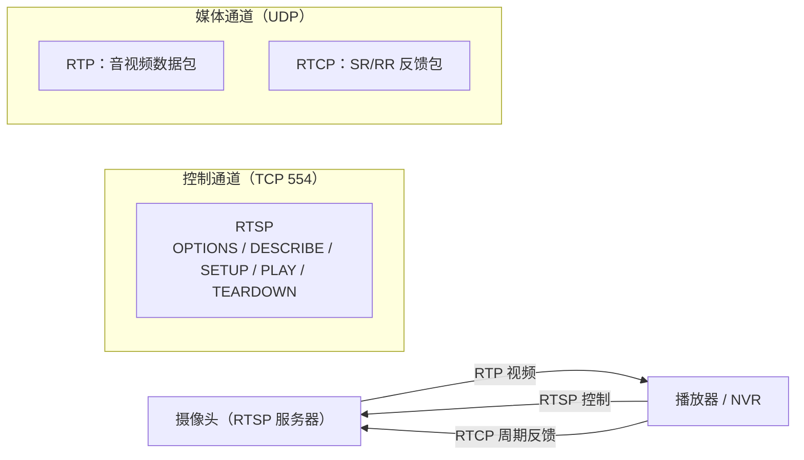
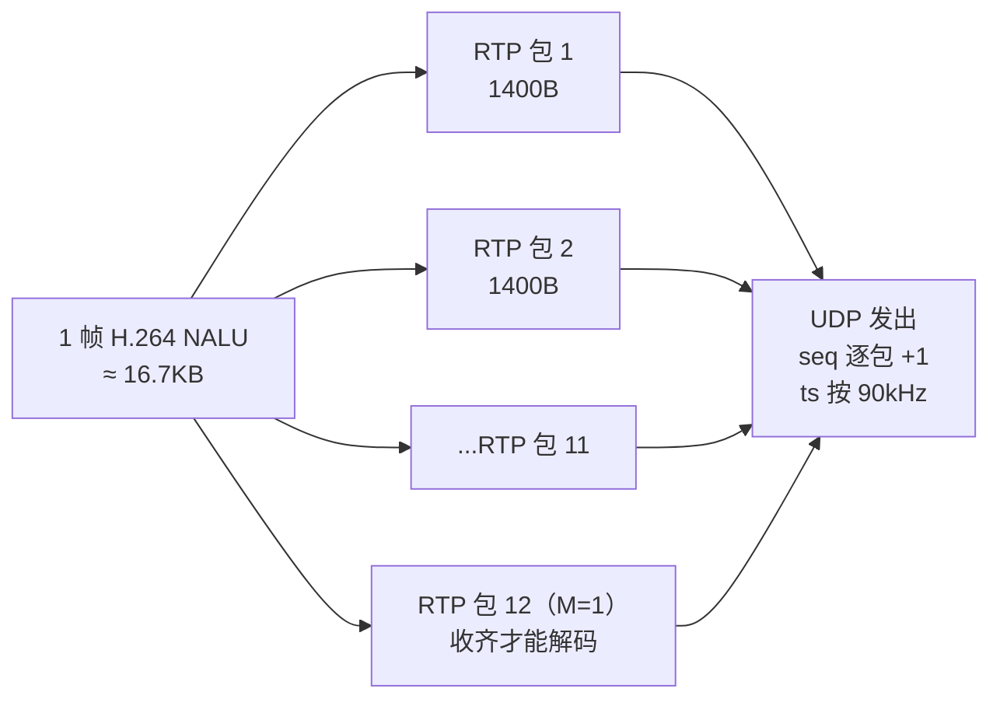

# 04 · RTSP / RTP / RTCP：信令与媒体分离

> 📍 阶段二 · 知识整理 04 ｜ 建议配合概览页知识点清单打卡

## 三兄弟分工

RTSP 家族由三个协议组成，必须放在一起理解——**控制与媒体分离**是这个家族最重要的设计思想：

| 协议 | 职责 | 传输层 / 端口 | 形态 |
| --- | --- | --- | --- |
| RTSP | 控制信令：播放、暂停、停止 | TCP 554（常配 8554） | 文本协议，像 HTTP |
| RTP | 承载媒体：一帧拆包传输 | UDP（偶有 TCP interleaved） | 二进制包，无连接 |
| RTCP | 质量反馈：丢包率、抖动、时钟对齐 | UDP（与 RTP 端口相邻） | 周期性小包 |

类比：RTSP 是**遥控器**，RTP 是**视频数据线**，RTCP 是**信号质量检测器**。WebRTC（阶段三）内部同样用 RTP/RTCP 传媒体——学会这一章，等于为 WebRTC 提前铺了半条路。



## RTSP 会话方法流

RTSP 是文本协议，与 HTTP 长得几乎一样（请求行 + 头部），但它是**有状态的**——每个会话有 Session ID。一次完整取流的方法序列：

```mermaid
sequenceDiagram
    participant P as 播放器
    participant S as RTSP 服务器
    P->>S: OPTIONS（问：你支持哪些方法？）
    S-->>P: 200（列表：DESCRIBE, SETUP, PLAY...）
    P->>S: DESCRIBE rtsp://cam/live
    S-->>P: 200 + SDP（媒体描述：编码/采样率/端口）
    P->>S: SETUP（视频轨 transport=RTP/AVP;...；音频轨再来一次）
    S-->>P: 200 + Session: 6F3B...（会话 ID）
    P->>S: PLAY
    S-->>P: 200（开始通过 RTP 持续发媒体）
    P->>S: TEARDOWN（挂断会话）
```

三个方法值得单独记：

- **DESCRIBE 返回 SDP**（Session Description Protocol）——一段文本，声明这条流有哪几路媒体、什么编码、什么采样率/时钟频率、用什么端口。**SDP 是音视频领域的「普通话简历」**：RTSP 用它、SIP 用它、WebRTC 更是重度使用。记住这个伏笔，阶段三大量出现。
- **SETUP 按 track 逐路协商**：视频一路、音频一路，各定一个 RTP 端口对（RTP 用偶数端口、RTCP 用奇数端口 +1）。
- **PLAY 之后媒体才流动**：控制是「拉闸」，媒体走的是另一条无连接的 UDP 通道。

## RTP 包头：12 字节的精确设计

RTP 包头固定 12 字节，字段不多但个个有用途：

| 字段 | 位数 | 作用 |
| --- | --- | --- |
| V（版本） | 2 bit | 固定为 2 |
| P / X / CC | 1+1+4 bit | 填充、扩展头、CSRC 计数 |
| M（Marker） | 1 bit | **标记「一帧的最后一个包」** |
| PT（Payload Type） | 7 bit | 负载类型：H.264 / AAC / Opus 的编号 |
| Sequence Number | 16 bit | 每包 +1 → 排序、查丢包 |
| Timestamp | 32 bit | 采样时刻，**视频时钟 90kHz** |
| SSRC | 32 bit | 媒体源标识，区分不同的流 |

两个最容易考的点：

**Marker 位**：一帧 1080p 视频要拆成多个 RTP 包，接收方必须知道「这一帧收齐了没有」才能组装解码。最后一个包 M=1，其余 M=0。音频通常一包一帧，M 恒为 1。

**Timestamp 90kHz**：视频 RTP 时间戳以 90kHz 为基准递增（这是历史上 NTSC 制式与 MPEG 标准折中的产物）。30fps 视频，相邻两帧时间戳差 `90000 / 30 = 3000`。音频则用实际采样率（如 AAC 48kHz → 时间戳按 48000 递增）——**两路媒体的时钟频率不同**，这正是音画同步要解决的问题（见 RTCP 部分）。

## 实例：一帧 4Mbps@30fps 视频怎么上网

把阶段一的码率知识接上，算一笔真实的传输账：

1. 码率 4Mbps、帧率 30fps → 平均每帧 `4,000,000 / 30 / 8 ≈ 16,667 字节`。
2. 网络路径 MTU 通常 1500 字节，扣除 IP 头 20B + UDP 头 8B + RTP 头 12B，单包有效负载约 **1400 字节**。
3. 一帧需拆包：`16667 / 1400 ≈ 12 个 RTP 包`，最后一包 M=1。



结论记住两点：**视频 RTP 流的包速率远高于帧率**（30fps 实际每秒发 360+ 个包）；**丢一个包只影响这一帧的一角**，接收方 NACK 请求重传或 FEC 补救即可，无需像 TCP 那样全停——这就是 01 章「裸 UDP + 少量重传」路线的具体落地。

## RTCP：反馈与音画同步

RTCP 周期性地（典型 5s 一次）在 RTP 会话里发两类核心包：

- **SR（Sender Report，发送方报告）**：发送端宣告「我发了多少包/字节、RTP 时间戳到了多少」。
- **RR（Receiver Report，接收方报告）**：接收端回报「我收到的丢包率、抖动、最大 seq」。

SR 里有一处精妙设计——**NTP 时间戳与 RTP 时间戳成对出现**：

```text
SR 报告块：
  NTP 时间戳：    3931234567.891   ← 绝对墙钟（UTC 纳秒级）
  RTP 时间戳：    180000           ← 本流 90kHz 相对时钟
  （两者对齐同一时刻）
```

**这是音画同步的钥匙**。回顾 01 章的伏笔：音频 48kHz、视频 90kHz，两套时钟频率不同、起点也可能不同，播放器如何知道「音频的第 N 毫秒」对应「视频的第 M 毫秒」？

答案：通过 SR 里这对时间戳，播放器把**两路流的 RTP 时钟都映射到同一个 NTP 墙钟坐标系**，再统一换算成播放时间线。音频抖动缓冲（jitter buffer，阶段三细讲）和视频缓冲各自按映射后的公共时间线对齐播放，音画就同步了。**没有 RTCP SR，音画同步就没有公共参照系。**

## 场景现状

- **安防监控（IP 摄像头）**：ONVIF 标准基于 RTSP，几乎每台网络摄像头都跑 `rtsp://...`，是 RTSP 的绝对主场。
- **IPTV / 广电**：机顶盒常用 RTSP 做 VOD 点播控制。
- **网页端不原生支持**：浏览器没有 RTSP/RTP 的直接入口（安全与防火墙考虑），安防厂商的产品在网页上通常要经网关转成 HTTP-FLV/WebRTC 才能播。
- **公网穿透弱**：RTP/UDP 大量端口常被企业防火墙拦截，这也是浏览器阵营放弃它的原因之一。

一句话定位：**RTSP 家族是「局域网/专网里的王者」，公网直播几乎不用它；但它定义的 RTP/RTCP 媒体层，被 WebRTC 原封不动继承了下来。**

## 关键要点

- 三兄弟分工：RTSP 管控制（TCP 554，有状态）、RTP 管媒体（UDP）、RTCP 管反馈。
- RTSP 方法流：OPTIONS → DESCRIBE（拿 SDP，WebRTC 伏笔）→ SETUP → PLAY → TEARDOWN。
- RTP 头 12B 关键字段：Marker 标一帧结束、Timestamp 视频按 90kHz、SSRC 分流。
- 4Mbps@30fps 一帧 ≈ 16.7KB → 按 MTU 1400 拆成约 12 个 RTP 包。
- RTCP SR 用「NTP + RTP 成对时间戳」建立公共坐标系，是音画同步的钥匙。

## 延伸阅读

- [RFC 3550：RTP/RTCP 规范](https://datatracker.ietf.org/doc/html/rfc3550)（读前 6 章即可）
- [RFC 2326：RTSP 1.0](https://datatracker.ietf.org/doc/html/rfc2326)
- [Wikipedia：SDP 会话描述协议](https://en.wikipedia.org/wiki/Session_Description_Protocol)

---

← 上一章：[03 HLS 与 LL-HLS](/roadmap/stage-2/03-hls) ｜ 下一章：[05 SRT 与低延迟新势力](/roadmap/stage-2/05-srt)
