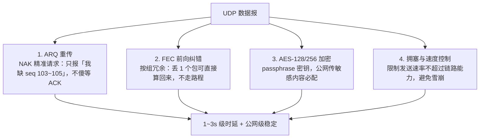

# 05 · SRT 与低延迟新势力

> 📍 阶段二 · 知识整理 05 ｜ 建议配合概览页知识点清单打卡

## SRT 要解决什么问题

回看前几章的协议版图，中间存在一个巨大的空档：

- RTMP/HLS：**稳定但慢**（秒级~十秒级），跨公网推流弱网下受 TCP 队头阻塞拖累。
- 裸 UDP（RTP）：**快但裸**（毫秒级），丢包自生自灭，公网穿透与加密全靠自己。

但真实业务里有一类需求卡在中间：**远程导播、云上转播、跨城市连线的信号回传**——要求 1~3 秒级时延、丢包率 10% 的公网上依然稳定、内容还要加密。TCP 做不到，裸 UDP 撑不住，这就是 **SRT（Secure Reliable Transport）** 的生态位。

SRT 由 Haivision 公司 2013 年开发，2017 年开源并成立 SRT Alliance，如今是广电/远程制作业界的标准传输层，SRS、FFmpeg、OBS 均已支持。

## SRT 的技术方案：UDP 上重建四层能力

SRT 完全是 01 章那张组合表里「**UDP + 应用层可靠**」路线的实现，四层能力：



**核心设计思想：不追求「完整恢复历史」（TCP 的思路），而追求「在预算内尽力」**——超过时延预算还没恢复的包，直接丢弃向前走。这个「过期丢弃」的价值观，正是 01 章「实时偏爱 UDP」三理由的工程化表达。

## 最重要参数：latency（时延预算）

SRT 所有机制都围绕一个参数展开：`latency`（单位毫秒）。它是**发送端与接收端共同维护的一个滑动缓冲窗口**，规定了「允许为恢复丢包等多久」：

- 接收端收到乱序/缺失报告后，会把包在缓冲区里 hold 住最多 `latency` 毫秒，等 NAK 重传或 FEC 算回来。
- 超过预算还没补齐 → 丢弃，媒体流继续向前。

**调参口诀（公网经验值）**：

| 场景 | RTT | 建议 latency | 预期端到端时延 |
| --- | --- | --- | --- |
| 同城/同区域 | < 30ms | 80~120ms | ~1s |
| 跨国 | 100~200ms | 250~350ms | 1~2s |
| 跨洲/卫星 | > 300ms | 400~600ms | 2~3s |

经验公式：`latency ≥ RTT × 3 ~ 4`（要覆盖一个来回的重传 + 抖动余量）。**latency 太小 → 丢包来不及恢复，画面花屏；太大 → 时延直线上升。** 这个「预算」思想请牢牢记住——阶段四 QUIC 的流控、WebRTC 的 jitter buffer，全是同一思想的变体。

## 其他关键特性

**streamid 鉴权**。SRT URL 里可带 `streamid`，格式约定为「鉴权信息 + 流信息」：

```text
srt://push.example.com:9000?streamid=#!::r=live/stream01,m=publish
```

云厂商（如阿里云、AWS MediaLive）普遍把 access token 塞进 streamid 做推流鉴权——角色相当于 RTMP 里的 streamKey。

**两种连接模式**：

| 模式 | 行为 | 适用 |
| --- | --- | --- |
| Caller | 客户端主动连服务器 | 常规推流（服务器有公网 IP） |
| Listener | 服务器监听等客户端来连 | 两台服务器互为收发、双向传输 |
| Rendezvous | 双方同时向对方发包握手 | 双方都在 NAT 后（较少用） |

**与 MPEG-TS 的关系**：SRT 传输的负载通常是 MPEG-TS 流（顺带支持多节目复用），因此广电行业可以「整套 TS 节目打包走 SRT 跨公网」——这是它替代卫星/专线回传的核心卖点，成本从每天数万降到几乎为零。

> 💡 **RIST 一句话**：RIST（Reliable Internet Stream Transport）是广播行业标准化组织（VSF）出的「对标 SRT」的开放标准，同样是 UDP + ARQ + 可选加密，设计上更贴近专业广播设备互通场景；市场影响力小于 SRT，知道定位即可，不必深究。

## 三条推流路线对比

把「推流上云」这个场景的三种协议放在一起看：

| 维度 | RTMP | SRT | WebRTC |
| --- | --- | --- | --- |
| 传输层 | TCP | UDP + ARQ/FEC | UDP + SRTP（应用层媒体协议栈） |
| 抗弱网 | 差（队头阻塞） | **强（预算内尽力恢复）** | 强（NACK/FEC/PLC 全家桶） |
| 加密 | 需 RTMPS（TLS） | 内置 AES | 内置 DTLS-SRTP |
| 典型时延 | 1~3s | 1~3s（可调） | < 500ms |
| 编码支持 | H.264/AAC（HEVC 需扩展） | H.264/HEVC（走 TS） | H.264/VP8/VP9/AV1 + Opus |
| 生态 | 最广（OBS/云厂商标配） | 广电/远程制作领域标配 | 浏览器原生、互动直播 |
| 防火墙友好 | 好（TCP 1935） | 中（UDP 需开端口） | 中（依赖 ICE/TURN，阶段三细讲） |

**选型口径**：

- 普通直播推流（观众秒级延迟可接受）→ **RTMP**：生态无敌，够用。
- 远程制作/信号回传（公网跨城、弱网、要稳）→ **SRT**：抗丢包能力是硬需求。
- 连麦互动/超低延迟（< 1s、要双向）→ **WebRTC**：唯一能在浏览器里做实时互动的方案。

三条路线没有绝对优劣，**决定因素只有两个：允许的时延预算 + 公网链路质量**。这张表建议你手抄一遍，比背协议规范有用得多。

## 关键要点

- SRT = UDP + ARQ(NAK) + FEC + AES + 速率控制，定位「公网上可控的可靠」。
- `latency` 参数是时延预算：决定「为恢复丢包等多久」，经验值 ≥ RTT × 3~4。
- streamid 做鉴权，Caller/Listener 两种模式覆盖推流与服务器互传。
- 推流选型：普通直播 RTMP、远程回传 SRT、实时互动 WebRTC——由时延预算与链路质量决定。
- RIST 是 SRT 的标准化对标品，定位广电设备互通，了解即可。

## 延伸阅读

- [SRT 官网与规范（SRT Alliance）](https://www.haivision.com/srt/)
- [SRS 文档：SRT 推拉流](https://ossrs.net/lts/zh-cn/docs/v5/doc/srt-params)
- [FFmpeg wiki：SRT 协议参数](https://trac.ffmpeg.org/wiki/)

---

← 上一章：[04 RTSP/RTP/RTCP](/roadmap/stage-2/04-rtsp-rtp) ｜ 下一章：[06 直播链路架构与选型](/roadmap/stage-2/06-architecture)
