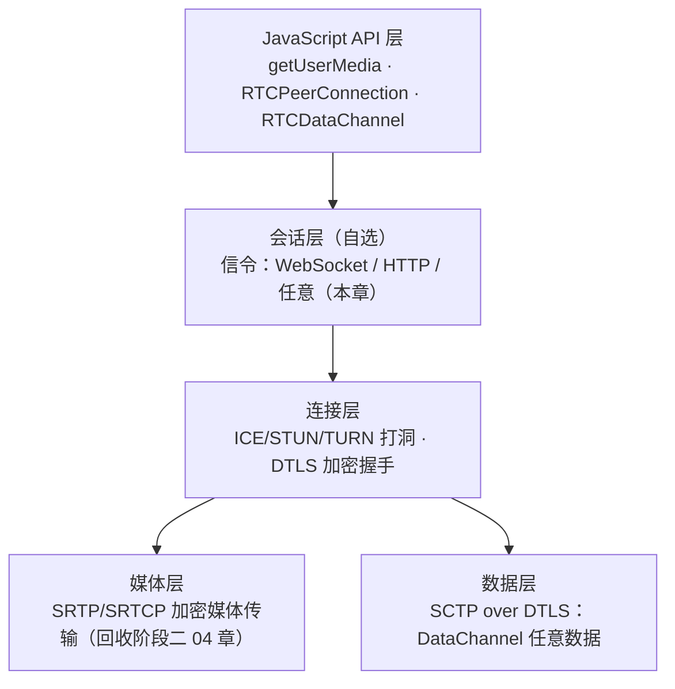
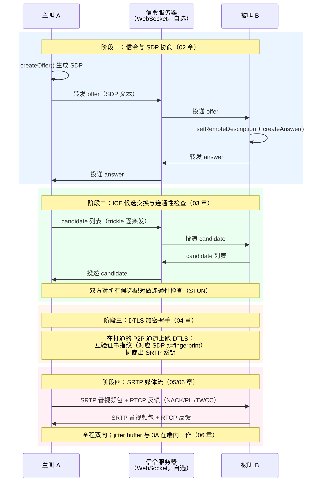

# 01 · WebRTC 全景：三大 API 与通话总时序

> 📍 阶段三 · 知识整理 01 ｜ 建议配合概览页知识点清单打卡

## 定位：把实时通信塞进浏览器

WebRTC（Web Real-Time Communication）2011 年由 Google 开源，现在是 W3C API 标准 + IETF 协议标准族（总览见 [RFC 8825](https://datatracker.ietf.org/doc/html/rfc8825)）。一句话定位：

> **浏览器原生提供的端到端实时音视频与任意数据传输能力——不装插件、不下载 App，一个 JS 调用就能和世界上任何一个人开视频通话。**

与阶段二协议的根本区别：

| | RTMP/HLS（阶段二） | WebRTC（本阶段） |
| --- | --- | --- |
| 拓扑 | 客户端 → 服务器 → 客户端（单向为主） | **端到端优先**（P2P），服务器只做辅助 |
| 时延 | 秒级（1~30s） | **亚秒级**（典型 100~400ms） |
| 方向 | 单向（推/拉） | **双向**（同时收发） |
| 传输决策 | 协议固化（TCP 有序重传 / HTTP 轮询） | **交给应用与引擎实时决策**（丢不丢、缓存多少、发多快） |

用 01 章的框架说：**RTMP/HLS 是「协议替你选好了可靠性策略」，WebRTC 是把所有传输决策（重传、缓存、码率）全部收回到应用层实时计算**。这是它低时延的根源，也是它复杂的根源——本阶段 8 章其实就是在拆解这些决策。

## 协议栈分层：先立地图

WebRTC 不是单一协议，而是一族标准拼图。记住这个分层，后面每章各拆一层：

关键洞察：**信令层是「自选」的，其余都是标准**。这正是 WebRTC 的设计哲学——媒体怎么传全世界必须统一（否则没法互通），但「谁和谁建立连接」属于应用逻辑（进哪个房间、谁能听到谁），标准不掺和。

## 三大 API：浏览器暴露的三扇门

| API | 职责 | 典型代码 |
| --- | --- | --- |
| `getUserMedia` | 拿麦克风/摄像头，产出 MediaStream | `navigator.mediaDevices.getUserMedia({audio: true, video: true})` |
| `RTCPeerConnection` | 建立与维护 P2P 连接：协商、打洞、加密、传输——**核心引擎** | `new RTCPeerConnection(cfg)` |
| `RTCDataChannel` | 在同一条 P2P 链路上传任意数据（聊天、状态、文件） | `pc.createDataChannel('chat')` |

三者关系一句话：**getUserMedia 产货，RTCPeerConnection 运货，DataChannel 是同一条路上的快递车**。注意 `RTCPeerConnection` 内部集成了阶段二学过的全套媒体机制——采集 → 编码 → RTP 打包 → 传输 → 抖动缓冲 → 解码 → 渲染，全被封装在这一个对象里。我们通过 API 设置策略（如码率上限），引擎自动执行。

## 1v1 通话总时序：四阶段地图

这是本阶段最重要的一张图。A 呼叫 B 的完整流程分四个阶段，后面每章拆解一个阶段：

**速度感**：一切顺利时，四个阶段合计约 **1~2 个 RTT 的信令 + 2~4 个 RTT 的 ICE/DTLS**——这就是「拨号到出画面」通常 1~3 秒的原因。首帧优化（阶段二 06 章三板斧的 RTC 版）本质就是在压缩这个流程。

## 阶段二伏笔全回收表

学阶段二时埋的伏笔，本章起逐一兑现——这张表也提醒你为什么阶段二没白学：

| 阶段二伏笔 | 在本阶段的兑现 |
| --- | --- |
| UDP 公网短板：NAT 穿透难（01 章） | 03 章 ICE/STUN/TURN 完整解决 |
| RTCP SR 的 NTP 对齐是音画同步钥匙（04 章） | 06 章 WebRTC 音画同步机制 |
| RTP 包头与 90kHz 时钟（04 章） | 05 章 RTP 头扩展与 RTCP 反馈族 |
| 可靠性分层按需构建（01 章） | 05 章 NACK/FEC/TWCC：只重传「来得及」的包 |
| SDP 会话描述（04 章 RTSP DESCRIBE） | 02 章 offer/answer 的核心载体 |
| 直播链路里 RTC 旁路（06 章架构图） | 07 章 SFU 架构——RTC 的「服务器」长什么样 |

## DataChannel：媒体之外的能力

一条 P2P 链路建立后（ICE + DTLS），除了 SRTP 媒体，还能跑 **SCTP over DTLS** 承载 RTCDataChannel：

- **可靠模式**（类 TCP）与**不可靠/限量重传模式**（类 UDP）可按 channel 配置——又一次「可靠性按需构建」。
- 典型用途：连麦里的弹幕/点赞、游戏状态同步、白板协作、文件快传（绕过服务器，省带宽成本）。
- 对比 WebSocket：WebSocket 必经服务器中转（多一跳 RTT），DataChannel 端到端直达——对时延敏感的小消息是质变。

> 💡 面试常问「WebRTC 只能传音视频吗」——错，DataChannel 能传任意二进制/文本，且比走服务器的 WebSocket 少一跳。这是它容易被低估的能力。

## 关键要点

- WebRTC = 浏览器原生的端到端实时通信：P2P 优先、双向、亚秒级。
- 协议栈四层：JS API（三大 API）→ 信令（自选）→ 连接（ICE + DTLS）→ 媒体（SRTP/SRTCP）+ 数据（SCTP）。
- 三大 API 分工：getUserMedia 产货、RTCPeerConnection 运货、DataChannel 顺路捎件。
- 1v1 通话四阶段：SDP 协商 → ICE 打洞 → DTLS 握手 → SRTP 媒体流，总计约 1~3 秒出画面。
- 阶段二的协议知识（SDP/RTP/RTCP/NTP 同步）在 WebRTC 里全部复用，只是组合方式不同。

## 延伸阅读

- [《WebRTC for the Curious》](https://webrtcforthecurious.com/)（免费在线书，概念第一书）
- [RFC 8825：WebRTC Overview](https://datatracker.ietf.org/doc/html/rfc8825)
- [MDN：WebRTC API](https://developer.mozilla.org/zh-CN/docs/Web/API/WebRTC_API)

---

← [阶段三总览](/roadmap/stage-3/) ｜ 下一章：[02 信令与 SDP](/roadmap/stage-3/02-signaling-sdp)
