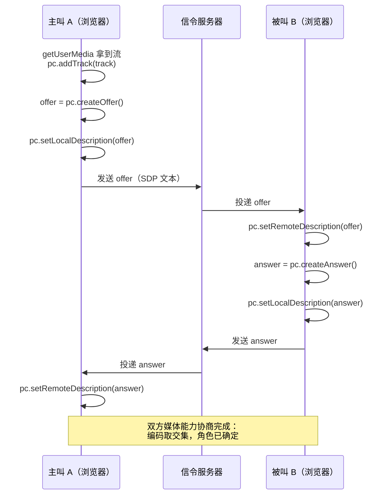

# 02 · 信令与 SDP：offer/answer 与逐行解析

> 📍 阶段三 · 知识整理 02 ｜ 建议配合概览页知识点清单打卡

## 为什么 WebRTC「不管」信令

浏览器里两个用户想通话，总得先互相「介绍自己」：我支持什么编码、我的地址在哪、用什么密钥。这些描述信息需要先交换到对方手里，才能建立直接连接——**交换这些信息的过程就是信令**。

WebRTC 标准刻意**不定义**信令协议，只规定「信令里该传什么内容」（SDP 与 candidate）。原因：

1. **应用形态千差万别**：视频会议要房间管理、客服系统要排队分配、连麦直播要和 RTMP 业务混跑——这些流程各产品完全不同，强行标准化只会碍事。
2. **实现门槛极低**：一条 WebSocket 转发 JSON 就够了（08 章实践用 Rust 写一个）。
3. **安全解耦**：信令通道本身可以走 HTTPS/WSS 加密，媒体层的加密（04 章 DTLS）独立于信令安全，两层互不依赖。

信令服务器的职责边界要划清：**它是「邮差」，只投递不解读**——offer、answer、candidate 三类消息原样转发（通常内容端到端加密，服务器都看不见）。它不做任何媒体处理。这也是「SFU 才是 RTC 的媒体服务器」（07 章）的原因。

## SDP：会话描述的「普通话简历」

SDP（Session Description Protocol，[RFC 8871](https://datatracker.ietf.org/doc/html/rfc8871) 系列在 WebRTC 语境下的规范）是一段纯文本，一行为一个属性。阶段二 04 章见过它的出场（RTSP DESCRIBE 返回 SDP），这里终于精读。

**一份 offer 里装三类信息**：

1. 媒体能力：有几路媒体、各自用什么编码、参数是什么。
2. 传输信息：ICE 凭证（ufrag/pwd）、DTLS 证书指纹。
3. 方向与组流：sendonly/recvonly/sendrecv、媒体流的 mid 分组。

## JSEP：offer/answer 状态机

浏览器把协商流程封装成 **JSEP**（JavaScript Session Establishment Protocol，[RFC 8829](https://datatracker.ietf.org/doc/html/rfc8829)）模型——经典的 **offer/answer 两阶段握手**：



配套四句口诀（面试常考）：

- **createOffer/createAnswer 生成描述**（本地能力清单）；
- **setLocalDescription 确认己方**（开始收集 candidate，03 章展开）；
- **setRemoteDescription 记录对方**；
- **offer 与 answer 必须成对**——answer 不是 offer 的拷贝，而是对 offer 逐项「接受/拒绝」后的回应，最终采用的编码是**双方能力交集**。

> 💡 常见坑：setLocalDescription 之后才开始收集 ICE candidate；若把 createOffer 的结果先展示再 set，会漏掉候选。另一个坑：setRemote 与 setLocal 的顺序错乱会导致协商失败——严格按上面时序写。

## 真实 SDP 逐行解析

下面是 Chrome 浏览器 `createOffer()` 产出的 SDP 节选（有删节），逐行注释：

```text
v=0
o=- 4611731400430051336 2 IN IP4 127.0.0.1
s=-
t=0 0
```

- `v=` 协议版本，恒为 0；`o=` 会话的唯一标识与版本号（WebView/重协商排查时有用）；`t=0 0` 时间范围（WebRTC 不用，恒 0）。

```text
m=audio 9 UDP/TLS/RTP/SAVPF 111 103 9 0 8
c=IN IP4 0.0.0.0
```

- `m=` **媒体行**，格式：`m=媒体类型 端口 传输协议 payload 类型列表`。
  - `audio`：这一路是音频；后面还会有 `m=video` 段，每段一个 m 行。
  - `9`：占位端口（真实端口由 ICE 决定，这里写死 9 是惯例）。
  - `UDP/TLS/RTP/SAVPF`：传输栈 = UDP + DTLS 加密 + RTP + 带反馈能力（SAVPF：Secure AV Profile with Feedback）——协议栈分层图里「连接层 + 媒体层」的浓缩表达。
  - `111 103 9 0 8`：这路媒体支持的 **payload type（PT）编号列表**，按优先级排序——111 是 Opus，优先级最高。

```text
a=ice-ufrag:EsAw
a=ice-pwd:P2uYro0UCOQ4zxjKXaWCBui1
```

- ICE 凭证：03 章连通性检查时，对方 STUN 请求必须带上这组 ufrag/pwd 才算通过认证。**凭证走信令分发，打洞包走媒体路径**——两路信息在此汇合。

```text
a=fingerprint:sha-256 D2:FA:0E:C3:22:59:5E:14:95:69:92:3D:13:B4:84:24:...
```

- 本端 DTLS 自签证书的 SHA-256 哈希。对方 DTLS 握手收到证书后，算哈希与此行比对——**一致才继续**。这是防中间人攻击的锚点（04 章详述）。面试高频：`a=fingerprint` 是「把信令通道的信任延伸到媒体通道」的那把钥匙。

```text
a=setup:actpass
a=mid:0
a=sendrecv
```

- `a=setup:actpass`：DTLS 角色协商——本端两种角色都行，让 answer 方定（answer 会回 `active` 或 `passive`）。`a=setup:active` 表示我来当 DTLS Client。
- `a=mid:0`：媒体段编号，BUNDLE（多路媒体复用一条连接）时靠它分组。
- `a=sendrecv`：方向。连麦是 sendrecv；看直播单向拉流是 recvonly；纯推流是 sendonly。

```text
a=rtpmap:111 opus/48000/2
a=fmtp:111 minptime=10;useinbandfec=1
a=ssrc:1001 cname:xxxx
```

- `a=rtpmap:PT 编码/时钟率/声道`：**PT 111 = Opus，48kHz，双声道**。回收阶段二 04 章「RTP PT 字段」知识——SDP 就是 PT 编号与编码的映射表。
- `a=fmtp:`：编码的格式参数。`useinbandfec=1` 表示 Opus 启用带内 FEC 抗丢包——「可靠性按需构建」在最底层的开关之一。
- `a=ssrc:` 本路媒体的 SSRC（阶段二 04 章：RTP 包里区分流的 32bit 标识）与 CNAME（跨流关联用，音画同步的辅助线索）。

视频段结构完全同构：

```text
m=video 9 UDP/TLS/RTP/SAVPF 96 97 98
a=rtpmap:96 H264/90000
a=fmtp:96 level-asymmetry-allowed=1;packetization-mode=1;profile-level-id=42e01f
a=rtcp-fb:96 nack
a=rtcp-fb:96 nack pli
a=rtcp-fb:96 goog-remb
a=rtcp-fb:96 transport-cc
```

注意 `a=rtcp-fb:` 行——**这是协商 RTCP 反馈能力的开关**：双方在此约定「我支持 NACK、PLI、REMB、TWCC，你要哪种都行」。05 章讲的反馈机制，全部先在这里握手敲定。`H264/90000` 印证阶段二的 90kHz 视频时钟。

## offer/answer 的「交集」规则

SDP 协商的本质是**能力取交集**：

| offer 声明 | answer 回应 | 结果 |
| --- | --- | --- |
| 支持 Opus/H264/VP8，按序优先 | 只回 Opus + H264 | 最终用 Opus（优先级最高交集） |
| `a=sendrecv` | `a=recvonly` | 单向：A 发 B 收（对端麦克风被禁用的典型表现） |
| `actpass` | `active` | 对方做 DTLS Client，本端做 Server |

排查协商失败的万能方法：把双方 SDP 拉出来对照——**m 行数量不一致、PT 无交集、方向冲突**，三占其一必失败。

## 关键要点

- 信令自选、媒体走标准：信令服务器是只转发 offer/answer/candidate 的邮差。
- JSEP offer/answer 模型四句口诀：create 生成、setLocal 确认己方、setRemote 记录对方、成对完成。
- SDP 核心字段：`m=` 媒体行（类型/协议栈/PT 列表）、`rtpmap/fmtp` 编码映射与参数、`ice-ufrag/pwd` 打洞凭证、`a=fingerprint` 证书指纹、`a=setup` DTLS 角色、`rtcp-fb` 反馈能力开关。
- 协商取交集；排错先对照双方 m 行、PT 与方向。

## 延伸阅读

- [RFC 8829：JSEP](https://datatracker.ietf.org/doc/html/rfc8829)
- [MDN：SDP 语法 anatomy](https://developer.mozilla.org/en-US/docs/Web/API/WebRTC_API/Protocols#session_description_protocol)
- [《WebRTC for the Curious》第 3 章：Signaling](https://webrtcforthecurious.com/docs/03-signaling/)

---

← 上一章：[01 WebRTC 全景](/roadmap/stage-3/01-webrtc-overview) ｜ 下一章：[03 NAT 穿透与 ICE](/roadmap/stage-3/03-nat-ice)
