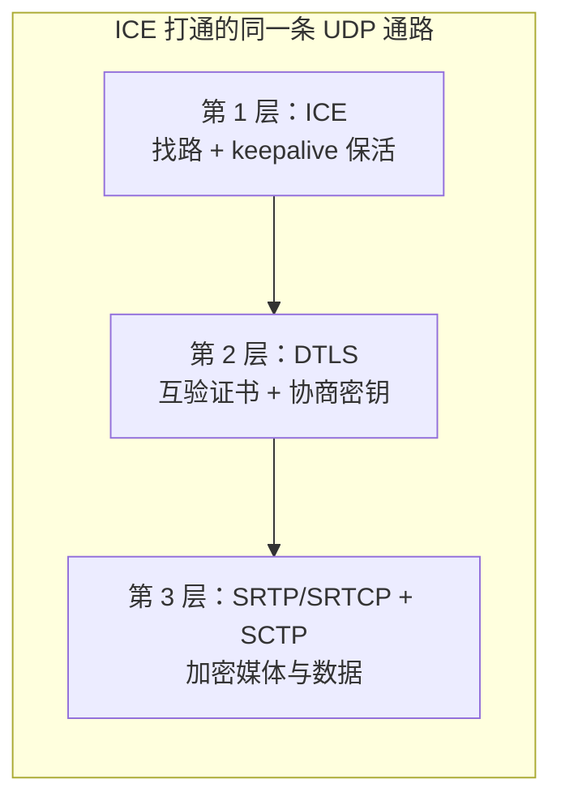
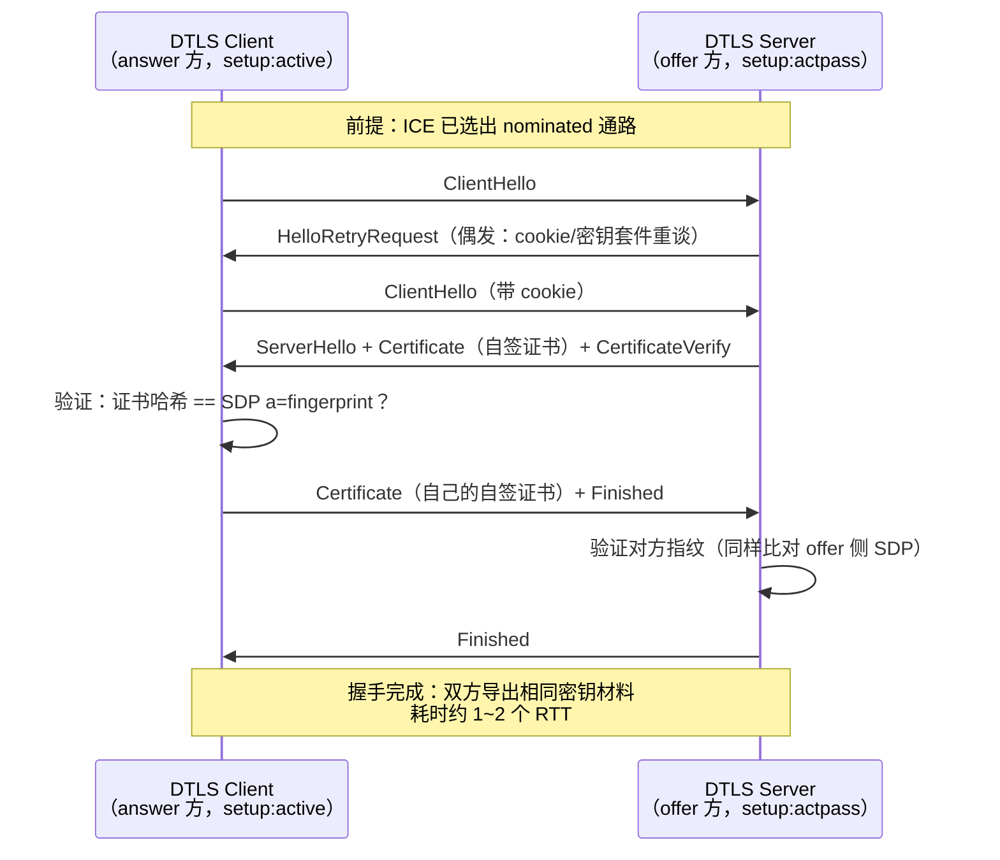

# 04 · DTLS 与 SRTP：P2P 链路上的加密

> 📍 阶段三 · 知识整理 04 ｜ 建议配合概览页知识点清单打卡

## 问题：HTTPS 的信任模型在 P2P 失效了

浏览器访问网站时，HTTPS 的信任链是「网站有 CA 签发的证书 → 浏览器内置 CA 列表验证」。但 WebRTC 是两个浏览器直连：

- 双方都不想为 P2P 通话去申请 CA 证书（也没法申请——连接的另一端是动态的个人设备）。
- 但媒体流若明文走公网，等于直播摄像头画面给全世界。

解法：**双方各自生成临时自签证书，用 DTLS（Datagram TLS）握手互相交换并验证——但验证手段不是 CA，而是 SDP 里的 `a=fingerprint`**（02 章伏笔在此兑现）。

信任逻辑变成：**信令通道（HTTPS/WSS，有 CA 与登录态保证）把对方的证书指纹可靠地送到我手上 → DTLS 握手收到对方证书 → 算哈希与指纹比对 → 一致才继续**。中间人若想替换证书，哈希必然对不上信令里的指纹——攻击失败。一句话：**把信令通道的信任，延伸到媒体通道。**

## DTLS：UDP 上的 TLS

**DTLS = TLS over UDP**（[RFC 9147](https://datatracker.ietf.org/doc/html/rfc9147) 定义 DTLS 1.3）。TLS 是为 TCP 设计的（有序、可靠），直接搬到 UDP 会因丢包乱序而握手失败；DTLS 给 TLS 加了：

- **握手包重传与序号**（应对 UDP 丢包）；
- **防重放窗口**；
- 每个握手消息控制在单包大小内（分块握手）。

在 WebRTC 里，DTLS 握手**发生在 ICE 打通的那条 UDP 通道上**——三层叠图：



## DTLS 握手时序

以 answer 方（SDP `a=setup:active`，02 章）充当 DTLS Client 为例：



要点：

1. **双向验证指纹**。两边都要拿「对方 SDP 里的 fingerprint」与「DTLS 握手收到的证书」比对——单边验证等于没防中间人。
2. **证书是临时的**。每次会话生成新自签证书（ECDSA P-256 为主），不落盘、不依赖 CA。
3. **耗时约 1~2 RTT**。ICE 的连通性检查与 DTLS 握手还会并行进行（ICE 状态到 `connected` 即启动 DTLS），所以 01 章总时序里阶段二、三能重叠。

> 💡 与 TLS 1.3 的对应：DTLS 1.3 已支持 **0-RTT 恢复**——同一对设备短时间内重连（如网络切换后 ICE restart）可跳过完整握手。这是移动端「重连快」的底层支撑之一。

## DTLS-SRTP：从握手会话导出媒体密钥

握手成功后，双方并不直接用 DTLS 传媒体，而是执行 **DTLS-SRTP**（[RFC 5764](https://datatracker.ietf.org/doc/html/rfc5764)）：

1. 握手时双方通过 `use_srtp` 扩展声明「我要用这条 DTLS 会话保护 RTP，SRTP 加密套件是 AES-128-GCM」；
2. 握手完成后，**用 DTLS 的 exporter（密钥导出接口）从会话密钥材料里导出 SRTP 主密钥**——两端各导一份，内容相同；
3. 后续媒体包不再走 DTLS 记录层，而是用导出的密钥按 **SRTP** 格式加密。

为什么这么绕？因为 **RTP 对时延极度敏感**：DTLS 记录层会引入额外头部与阻塞语义，而 SRTP 是为实时流定制的轻量加密——每包只加几十字节认证标签，无握手、无阻塞。一句话：**DTLS 管「密钥怎么商量」，SRTP 管「每个包怎么加密」。**

## SRTP：一帧画面上网后的样子

SRTP（[RFC 3711](https://datatracker.ietf.org/doc/html/rfc3711)）只加密必要部分——看一个 RTP 包在 SRTP 前后的结构对比：

```mermaid
flowchart LR
    subgraph 明文 RTP["明文 RTP 包（阶段二 04 章）"]
        A1["RTP 头<br/>V/PT/seq/ts/SSRC（12B）"] --- A2["payload<br/>H.264 帧切片"]
    end
    subgraph SRTP["SRTP 包"]
        B1["RTP 头<br/>保持明文"] --- B2["payload<br/>AES-CTR/GCM 加密"] --- B3["认证标签<br/>HMAC-SHA1 / GCM tag，4~16B"]
    end
    明文 RTP -->|"加密 payload + 追加认证标签"| SRTP
```

设计动机逐条对应：

- **RTP 头保持明文**：下游的 SFU（07 章）、RTCP 处理逻辑需要读 seq/timestamp/SSRC 才能做路由、丢包统计、拥塞估计——头加密了这些就全瘫了。敏感内容（帧数据）已全部加密，头暴露不构成实质泄露。
- **认证标签**：证明包未被篡改。RTCP 同样处理（叫 SRTCP）。
- **密钥轮换**：SRTP 有 rollover counter 机制配合序号扩展，主密钥按会话策略定期更换，长会话不裸奔。

**加密范围口诀**：媒体（payload）全加密、RTP 头明文保功能、每包附认证标签、DTLS 只负责把密钥安全送到两端。

## 一条链路的安全总账

把 01~04 章串成「一次 1v1 通话的安全账单」：

| 环节 | 安全机制 | 信任来源 |
| --- | --- | --- |
| 信令 | WSS/HTTPS | CA 证书 + 平台登录态 |
| 打洞（ICE） | STUN 请求带 ice-ufrag/pwd | 信令分发凭证 |
| 媒体通道建立 | DTLS 互验自签证书 | SDP a=fingerprint（信令送达） |
| 媒体传输 | SRTP/SRTCP | DTLS exporter 导出密钥 |
| DataChannel | DTLS 直接保护 | 同一条 DTLS 会话 |

每一层只信任上一层——**没有一层需要「上帝视角」的全局信任**，这是 WebRTC 安全设计的精髓，也是它能端到端直连还敢说安全的原因。

## 关键要点

- P2P 信任模型：自签证书 + SDP `a=fingerprint` 比对，把信令信任延伸到媒体通道。
- DTLS = UDP 上的 TLS（加重传/防重放/分块），在 ICE 通路上握手，约 1~2 RTT。
- DTLS-SRTP 分工：DTLS 协商密钥（use_srtp 扩展 + exporter 导出），SRTP 逐包加密。
- SRTP 只加密 payload，RTP 头明文保功能（SFU/RTCP 依赖），每包带认证标签。
- 全链路安全是分层接力：信令 → ICE 凭证 → DTLS 指纹 → SRTP 密钥，无全局信任点。

## 延伸阅读

- [《WebRTC for the Curious》第 8 章：Security](https://webrtcforthecurious.com/docs/08-security/)
- [RFC 5764：DTLS-SRTP](https://datatracker.ietf.org/doc/html/rfc5764)
- [MDN：WebRTC 安全](https://developer.mozilla.org/zh-CN/docs/Web/API/WebRTC_API/Security)

---

← 上一章：[03 NAT 穿透与 ICE](/roadmap/stage-3/03-nat-ice) ｜ 下一章：[05 RTP/RTCP 与拥塞控制](/roadmap/stage-3/05-rtp-rtcp)
