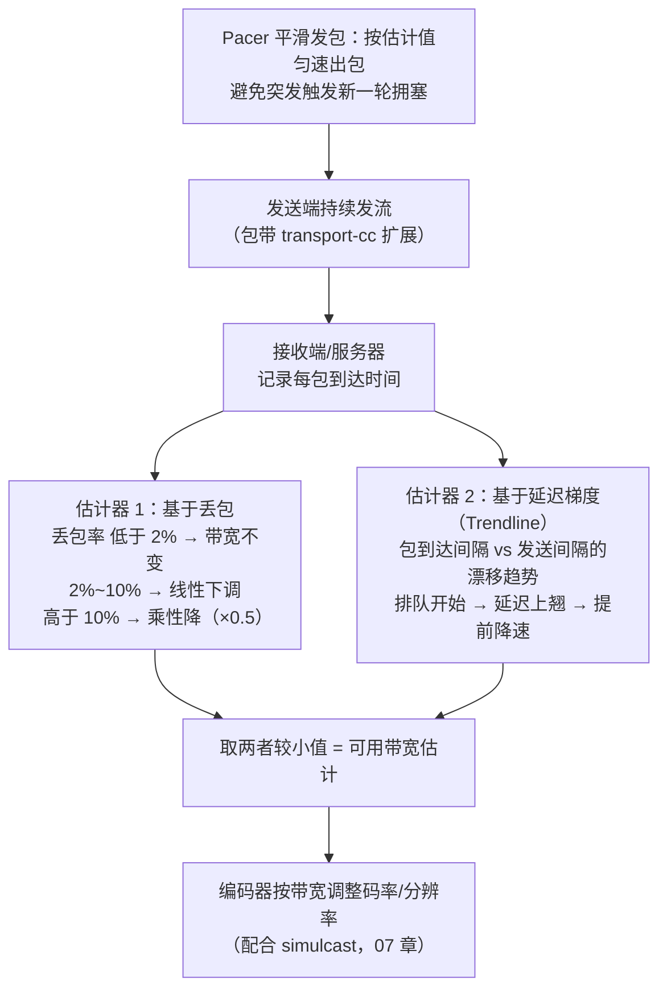

# 05 · RTP/RTCP 在 WebRTC：反馈族与拥塞控制

> 📍 阶段三 · 知识整理 05 ｜ 建议配合概览页知识点清单打卡

## 定位：01 章组合表的「第三路线」完整实现

阶段二 01 章给过三路线表：TCP 系 / UDP + 应用层可靠 / **裸 UDP + 少量重传**。第三行写着「RTP + FEC/NACK，只重传还来得及的包」——本章就是这行的完整实现，也是 WebRTC 媒体层的日常。

阶段二 04 章已学 RTP 基础（12B 头、seq/timestamp/SSRC/Marker、90kHz 时钟），全部直接复用。本章只讲 **WebRTC 在 RTP 之上新增的三件事**：头扩展、反馈报文族、拥塞控制。

## RTP 头扩展：给标准头装插件

12B 固定头不够用，WebRTC 大量依赖 **RTP Header Extensions**（SDP 里 `a=extmap:` 协商，02 章提过）。常见三种：

| 扩展 | 作用 | 谁消费 |
| --- | --- | --- |
| `transport-cc` 序号 | 包级连续编号（跨 SSRC），供 TWCC 统计 | 接收端/服务器算延迟梯度 |
| `audio-level` | 音频包的音量电平 | 接收端做「谁在说话」显示与混音 |
| `absolute-send-time` | 发送时的绝对时钟 | 接收端算端到端延迟梯度 |

理解方式：**固定头是信封上的标准栏位，扩展是贴的便利贴**；每次协商时双方约定贴哪几种（各分配一个本地 ID）。这不改变「RTP 是无连接、单向、低开销」的本质。

## RTCP 反馈族：丢什么、缺什么、网多宽

阶段二 04 章学的 RTCP SR/RR 负责「统计与同步」，WebRTC 在此之上定义了**反馈报文族（RTCP Feedback，PSFB/RTPFB）**，四类核心报文一张表：

| 报文 | 全称 | 干什么 | 典型场景 |
| --- | --- | --- | --- |
| **NACK** | Negative ACK | 「seq 103~105 我没收到，补发」 | 偶发丢包，重传还来得及 |
| **PLI** | Picture Loss Indication | 「解码器坏了，给我个关键帧」 | 连续丢包/新订阅者加入 |
| **FIR** | Full Intra Request | 与 PLI 类似，「强制整帧关键帧」 | 多方会议中中途加入者 |
| **REMB** | Receiver Estimated Max Bitrate | 接收端算出「你最多发 X kbps」 | 早期带宽估计（渐被 TWCC 取代） |
| **TWCC** | Transport-CC | 接收端回报每个包的到达时间，**发送端**自己算带宽 | 当前主流（Chrome 默认） |

**NACK 与 PLI 的区别**（面试高频）：

- **NACK 是「零售补货」**：丢 1~2 个包，指名道姓要某几个 seq 的重传，重传的是**编码后的包**（P 帧切片），代价小、恢复快。
- **PLI 是「整单重做」**：关键参考帧丢了，重传零散包也没用（解码链已断），只能让发送端重新编码一个 I 帧——代价大（I 帧体积是 P 帧的 5~10 倍）、恢复慢（几百 ms），但能救活整条流。

**工程口径**：能用 NACK 解决就不用 PLI；连续丢包超过 NACK 能覆盖的范围（或 jitter buffer 超时）才升级 PLI。

## GCC：两个估计器取小

**GCC（Google Congestion Control）** 是 WebRTC 的带宽估计算法，思想是「两条独立的证据链，交叉验证」：

两个估计器的分工：

- **丢包证据**：诚实但滞后——丢包发生时拥塞已经造成。
- **延迟梯度证据**：超前预警——队列开始堆积时延迟先上翘，还没丢包就能发现。Trendline 算法把最近若干个包的「发送-到达时间漂移」做线性回归，斜率上抬即视为拥塞前兆。

**取小（min）** 的哲学：宁可保守。带宽估错了会连环雪崩（越拥塞越重传、越重传越拥塞），保守估低顶多画质降一档。

回收阶段二伏笔：这就是「拥塞控制必须自建」的答案——TCP 的 CUBIC/BBR 替不了它，因为 TCP 管的是字节流，而这里的估计对象是**实时媒体帧的时延形态**。

## 一次弱网波动的完整故事

把本章机制串成一个时间线（30 秒弱网：WiFi 切到拥塞）：

1. **t=0**：链路从 5Mbps 掉到 1.5Mbps。发送端还在按 3Mbps 发。
2. **t=0~0.5s**：路径队列堆积，包到达延迟上翘——接收端 Trendline 侦测到漂移，TWCC 回报。
3. **t≈0.5s**：GCC 延迟估计器下调带宽估计到 ~1.4Mbps；编码器降码率、可能降 simulcast 层（07 章）——**这发生在丢包大量出现之前**。
4. **t≈1s**：仍有零星丢包 → 接收端 NACK 点名补传，jitter buffer（06 章）用余量扛住。
5. **t≈3s**：若连续丢掉关键帧 → PLI → 发送端编码新 I 帧，画面短暂模糊后恢复。
6. 全程 **没有任何 TCP 式「全线等待」**——最坏情况是几帧马赛克与一瞬模糊。

对比阶段二 01 章的 TCP 队头阻塞账单（1 次丢包卡 200ms~1s），这就是 RTC 「宁丢勿停」的工程兑现。

## 关键要点

- WebRTC 复用阶段二的 RTP/RTCP，新增：头扩展（transport-cc/audio-level/send-time）与反馈报文族。
- NACK 点名补包（便宜、快）；PLI/FIR 请求关键帧（昂贵、救命）；REMB/TWCC 是带宽估计的信号通道（TWCC 是当前主流）。
- GCC = 丢包估计（诚实滞后）+ 延迟梯度估计（超前预警），**取小保守**；估出带宽驱动编码器与 Pacer。
- 弱网标准动作：延迟梯度先警 → 降码率 → NACK 补包 → 必要时 PLI——「宁丢勿停」。
- SDP 里 `a=rtcp-fb:` 行就是这些能力的协商开关（回收 02 章）。

## 延伸阅读

- [RFC 4585：RTP/RTCP Feedback（NACK/PLI 来源）](https://datatracker.ietf.org/doc/html/rfc4585)
- [RFC 8888：Transport-CC（TWCC）](https://datatracker.ietf.org/doc/html/rfc8888)
- [《WebRTC for the Curious》第 6 章：RTP/RTCP](https://webrtcforthecurious.com/docs/06-media-communication/)
- [Google Congestion Control 论文（draft）](https://datatracker.ietf.org/doc/html/draft-ietf-rmcat-gcc-02)

---

← 上一章：[04 DTLS 与 SRTP](/roadmap/stage-3/04-dtls-srtp) ｜ 下一章：[06 jitter buffer 与 3A](/roadmap/stage-3/06-mechanisms)
