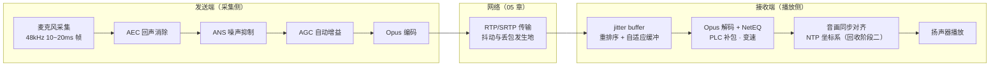

# 06 · jitter buffer、NetEQ、3A 与音画同步

> 📍 阶段三 · 知识整理 06 ｜ 建议配合概览页知识点清单打卡

## 本章视角：换到接收端与采集端

05 章讲的是「路上」的机制（重传、带宽估计），本章讲「两端」的机制：

- **发送端采集侧**：3A 处理（回声/噪声/增益）——为什么对方听你说话没有回声、没有空调声。
- **接收端播放侧**：jitter buffer + NetEQ + 音画同步——为什么网络抖动时你听到的声音依然连续。

一条完整的实时音频处理链路（记住这张图，逐节拆解）：

## jitter buffer：用「一点点延迟」换「连续播放」

**抖动（jitter）** 是包到达间隔的不一致性：发送端每 20ms 出一个音频包，经过网络后可能变成 5ms、60ms、15ms……网络路径差异、排队、重传都会造成它。

播放器不能「到哪播哪」——包 2 晚到就播不出，包 3 早到没得播。解法：**在内存里设一个缓冲区，包先到缓冲区排队，按播放时钟匀速取出**。这个缓冲区就是 jitter buffer。

**核心矛盾是缓冲大小**：越大越抗抖动（越流畅），但时延越高。WebRTC 的解法是**自适应**：

| 网络状态 | 缓冲水位 | 效果 |
| --- | --- | --- |
| 稳定（抖动 < 20ms） | 收缩到最小 ~30ms | 时延贴近下限 |
| 抖动增大 | 平滑扩张（60→100→150ms） | 用延迟换流畅 |
| 突发大抖动 | 允许瞬时膨胀，随后缓慢回收 | 扛住峰值 |
| 丢包且重传未到 | 保持播放不断流（NetEQ 接手，下节） | 宁可「糊」不可「停」 |

与阶段二 05 章 SRT 的 `latency` 参数对比：**思想完全同构**——都是「时延预算换恢复能力」，只是 SRT 是静态配置，jitter buffer 是毫秒级动态伸缩。视频侧同理（video jitter buffer 按 RTP timestamp 重排帧、对齐解码节奏），音频侧就是 NetEQ。

## NetEQ 与 PLC：音频的「无中生有」

NetEQ 是 WebRTC 音频接收端的招牌引擎，在 jitter buffer 之上叠三个能力：

1. **智能缓冲调度**：不止「攒包」，还决定「何时播、播多快」——播放时钟微调，缓慢吞掉抖动。
2. **变速不变调（加速/减速）**：缓冲积压过多时把已解码音频**轻微加速**播放（人耳无感地快 5%~10%）；缓冲见底时**轻微拉长**。这是 NetEQ 的独门绝技——不让用户感知缓冲调整。
3. **PLC（Packet Loss Concealment，丢包隐藏）**：丢包且重传来不及（05 章 NACK 没赶上）时，**根据前文信号特征合成一段「假音频」填补缺口**——人声的浊音段有强周期性，沿波形外推一小段（10~60ms），听感上是轻微「发毛」而非「咔哒断音」。

> 一句话对比：**视频丢包靠「参考帧重建 + NACK/PLI」，音频丢包靠「PLC 无中生有」**。音频能造假因为人耳对短时缺失不敏感且语音强相关；视频造假难因为画面结构复杂。这决定了两者抗丢包策略不同。

## 音频 3A：采集端三件套

**3A = AEC / ANS / AGC**，全在编码之前处理（见链路图）。逐个说清楚「它在消除什么」：

**AEC（Acoustic Echo Cancellation，回声消除）**。回声的来源：扬声器播出的对方声音 → 被本地麦克风重新拾取 → 传回对方 → 对方听到自己的回声。AEC 的原理：

- 播放信号是**已知的**（本来就要放）；
- 自适应滤波器估计「从扬声器到麦克风的房间声学路径」（墙面反射、设备漏音）；
- 从麦克风信号里**减去「估计出来的回声成分」**，剩下的才是人声。

难点在**双讲（double-talk）**：双方同时说话时，麦克风里「对方远端回声 + 本地人声」混在一起，滤波器既要消干净回声又不能削掉人声——这是 AEC 调优的永恒难题（也是语音质量评测的重要维度）。扬声器外放音量越大、房间越空旷，回声路径越难建模——**外放免提比戴耳机难做一个数量级**。

**ANS（Automatic Noise Suppression，噪声抑制）**。把风扇声、键盘声、街道底噪从人声里剥掉。频域思路：人声能量集中在中频段且帧间相关性强，稳态噪声（风扇）频谱平稳——统计建模后按频带衰减。过度抑制会让人声发「水声/断续」，抑制不足则底噪明显——同样有调参权衡。

**AGC（Automatic Gain Control，自动增益）**。有人离麦克风远声小、有人贴脸喊声大，AGC 把电平动态拉到目标区间（数字增益 + 可选模拟增益联动）。目的：让远端听到的人声音量一致，也保障后续 ANS/编码器在合理电平工作。

> 💡 3A 在 WebRTC 里由 `getUserMedia` 的 audio constraints 或 APM（Audio Processing Module）配置，浏览器默认开启基本档。做连麦产品的「回声/电流声」工单，九成出在 AEC 场景（外放 + 声学路径突变）。

## 音画同步：NTP 坐标系的最后一公里

阶段二 04 章埋的伏笔：RTCP SR 里「NTP 时间戳 + RTP 时间戳」成对出现，把音视频两套时钟（48kHz 与 90kHz）映射到同一 NTP 墙钟。WebRTC 接收端的最后一步：

1. 音频流与视频流各自收到 SR → 分别算出「自己的 RTP 时钟 ↔ NTP 墙钟」映射；
2. 两路媒体的 RTP 时间戳全部换算到 NTP 坐标系下的「原始采集时刻」；
3. 播放时以**音频为主时钟**（人耳对音频中断远比画面卡顿敏感），计算视频应提前/延后多少毫秒渲染；
4. 差异小于阈值（~30ms 内人眼无感）→ 直接播；音频超前视频 → 视频重复上一帧等待；视频超前 → 视频丢帧追赶（配合 NetEQ 的微变速吸收小误差）。

**同步的判据一句话**：让观众在同一时刻听到与看到「同一采集时刻」的内容，锚点是 NTP，主时钟是音频，视频靠丢帧/等帧贴齐。

## 关键要点

- jitter buffer 用「可伸缩的小缓冲」换播放连续性：30ms 起步，随抖动自适应伸缩——与 SRT latency 同思想。
- NetEQ 三板斧：缓冲调度、变速不变调、PLC 丢包合成——音频「宁可糊、不可停」。
- AEC 消「扬声器→麦克风」回声（双讲是难点）；ANS 剥稳态噪声；AGC 统一电平——3A 在编码前完成。
- 音画同步：SR 的 NTP 映射统一坐标系 → 音频为主时钟 → 视频丢帧/等帧贴齐。
- 接收端设计哲学与 05 章一致：一切为了「不断流」，时延与质量在预算内动态权衡。

## 延伸阅读

- [《WebRTC for the Curious》第 7 章：Audio/Video Engines](https://webrtcforthecurious.com/docs/07-audio-video/)
- [WebRTC 官方博客：NetEQ 原理](https://webrtc.org/)
- [RFC 3550：RTCP SR 与 NTP（回收阅读）](https://datatracker.ietf.org/doc/html/rfc3550#section-6.4)

---

← 上一章：[05 RTP/RTCP 与拥塞控制](/roadmap/stage-3/05-rtp-rtcp) ｜ 下一章：[07 SFU 架构](/roadmap/stage-3/07-sfu)
