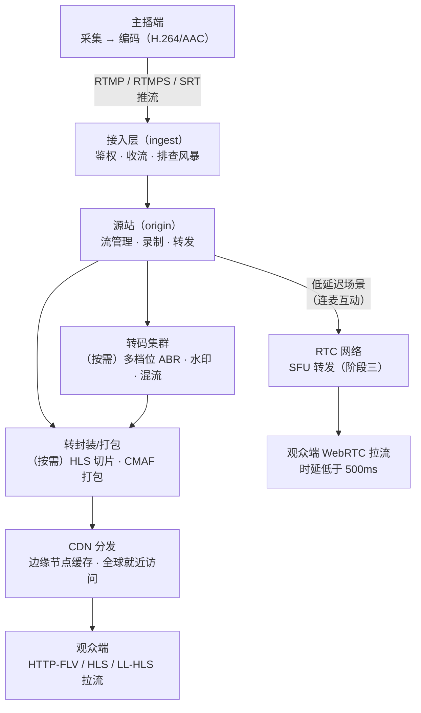
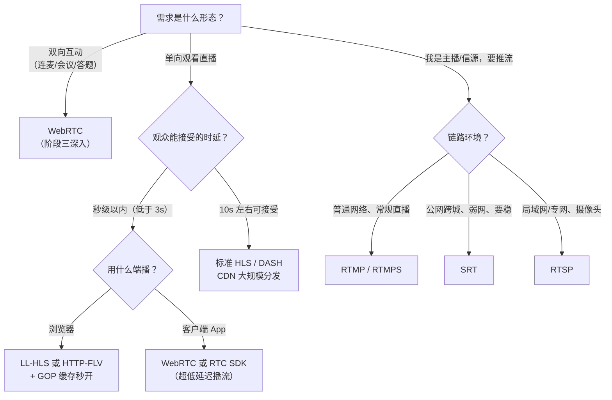

# 06 · 直播链路架构与协议选型

> 📍 阶段二 · 知识整理 06 ｜ 建议配合概览页知识点清单打卡

## 全链路：从主播到观众

前五章学的每个协议，都在这张图里找到自己的位置：

每一跳的职责与使用的协议：

| 跳 | 节点 | 干什么 | 常用协议 |
| --- | --- | --- | --- |
| 1 | 主播 → 接入层 | 收流、鉴权（streamKey/streamid） | RTMP / RTMPS / SRT |
| 2 | 接入层 → 源站 | 流注册、录制、分发树起点 | 内部协议（RTMP/私有） |
| 3 | 源站 → 转码 | 产出多码率/水印/混流 | 内部（RTMP/流转发） |
| 4 | 转码/源站 → 打包 | 切片、生成 m3u8/MPD | 转封装（HLS/DASH/FLV） |
| 5 | 打包 → CDN | 静态文件缓存与分发 | HTTP（HLS/HTTP-FLV） |
| 6 | CDN → 观众 | 就近拉流、ABR | HTTP-FLV / HLS / WebRTC |

记住这张图的**分层逻辑**：接入看推流协议（02/05 章），分发看打包与 CDN（03 章），互动看 RTC（阶段三）。看任何一家云厂商的直播产品文档（阿里云、腾讯云、AWS），架构几乎就是这张图的变体。

## 转码 vs 转封装：一字之差，成本百倍

这是直播架构里最重要的成本概念：

| | 转封装（remux） | 转码（transcode） |
| --- | --- | --- |
| 本质 | 换包装：拆容器重新装（FLV→TS） | 换货物：解码 → 重新编码 |
| 媒体数据 | **逐字节不变** | 重新压缩，画质有损 |
| CPU 开销 | 几乎为零（内存搬运） | 高（每一路都是 GPU/大量核的活） |
| 时延 | 毫秒级 | 秒级（引入编码延迟 + 缓冲） |
| 典型用途 | RTMP→HLS/FLV 切片、协议适配 | ABR 多档位、格式兼容、水印 |

> 💡 数量级感受：一台服务器转封装可承载数百路流；而一路 1080p 转码（软编）就要吃掉数个 CPU 核心，1080p GPU 转码一张卡也只能并行十几路。**直播平台的成本大头，转码当仁不让**——所以架构设计的第一原则是：能不转码就不转码（转封装优先），转码只发生在「确实需要多档位/格式转换」的流上。

### ABR Ladder：转码产出多档位

转码集群的典型产出是一套 **ABR ladder（码率阶梯）**，示例（真实大厂配置的简化版）：

| 档位 | 分辨率 | 码率 | 帧率 | 目标设备 |
| --- | --- | --- | --- | --- |
| 1080p 高清 | 1920×1080 | 4 Mbps | 30fps | WiFi 大屏 |
| 720p | 1280×720 | 2 Mbps | 30fps | 主力档位 |
| 480p | 854×480 | 800 kbps | 30fps | 4G 移动端 |
| 360p | 640×360 | 400 kbps | 30fps | 弱网兜底 |

观众端在档位间自动切换（03 章 ABR 算法），**阶梯设计原则：每档码率约是下一档的 1.5~2 倍**，保证切换时画质/带宽感受平滑。这四档流 + 转码成本，就是「清晰度切换按钮」背后的真金白银。

## 秒开三板斧

「秒开」（起播 < 1s）是直播体验的第一指标。观众点开直播间到看到画面，路上有三个敌人：**首帧太远、缓冲不足、档位太高**。三板斧逐一化解：

**1. GOP 缓存（服务端侧，最重要）**。阶段一学过：只有 I 帧能独立解码。若观众随机时刻加入，最近的 I 帧在 2 秒前——难道让他等 2 秒？服务器的解法是**缓存最近一个 GOP（从最近 I 帧开始的完整数据），新观众一来，立刻把这段数据灌给他**——瞬间有画面。代价：每个新观众都会多消耗一点带宽与服务器内存，直播人数多时是笔账。

**2. 预加载与首帧封面（客户端侧）**。滑动进入列表时就后台预拉流；起播前先显示封面/骨架屏，感知上「秒开」。技术细节：播放器把网络预取、DNS/连接预热（keep-alive）都做在用户点击之前。

**3. 低档位起步（播放器侧）**。ABR 算法起播先选 480p 甚至 360p——低档位下载快、首帧近，先「出画面」再升档。用户感知顺序远比一开始就高清重要。

> 💡 三板斧分别作用于**服务端（GOP 缓存）、网络（预加载）、客户端（低档起步）**——性能优化的经典分层套路，在 RTC 的首帧优化（阶段三）里会再次出现同样的分层结构。

## 协议对比总表：本阶段的收获

把 02~05 章全部协议放进一张大表，这就是你本阶段知识体系的「一览图」：

| 协议 | 传输层 | 典型时延 | CDN 友好 | 穿透性 | 典型场景 |
| --- | --- | --- | --- | --- | --- |
| RTMP | TCP 1935 | 1~3s | 差（需代理） | 好 | **推流事实标准** |
| RTMPS | TCP 443 (TLS) | 1~3s | 差 | 极好 | 生产推流（加密） |
| HTTP-FLV | HTTP(TCP) 长连接 | 2~5s | 中（长连接难缓存） | 极好 | 浏览器低延迟直播 |
| HLS | HTTP(TCP) | 10~30s | **极好** | 极好 | 大规模直播、点播 |
| LL-HLS | HTTP(TCP) | ~2s | 极好 | 极好 | 低延迟大规模直播 |
| MPEG-DASH | HTTP(TCP) | 10~30s | 极好 | 极好 | YouTube/安卓生态 |
| RTSP/RTP | TCP 554 + UDP | < 1s | 差 | 差 | 安防、IPTV（专网） |
| SRT | UDP + ARQ/FEC | 1~3s | 差（点对点） | 中 | 远程制作、公网回传 |
| WebRTC | UDP/SRTP | < 500ms | 差（需 SFU） | 中（ICE/TURN） | 连麦互动、会议（阶段三） |

从表里读出两条行业规律：

1. **推流端高度统一（RTMP），播放端百花齐放（FLV/HLS/WebRTC）**——因为推流端只有主播一个点，协议统一成本最低；播放端面对亿级异构设备，必须按设备能力与延迟需求分流。
2. **CDN 友好度与延迟是一对反义词**：HTTP 静态文件（HLS）最友好但最慢；点对点/长连接（RTP/WebRTC）最快但无法 CDN 缓存。**没有任何协议同时占优**，架构选型永远是在这条光谱上找业务需要的平衡点。

## 选型决策树

实际工作中被问「这个直播用什么协议」，按下面走一遍就有答案：

> 💡 用法示例：老板说「做一个延迟 2 秒以内的浏览器直播」→ 决策树走 B 支：推流 RTMP + 服务器转 LL-HLS/FLV + GOP 缓存。再比如「把现场摄像机信号传回机房导播」→ F 支：SRT。**先问时延预算，再问播放端形态，最后问链路环境**——三问定协议。

## 关键要点

- 全链路：主播 → 接入层 → 源站 → 转码/转封装 → CDN → 观众端（互动场景旁路 RTC）。
- 转封装换包装（零成本），转码换货物（成本大头）；ABR ladder 每档差 1.5~2 倍码率。
- 秒开三板斧：GOP 缓存（服务端）+ 预加载（网络）+ 低档起步（客户端）。
- 行业规律：推流端统一 RTMP，播放端百花齐放；CDN 友好度与时延不可兼得。
- 选型三问：时延预算 → 播放端形态 → 链路环境。

## 延伸阅读

- [SRS 文档：RTMP→HLS 工作原理](https://ossrs.net/lts/zh-cn/docs/v5/doc/delivery-hls)
- [阿里云直播产品架构（对照真实商用架构）](https://help.aliyun.com/document_detail/127838.html)
- [FFmpeg wiki：直播流处理](https://trac.ffmpeg.org/wiki/)

---

← 上一章：[05 SRT 与低延迟新势力](/rtc/stage-2/05-srt) ｜ 下一章：[07 FFmpeg 推拉流实践](/rtc/stage-2/07-practice)
