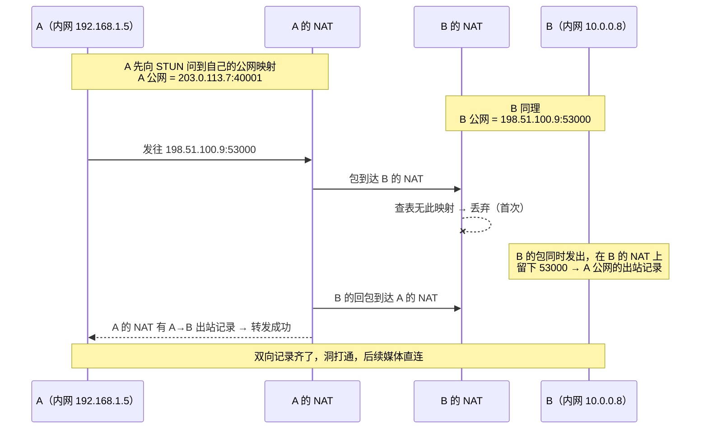
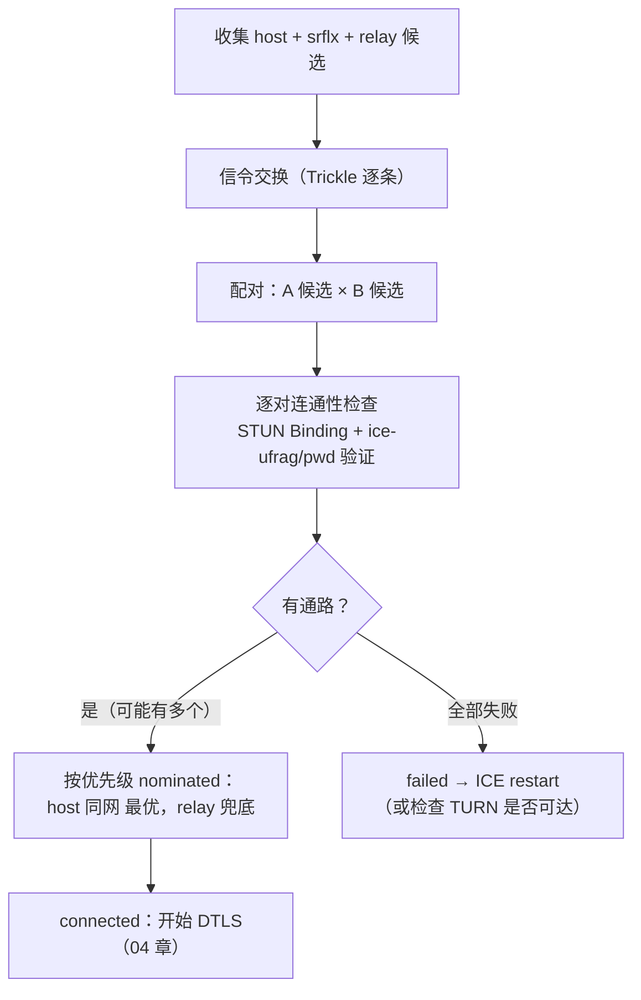

# 03 · NAT 穿透与 ICE：STUN、TURN 与打洞

> 📍 阶段三 · 知识整理 03 ｜ 建议配合概览页知识点清单打卡

## 问题：两边都在内网，怎么直连？

阶段二 01 章埋的伏笔现在回收：UDP 在公网的短板之一就是 **NAT（Network Address Translator）**。

IPv4 地址只有约 43 亿个，不够全球设备人手一个公网 IP，于是家庭/公司网络里的设备都躲在 NAT 后面共享少数公网 IP。NAT 的工作方式：

> 内网设备（192.168.1.5:51000）向外发包时，NAT 把源地址改写为**自己的公网 IP + 一个新端口**（如 203.0.113.7:40001），并在映射表里记一条「40001 ↔ 192.168.1.5:51000」。外网回包到 203.0.113.7:40001，NAT 查表转发回内网。

问题来了：**A 和 B 都在内网，彼此都不知道对方 NAT 的公网映射**。A 直接向「B 的内网地址」发包毫无意义；向「B 的公网 IP」发包，B 的 NAT 查不到映射记录，直接丢弃。P2P 直连就是这么被挡住的。

## 打洞原理：同时互发，双向开洞

ICE 打洞的核心动作朴素得惊人——**双方「同时」向对方的公网映射地址发包**：



要点：**每个 NAT 只认「出站记录」**。谁先出站谁留记录，对方的包随后到达就能通过；双方几乎同时发，两个方向的记录都建立起来——这就是「洞」。

## NAT 四种类型：打洞难度天梯

不是所有 NAT 都这么好说话。按「什么样的外部包能通过映射进来」分四类：

| 类型 | 规则 | 打洞难度 |
| --- | --- | --- |
| 全锥形（Full Cone） | 一旦建立映射，**任何**外部地址都能发进来 | 最容易 |
| 受限锥形（Restricted Cone） | 只放行「我主动发过包的 IP」 | 容易 |
| 端口受限锥形（Port Restricted） | 只放行「我主动发过包的 IP+端口」 | 较难（上面的标准打洞就是应对它） |
| 对称形（Symmetric） | **每换一个目的地址就换一个新映射端口** | 几乎无解（预知的映射地址不对） |

对称 NAT 是杀手：A 向 STUN 服务器查询得到映射 `40001`，但 A 向 B 发包时 NAT 实际用了新端口 `40002`——B 拿着 `40001` 打洞必然打偏。经验数据：**标准打洞能覆盖约 80%~90% 的场景，剩余主要是对称 NAT 与企业级防火墙**，这部分交给 TURN 兜底。

## STUN：先知道「我是谁」

打洞的前提是知道自己的公网映射。**STUN（Session Traversal Utilities for NAT，[RFC 8489](https://datatracker.ietf.org/doc/html/rfc8489)）** 就是干这个的：

```mermaid
flowchart LR
    A["内网终端<br/>192.168.1.5:51000"] -->|"Binding Request<br/>（UDP 3478）"| S["STUN 服务器<br/>公网已知地址"]
    S -->|"Binding Response<br/>映射地址 XOR-MAPPED-ADDRESS：<br/>203.0.113.7:40001"| A
    Note over A: 「原来我的公网门牌是<br/>203.0.113.7:40001」
```

- 终端向公网 STUN 服务器发一个 **Binding Request**，服务器从包的来源看到 NAT 改写后的地址，原样告诉终端。
- STUN 服务器**极轻量**：只处理几十字节的小包，公共免费服务一大把（如 `stun.l.google.com:19302`）。SDP 里的 `ice-ufrag/pwd`（02 章）会在后续连通性检查中用到——STUN 请求带上凭证才算合法。

**局限**：STUN 只负责「报地址」，不管「能不能连上」。对不可穿透的 NAT（对称型）或严格防火墙（只允许 80/443 出站），STUN 无能为力——此时需要 TURN。

## TURN：最后的兜底中继

**TURN（Traversal Using Relays around NAT，[RFC 8656](https://datatracker.ietf.org/doc/html/rfc8656)）** 是一个公网中继服务器：双方都连它，所有媒体包经它转发。本质是「连不上就绕路」。

| | STUN | TURN |
| --- | --- | --- |
| 职责 | 告诉你你的公网映射 | 中继全部媒体流量 |
| 流量经过量 | 仅握手小包 | **整路媒体双向全量** |
| 成本 | 几乎为零（公共免费） | **带宽成本全在自己服务器上** |
| 时延影响 | 无 | 增加一跳（+10~50ms） |
| 部署 | 可用公共服务 | 必须自己部署（要鉴权防滥用） |

**代价要心里有数**：一路 1.5Mbps 的通话走 TURN，双向就是 3Mbps 的服务器带宽；1000 人并发的 TURN 集群，纯带宽每月就是万元级。所以工程实践是**永远先尝试直连，失败才 fallback 到 TURN**——ICE 自动完成这个降级。

## ICE：把以上一切串起来的框架

**ICE（Interactive Connectivity Establishment，[RFC 8445](https://datatracker.ietf.org/doc/html/rfc8445)）** 不是新协议，而是一个**调度框架**：收集所有可能的地址 → 交换 → 配对 → 逐一测试 → 选出最优路径。

**第一步：收集 candidate（候选地址）**，三种类型：

| 类型 | 含义 | 来源 | 优先级 |
| --- | --- | --- | --- |
| host | 本机局域网地址 | 网卡（192.168.1.5:51000） | 最高（同网段直连最快） |
| srflx | 公网映射地址 | 问 STUN 得到（203.0.113.7:40001） | 中 |
| relay | TURN 中继地址 | 向 TURN 申请分配（relay.example.com:61000） | 最低（成本最高，最后用） |

**第二步：交换**。通过信令（02 章）把 candidate 互相传递。实践中的标配是 **Trickle ICE**：不等全部收集完，**收到一条发一条**，与 SDP 协商并行——省下数百毫秒。

**第三步：配对与连通性检查**。双方 candidate 做笛卡尔积配对（3×3 = 9 对），每对发带凭证的 STUN Binding 请求验证：



**第四步：选路**。多个 pair 同时通时按优先级选：**host > srflx > relay**（同网段两台电脑就是 host 直连，不出公网）。

ICE 状态机可观测：`new → checking → connected → completed`；全挂则 `failed`。08 章实践里用 `pc.oniceconnectionstatechange` 打印它。

## 实战排查表

| 现象 | 高概率原因 | 排查动作 |
| --- | --- | --- |
| 一直 `checking` 后 `failed` | 对称 NAT / 企业防火墙只放行 80/443 | 确认 TURN 已部署且端口可达；改用 TURN over TLS（443） |
| 本机能通，对方不通 | 对方在严格防火墙后，且没配 TURN | 服务端看 TURN allocation 日志 |
| 通了但延迟高 | 走了 relay（或跨国绕路） | `chrome://webrtc-internals` 看 candidate 类型（08 章） |
| 偶尔断流重连 | NAT 映射超时被回收 | 启用 ICE keepalive（STUN 周期心跳，引擎默认做） |

> 💡 免费额度感：公共 STUN（Google 等）随便用；**TURN 没有靠谱的免费公共服**——带宽是真金白银，这是自建 RTC 服务的第一笔基础设施预算。云厂商按 TURN 流量计费（如每 GB 几毛钱）就是卖这个。

## 关键要点

- NAT 只认出站记录 → 打洞 = 双方同时向对方公网映射发包。
- 四种 NAT：锥形三级越来越好打，**对称 NAT 换端口，标准打洞无解**。
- STUN 报公网地址（免费轻量），TURN 全量中继兜底（贵+慢，只作 fallback）。
- ICE 三种 candidate：host / srflx / relay，优先级递减；Trickle ICE 边收边发省时间。
- 连通性检查用 SDP 里的 ice-ufrag/pwd 鉴权；成功后同一条通路立刻跑 DTLS。

## 延伸阅读

- [RFC 8445：ICE](https://datatracker.ietf.org/doc/html/rfc8445)（读连通性检查章节即可）
- [《WebRTC for the Curious》第 4 章：ICE/STUN/TURN](https://webrtcforthecurious.com/docs/04-ice/)
- [MDN：WebRTC 连通性](https://developer.mozilla.org/zh-CN/docs/Web/API/WebRTC_API/Connectivity)

---

← 上一章：[02 信令与 SDP](/rtc/stage-3/02-signaling-sdp) ｜ 下一章：[04 DTLS 与 SRTP](/rtc/stage-3/04-dtls-srtp)
