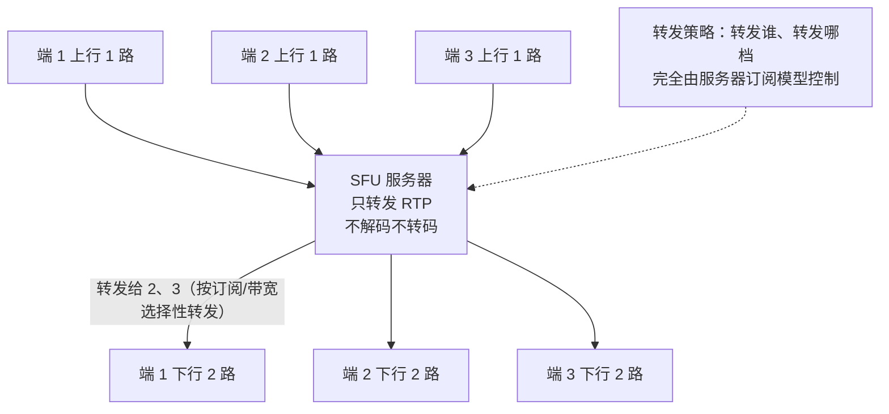
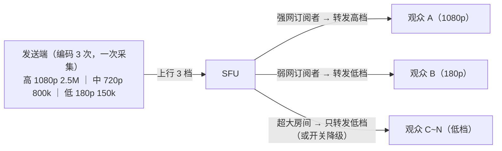

# 07 · SFU 架构：Mesh、MCU 与 Simulcast

> 📍 阶段三 · 知识整理 07 ｜ 建议配合概览页知识点清单打卡

## 问题：P2P 直连撑不起「多人」

前六章的 1v1 通话走 P2P 没问题。但 5 人会议、万人连麦呢？**把 N 个端两两直连（Mesh）会瞬间爆炸**——先算账，再引出解法。

## 三种拓扑与带宽账本

### Mesh：纯 P2P 网状

每个人与其余 N-1 人各建一条 WebRTC 连接。以 5 人会议、每人 1.5Mbps 上行为例：

| | 每端上行 | 每端下行 | 服务器成本 |
| --- | --- | --- | --- |
| Mesh（N=5） | 4 × 1.5 = **6 Mbps** | 4 × 1.5 = 6 Mbps | 零（只有信令） |

上行 6Mbps 是家庭宽带的极限（还只是 5 人！）。**Mesh 只适合 2~4 人且无服务器预算的场景**。

### MCU：服务端混流

MCU（Multipoint Control Unit）：所有人各推 1 路给服务器，服务器**解码 → 画面拼接 + 音频混音 → 重新编码成 1 路 → 每人下拉 1 路**。

| | 每端上行 | 每端下行 | 服务器成本 |
| --- | --- | --- | --- |
| MCU（N=5） | 1 × 1.5 | 1 × 1.5 | **极高**：N 路解码 + 1 路编码/会议 |

优点：终端省电省带宽（各 1 路）；缺点：**服务端为每场会议承担转码**（阶段二 06 章算过转码多贵）、增加 200~500ms 处理时延、所有人看到同一布局无法个性化。

### SFU：只转发，不编解码

SFU（Selective Forwarding Unit）：每人上行 1 路，服务器**原样转发 RTP 包**给其他人——不解码、不重编码、不混流。

| | 每端上行 | 每端下行 | 服务器成本 |
| --- | --- | --- | --- |
| SFU（N=5） | 1 × 1.5 | 4 × 1.5 | **低**：纯转发（内存/网卡开销） |

| 维度 | Mesh | MCU | SFU |
| --- | --- | --- | --- |
| 服务端转码 | 无 | 全量转码 | **无** |
| 服务端成本 | 无 | 极高 | **低** |
| 端上行压力 | N-1 路 | 1 路 | **1 路** |
| 端下行压力 | N-1 路 | 1 路 | N-1 路 |
| 时延 | 最低 | +200~500ms | **接近 P2P** |
| 个性化布局/录制 | 难 | 差 | **灵活** |
| 适用规模 | 2~4 人 | 大规模单向分发、弱终端 | **行业主流** |

**SFU 胜出的本质**：把「智能」放回终端（端上处理 N 路解码毫无压力），服务器只干「路由」这种便宜活——**成本结构与互联网分发逻辑天然契合**。代价是端上带宽上行只有 1 路但下行要接 N-1 路——这个缺口由 Simulcast 补（下节）。

## Simulcast：端上多档，服务器按需分发

下行 N-1 路是 SFU 的软肋（20 人会议每人收 19 路 1.5Mbps = 28.5Mbps，不可能）。解法是 **Simulcast（多流同播）**：

> **发送端同时编码并上行多档画质**（如 1080p 2.5Mbps + 720p 800kbps + 180p 150kbps 三档），SFU 按每个订阅者的带宽与需求，**挑合适的档转发**。

与阶段二 ABR 的对照（容易混淆，务必分清）：

| | HLS/DASH 的 ABR（阶段二） | WebRTC 的 Simulcast |
| --- | --- | --- |
| 多档怎么来 | **服务端转码**出多档 | **发送端编码**出多档 |
| 多档存哪 | CDN 静态文件 | SFU 内存里 |
| 切换执行者 | 播放器自己换 URL | **SFU 切换转发哪档** |
| 适配方向 | 下行带宽（观众网络） | 同样是下行带宽，但实时生效 |

**SVC（Scalable Video Coding）** 是另一条路线：**只编 1 路**，但编码成带分层的流（时间层/空间层/质量层），SFU 按订阅者带宽**剥层转发**（弱网只发基础层）。对比 Simulcast：SVC 省上行带宽与编码开销，但编码器复杂、SFU 解析包结构更费 CPU。工程现状：**Simulcast 是主流**（Chrome 原生支持 `addTransceiver` 的 sendEncodings），SVC 在 AV1 场景回升。

## 真实世界的 SFU：产品与生态

| 项目 | 语言 | 定位 |
| --- | --- | --- |
| **mediasoup** | C++/Node | 高性能 SFU 库，商用首选之一 |
| **Jitsi** | Java | 开箱即用的开源会议全家桶 |
| **LiveKit** | Go | 云原生 SFU，SaaS 化代表 |
| **ion-sfu / webrtc-rs** | **Rust** | Rust 生态（阶段实践 2 的进阶路标） |
| **SRS** | C++ | 阶段二用过的它也支持 WebRTC（4.x 起） |

大厂架构里 SFU 通常是**多级集群**：房间内 SFU（就近接入）+ 跨机房级联（房间分布在不同区域时 SFU 之间互拉）。管理面（房间路由、鉴权、计费）与数据面（SFU 转发）分离——和阶段二「接入层/源站/CDN」的分层思想一脉相承。

> 💡 回收阶段二 06 章选型树：连麦互动场景最终指向的就是本章——「RTC 网络（SFU）+ 主播上行同时推 RTMP 给观众」。**连麦直播 = SFU 服务连麦互动方 + CDN 服务海量观众方**，两套系统并存，这是直播行业的标准混合架构。

## 关键要点

- Mesh 每端 N-1 路上下行，只适合 2~4 人；MCU 全量转码成本极高；**SFU 只转发，成本与体验双赢，是行业主流**。
- SFU 的下行压力由 Simulcast 解决：发送端编多档，SFU 按订阅者带宽挑档转发。
- Simulcast vs SVC：多流多编 vs 单流分层；主流是 Simulcast。
- ABR（转码多档、播放器切换）与 Simulcast（编码多档、SFU 切换）别混淆。
- 连麦直播标准架构：SFU 承接互动方 + CDN 承接观看方，两系统并存。

## 延伸阅读

- [《WebRTC for the Curious》第 11 章：Where is my media server?](https://webrtcforthecurious.com/docs/11-where-is-my-media-server/)
- [mediasoup 文档（SFU 设计）](https://mediasoup.org/documentation/)
- [MDN：Simulcast 与 addTransceiver](https://developer.mozilla.org/en-US/docs/Web/API/RTCRtpSender/setParameters)

---

← 上一章：[06 jitter buffer 与 3A](/rtc/stage-3/06-mechanisms) ｜ 下一章：[08 实践](/rtc/stage-3/08-practice)
