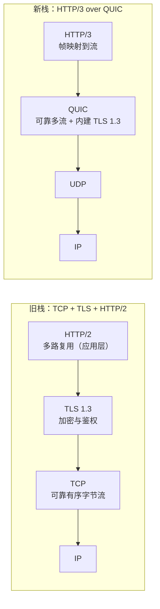

# 01 · QUIC 全景：为什么在 UDP 上重建一套传输

> 📍 阶段四 · 知识整理 01 ｜ 建议配合概览页知识点清单打卡

## 问题：TCP 已经够用了，为什么还要造一个新传输

阶段二、三反复出现同一个抱怨：**TCP 的有序字节流会把「一个包丢了」放大成「所有数据一起等」**，而 TLS 握手又要额外一个往返。工程师的第一反应往往是「那就改 TCP 嘛」——但这条路被现实堵死了。本章先讲清楚 QUIC 是什么、为什么非要在 UDP 上另起一套。

## QUIC 是什么

一句话定位（对应知识点清单第一条）：

> **QUIC 是跑在 UDP 之上的、可靠的多路流传输协议，并且把 TLS 1.3 直接内建进握手——加密不是可选层，而是传输的一部分。**

拆开看三个关键词：

| 关键词 | 含义 | 对应旧世界的哪块 |
| --- | --- | --- |
| 可靠 + 多流 | 每个 stream 独立有序、可靠，流与流之间互不阻塞 | TCP 的可靠性 + 应用层自己分帧 |
| 内建 TLS 1.3 | 传输握手与加密握手合并，默认全程加密 | TLS 作为 TCP 之上的独立层 |
| 跑在 UDP 上 | 只用 UDP 提供「端口 + 校验和」这点最小能力 | 绕开内核与中间盒对 TCP 的改造阻力 |

## 为什么是「重建」而不是「改造 TCP」

这不是技术偏好，是被四重现实约束逼出来的：

| 约束 | 具体表现 | 对 QUIC 的影响 |
| --- | --- | --- |
| **协议僵化（ossification）** | 中间盒（NAT、防火墙、负载均衡）会检查并假设 TCP 头/端口语义，改动线格式会被丢弃或改写 | 把新逻辑藏进 UDP 载荷，中间盒看不懂但会照常转发 |
| **中间盒干预** | 部分设备会重写序号、拆包、甚至注入 RST | QUIC 全加密（含传输头大部分字段），中间盒无从下手 |
| **内核态升级慢** | TCP 在操作系统内核，新特性要等内核版本 + 全网设备更新，周期以年计 | 用户态实现，随应用发版即可迭代 |
| **实验成本高** | 在内核里试一个新拥塞控制算法，回滚代价极大 | 用户态可灰度、可按连接选算法（第 02 章） |

代价也必须说清楚：**UDP 只承诺「尽力而为」，QUIC 得自己实现可靠性、拥塞控制、丢包检测、流量控制**——等于把 TCP 几十年的活重写一遍，而且全在用户态跑，CPU 开销更高。这不是免费的午餐。

## 分层栈对照：同一件事，换了个切法

关键差异不在「层数」，而在**边界被重新画了**：

- 旧栈里，TCP 不知道「应用层有几个逻辑流」，它只看到一条字节流，所以一个流丢包，所有流一起等（第 03 章的队头阻塞）。
- QUIC 把「多流」下沉到传输层，传输层自己知道哪个包属于哪个流，才能做到「只阻塞丢包的那个流」。
- 加密也从「套在 TCP 外面的独立层」变成「握手的一部分」，这才有第 02 章的 1-RTT 甚至 0-RTT。

## 一条连接，多条流

QUIC 连接建立一次后，可以在里面开任意多条**相互独立**的流（stream）：每条流有自己的序号空间与流量控制，互不等待。这直接对应 HTTP/3 的「一个请求一条流」，也对应 MoQ 的「一个 object 一条流」（第 07 章）。

理解方式：**TCP 是一条单车道公路，QUIC 是一条多车道高速——某条车道事故，其它车道照常通行**。但注意，它们共用同一个「收费站」（连接级拥塞控制），这个诚实的边界在第 03 章会专门讲。

## 用户态实现的取舍

| 维度 | 内核态 TCP | 用户态 QUIC |
| --- | --- | --- |
| 升级速度 | 受内核版本制约 | 跟随应用发版，天级 |
| 单包 CPU 成本 | 低（内核优化充分） | **高**（用户态收发、加密、拷贝） |
| 可定制性 | 几乎为零 | 拥塞控制、帧调度都可插拔 |
| 部署阻力 | 中间盒友好 | 部分网络封 UDP，需要回退（第 04 章） |

所以工程上常见的口径是：**QUIC 用「多一点 CPU」换「快得多的迭代速度与更好的弱网表现」**。在大规模服务端，这个 CPU 成本是真实账单（GSO/GRO、硬件卸载就是为此而生）；在移动端，电量也是成本。

> 💡 先记住这张地图：02 章讲握手与迁移，03 章讲多流与队头阻塞，04~07 章是 QUIC 之上的三种用法（HTTP/3、Datagram、WebTransport、MoQ），08 章动手抓包。

## 关键要点

- QUIC = UDP 之上的可靠多路流传输 + 内建 TLS 1.3，加密是传输的一部分而非外挂层。
- 不改造 TCP 的根本原因是协议僵化、中间盒干预、内核升级慢、实验成本高，而非「TCP 不好」。
- QUIC 把「多流」下沉到传输层，才可能只阻塞丢包的那条流（第 03 章展开）。
- 用户态实现的代价是 CPU 与电量，换来的是快速迭代与可插拔策略。
- UDP 只提供最小能力，可靠性、拥塞控制、流控全部由 QUIC 自己实现。

## 延伸阅读

- [RFC 9000：QUIC Transport](https://datatracker.ietf.org/doc/html/rfc9000) —— 先读第 1~2 章的设计动机与术语
- [RFC 9001：Using TLS to Secure QUIC](https://datatracker.ietf.org/doc/html/rfc9001) —— 加密如何成为握手的一部分
- [The QUIC Transport Protocol: Design and Internet-Scale Deployment（SIGCOMM 2017）](https://research.google/pubs/pub46429/) —— Google 的原始设计论文
- [MDN：QUIC 简介](https://developer.mozilla.org/en-US/docs/Glossary/QUIC)

---

← [阶段四总览](/rtc/stage-4/) ｜ 下一章：[02 握手、0-RTT 与连接迁移](/rtc/stage-4/02-handshake-migration)
