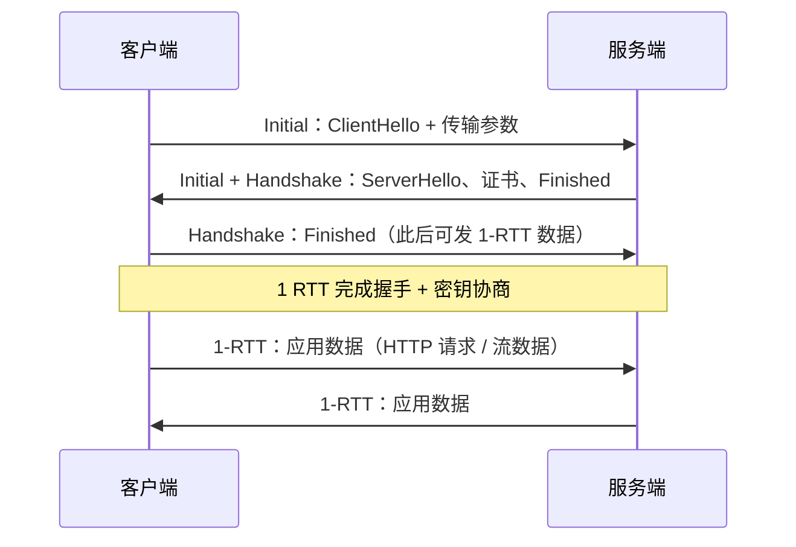
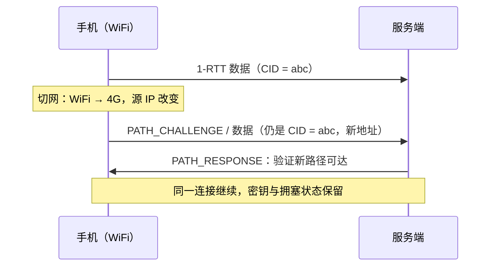

# 02 · 握手、0-RTT 与连接迁移

> 📍 阶段四 · 知识整理 02 ｜ 建议配合概览页知识点清单打卡

## 问题：为什么首包就要等两个往返

阶段三的 WebRTC 连接要先做 ICE 打洞、再跑 DTLS 握手，用户体感是「点了接通还要等一下」。在 HTTP 世界同样如此：TCP 三次握手 1 个 RTT，TLS 1.3 再 1 个 RTT，**首个请求发出前已经花掉 2 个 RTT**。QUIC 的核心卖点之一，就是把这段等待压到 1 个、甚至 0 个 RTT。

## 1-RTT 握手：把两件事合成一件事

QUIC 的握手不是「先建传输再加密」，而是**传输握手与 TLS 1.3 握手在同一次往返里完成**。三个包类型对应三个阶段：

| 阶段 | 包类型 | 干了什么 |
| --- | --- | --- |
| 第一次往返 | **Initial** | 客户端发 ClientHello（含密钥交换材料），服务端回 ServerHello + 证书等 |
| 握手确认 | **Handshake** | 双方用协商出的密钥确认握手，传输参数（流数上限等）在此交换 |
| 数据阶段 | **1-RTT** | 应用数据流开始传输，全部加密 |

理解要点：**TLS 1.3 本身就把证书加密、把握手压到 1-RTT，QUIC 只是把这次 TLS 握手和传输参数交换「并进同一批包」**，没有额外叠加一次传输握手。

## RTT 对照：首次 vs 恢复

| 场景 | 协议栈 | 首字节前的最小等待 | 说明 |
| --- | --- | --- | --- |
| 首次连接 | TCP + TLS 1.3 | **2-RTT** | TCP 握手 1 RTT + TLS 1 RTT |
| 首次连接 | QUIC | **1-RTT** | 传输与 TLS 合并 |
| 恢复连接 | TCP + TLS 1.3（session resumption） | 约 1-RTT | 仍需 TCP 握手，TLS 可复用 PSK |
| 恢复连接 | QUIC（0-RTT） | **0-RTT** | 首个包即携带应用数据 |

0-RTT 的前提是客户端缓存了上次的**会话票据（session ticket）**，用旧密钥直接加密首批数据。

## 0-RTT 的收益与代价

0-RTT 看起来是纯赚，但有一个必须讲透的安全代价：**重放攻击（replay）**。

> 0-RTT 数据在服务端完成握手确认之前就能被处理，攻击者可以截获并重复发送这批数据。QUIC/TLS 层面**无法保证 0-RTT 数据只被处理一次**。

因此工程纪律是：

- **只对幂等请求使用 0-RTT**（如 GET 静态资源、拉流切片）；下单、支付、发消息这类非幂等操作必须等 1-RTT。
- 服务端要自己做**防重放**（记录票据、限制时间窗），或干脆对敏感接口禁用 0-RTT。
- 大量小请求场景（网页、API）收益明显；**长连接的实时媒体一次性建连，0-RTT 意义有限**——这点在 RTC 语境下要诚实。

## Connection ID 与连接迁移

TCP 连接的身份证是「四元组（源 IP、源端口、目的 IP、目的端口）」，**手机从 WiFi 切到 4G，源 IP 一变，这条 TCP 连接就死了**，只能重连（重新握手、重新拥塞控制爬坡、媒体中断）。

QUIC 用 **Connection ID（CID）** 标识连接，而不是四元组：

对移动端 RTC 的意义非常直接：

| 维度 | TCP 四元组 | QUIC CID |
| --- | --- | --- |
| 换网后连接 | 断开，需重建 | **保持，不中断** |
| 重建成本 | 重新握手 + 重新慢启动 | 仅路径验证，拥塞窗口可保留/平滑调整 |
| 用户体感 | 视频卡住几秒 | 短暂抖动后恢复 |

代价：CID 需要服务端维护「CID → 连接状态」的映射表（NAT 场景下还要考虑 CID 长度与路由），并且新路径的质量可能与旧路径不同，拥塞控制要能识别并适应。

## 可插拔拥塞控制

QUIC 把拥塞控制做成了**可替换模块**，同一份协议实现可以按连接选择算法：

| 算法 | 核心信号 | 特点（概念层） |
| --- | --- | --- |
| **NewReno** | 丢包 | 经典、保守，丢包即减半 |
| **CUBIC** | 丢包 | 高带宽长肥管道吞吐更好，Linux 默认 |
| **BBR** | 带宽 + RTT（不依赖丢包） | 在有随机丢包的链路上更稳，但公平性与部署有争议 |

本章不深入算法细节，只需记住两个判断：

1. **可插拔的本质是「把策略从内核搬到应用」**——这正是第 01 章说的用户态红利。
2. 拥塞控制仍然是**连接级**的：它管的是「这条连接整体能发多快」，不是「每条流各自能发多快」。这一点在第 03 章会变成理解队头阻塞边界的关键。

## 关键要点

- QUIC 把传输握手与 TLS 1.3 合并，首次连接 1-RTT（TCP+TLS 需 2-RTT）。
- 0-RTT 用缓存票据提前发数据，但对非幂等请求有重放风险，必须谨慎使用；实时长连接收益有限。
- Connection ID 让连接不再绑定四元组，换网（WiFi ↔ 4G）可不断连，对移动端 RTC 意义重大。
- 迁移需要新路径验证（PATH_CHALLENGE/RESPONSE），拥塞状态要能适应路径变化。
- 拥塞控制可插拔（NewReno/CUBIC/BBR），但仍是连接级而非流级。

## 延伸阅读

- [RFC 9000 第 7 章：Connection Migration](https://datatracker.ietf.org/doc/html/rfc9000#section-7)
- [RFC 9001 第 4 章：0-RTT](https://datatracker.ietf.org/doc/html/rfc9001#section-4.6)
- [RFC 8446：TLS 1.3](https://datatracker.ietf.org/doc/html/rfc8446) —— 理解 1-RTT 与 PSK 恢复的基础
- [Cloudflare：QUIC 0-RTT 与重放攻击](https://blog.cloudflare.com/introducing-0-rtt/)
- [RFC 9002：QUIC Loss Detection and Congestion Control](https://datatracker.ietf.org/doc/html/rfc9002)

---

← 上一章：[01 QUIC 全景](/rtc/stage-4/01-quic-overview) ｜ 下一章：[03 多路流](/rtc/stage-4/03-streams)
