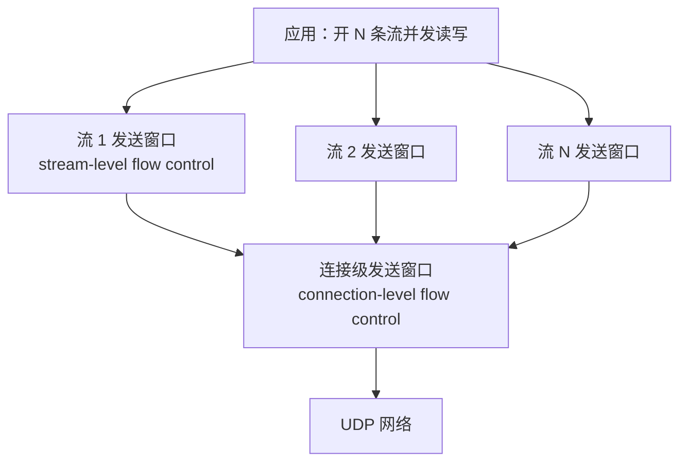
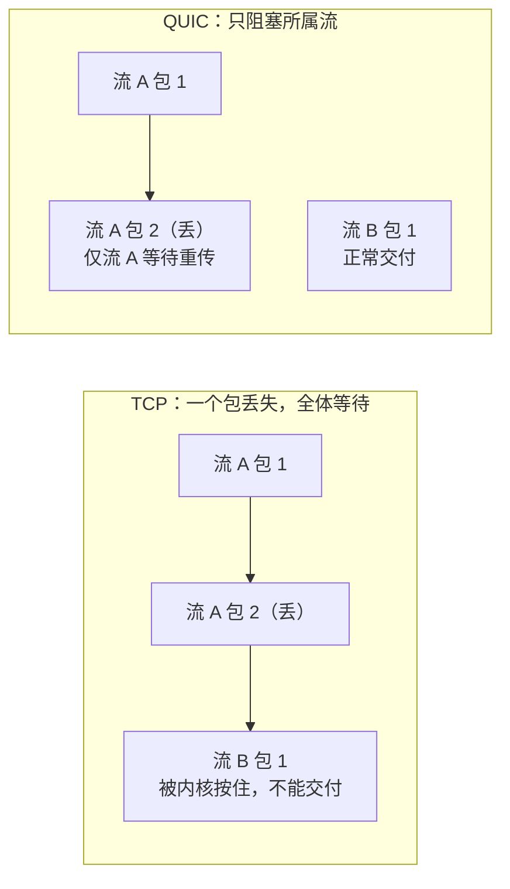

# 03 · 多路流：队头阻塞到底消除了多少

> 📍 阶段四 · 知识整理 03 ｜ 建议配合概览页知识点清单打卡

## 问题：HTTP/2 说过「多路复用」，为什么还卡

HTTP/2 在应用层做了多路复用：一个 TCP 连接里并发跑多个请求。听起来队头阻塞解决了，但**底层还是 TCP 一条有序字节流——前面某个包丢了，后面的字节一律不能交付，所有请求一起等**。这就是「TCP 层队头阻塞」。QUIC 把它下沉到传输层解决，但「解决了多少」需要精确回答，这正是本章的重点。

## stream 的抽象

QUIC 连接里的每条流都是一段**独立的、有序的、可靠的字节序列**，核心设计：

| 属性 | 单向流（unidirectional） | 双向流（bidirectional） |
| --- | --- | --- |
| 方向 | 发送方 → 接收方，单向 | 双方各有一条发送方向 |
| 谁创建 | 任一端都可开 | 任一端都可开 |
| 典型用途 | 服务端推数据、日志、单个请求体 | 请求 + 响应、双向控制通道 |
| 序号空间 | 独立 | 独立 |

> 序号空间独立的意思是：**每个方向上的流 ID 各自递增**，一个流丢了包，只影响这个流自己的排序，其它流的 ID 空间和交付进度完全不受影响。

## 两层流量控制

QUIC 的流控不是一层，而是**流级 + 连接级**双层：

为什么需要两层：

- **流级**限制「单条流最多能发多少未被确认的字节」，防止一条流把内存吃光。
- **连接级**限制「整条连接所有流的未确认字节总和」，防止对端开一万条流绕过单流限制。

这跟阶段三的 SFU 带宽账本是一个思路：**局部限额 + 全局限额，任何一层都不能被绕过**。同时，流数量本身也有上限（`max_streams` 传输参数），开流太快会被对端拒绝或阻塞。

## 与 TCP 队头阻塞的对照

| 维度 | TCP（含 HTTP/2 over TCP） | QUIC |
| --- | --- | --- |
| 有序单位 | 整条连接一个字节流 | 每条流各自有序 |
| 丢 1 个包 | **连接上所有数据一起等** | 只有所属那条流等 |
| 多请求并发 | 应用层复用但共享阻塞 | 传输层隔离，互不等待 |
| 流控 | 单一接收窗口 | 流级 + 连接级两层 |
| 流数量 | 无「流」概念 | 有 `max_streams` 上限 |

## 诚实的边界：只消除了「跨流」阻塞

这是本章最重要、也最容易被营销话说糊的一点：

> **QUIC 消除的是「流与流之间」的队头阻塞；单条流内部仍然严格有序，且所有流共享同一个连接级拥塞控制窗口。**

具体来说，丢包会带来两层影响：

1. **流内阻塞**：丢的那个包，它所在流后面的字节必须等重传（这是可靠性本身要求的，无法消除）。
2. **连接级减速**：丢包会被拥塞控制判定为「网络拥塞」，**整条连接的发送速率一起下降**——不管你丢的是哪条流的包。所以「多流」并不会让你在拥塞时还能满速发别的流。

| 常见误解 | 实际情况 |
| --- | --- |
| 「QUIC 多流 = 丢包完全互不影响」 | 交付互不影响，但**速率共享**，拥塞时大家一起降 |
| 「开更多流就能更快」 | 流越多，连接级窗口越拥挤，反而可能互相拖慢 |
| 「单流也能乱序交付」 | 不能，单流仍是有序字节流 |

工程含义：**实时媒体仍然需要「过期就丢」的机制**，因为可靠流里的重传对已经过期的帧毫无意义——这正是第 05 章 Datagram 的动机。

## 流数量的实现约束

- `max_streams` 由接收方声明，发送方不能无限开流；达到上限后要等对端放宽。
- 每条流都有状态（收发偏移、重传队列、流控额度），**海量小流会推高内存与 CPU**，服务端需要限制并发流数或做流复用。
- 流的创建/关闭是显式帧（STREAM / RESET_STREAM / STOP_SENDING），错误关闭要能通知对端，避免半开流泄漏。

## 关键要点

- 每条 stream 是独立有序的可靠字节序列，单向/双向各自拥有独立序号空间。
- 流控分两层：流级防单流吃内存，连接级防总量失控，另有 `max_streams` 限制流数量。
- QUIC 只消除跨流队头阻塞；单流内仍有序，丢包仍通过连接级拥塞控制拖慢所有流。
- 「多流」不等于「丢包互不影响」，速率是共享的。
- 可靠流无法满足实时媒体的「过期即弃」，需要第 05 章的 Datagram。

## 延伸阅读

- [RFC 9000 第 2~4 章：Streams 与 Flow Control](https://datatracker.ietf.org/doc/html/rfc9000#section-2)
- [RFC 9114 第 4 章：HTTP/3 的流映射](https://datatracker.ietf.org/doc/html/rfc9114#section-4)
- [HTTP/3 explained（Daniel Stenberg）](https://http3-explained.haxx.se/) —— 队头阻塞的图解讲得很清楚
- [Cloudflare：HTTP/3 与 QUIC 的队头阻塞](https://blog.cloudflare.com/the-road-to-quic/)

---

← 上一章：[02 握手、0-RTT 与连接迁移](/rtc/stage-4/02-handshake-migration) ｜ 下一章：[04 HTTP/3](/rtc/stage-4/04-http3)
