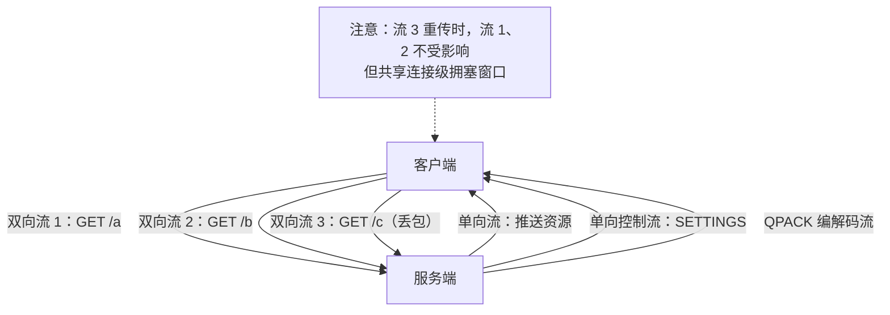

# 04 · HTTP/3：跑在 QUIC 上的 Web

> 📍 阶段四 · 知识整理 04 ｜ 建议配合概览页知识点清单打卡

## 问题：HTTP/2 已经多路复用，为什么还要再来一版

第 03 章已经给出答案的一半：HTTP/2 的多路复用建立在 TCP 之上，**TCP 一丢包，所有请求一起等**。HTTP/3 的本质就是把 HTTP 语义搬到 QUIC 上，让「多路复用」真正独立。本章讲清楚它怎么映射、和 HTTP/2 差在哪、对媒体分发意味着什么，以及现实中的坑。

## HTTP/3 = HTTP over QUIC

一句话：**HTTP/3 保留 HTTP 的语义（方法、状态码、头、body），把传输换成 QUIC，并用「一条请求一条流」的映射替代 HTTP/2 的「一条连接内交织帧」**。

| HTTP/2 的流 | HTTP/3 的流 | 用途 |
| --- | --- | --- |
| 逻辑流（帧交织在同一条 TCP 上） | **双向流（客户端发起）** | 一次请求 + 响应 |
| Push 流 | **单向流（服务端发起）** | 服务端推送 |
| 控制帧共用连接 | **单向控制流** | SETTINGS、GOAWAY 等 |
| — | **QPACK 编码器/解码器流** | 头部压缩的动态表同步 |

映射关系带来的直接结果：**一个请求的丢包只阻塞它自己那条流**，其它请求照常推进。

## HTTP/2 vs HTTP/3 差异表

| 维度 | HTTP/2 | HTTP/3 |
| --- | --- | --- |
| 传输层 | TCP | **QUIC（UDP）** |
| 队头阻塞 | 连接级（TCP 丢包全体等） | **跨流消除**，单流内仍有 |
| 头部压缩 | HPACK（依赖有序字节流） | **QPACK**（适配乱序流） |
| 连接建立 | TCP + TLS（首次 2-RTT） | QUIC 内建 TLS 1.3（首次 1-RTT，可 0-RTT） |
| 连接迁移 | 四元组绑定，换网断连 | **Connection ID，换网不断** |
| 加密 | 事实必需（浏览器强制） | **协议强制，默认全程加密** |
| 多路复用单位 | 逻辑帧交织 | 真正的独立流 |

## QPACK：为什么不能直接用 HPACK

HPACK 的头部压缩依赖一张**动态表**：双方按「发送顺序」增删表项，解码方必须**按完全相同的顺序**处理头部块，否则索引对不上。

问题来了：QUIC 的流是**乱序到达**的。如果流 3 的头部块比流 1 先到，而 HPACK 的动态表要求按发送顺序更新——解码器就会错位。

QPACK 的解法（概念层）：

- 把动态表更新放在**独立的编码器/解码器单向流**上，与请求流分离。
- 头部块里引用动态表项时，附带「需要等哪个插入计数被确认」的信息；解码器可以**阻塞等待**特定表项就绪，而不是阻塞整个连接。
- 结果是：**头部压缩不再要求全局严格有序**，代价是引入了额外的同步延迟与实现复杂度。

> 这是个很好的「分层约束传导」案例：传输层从有序变乱序，压缩层就必须重新设计。

## 对媒体分发的意义

点播、直播切片本质是**大量 HTTP 请求（或分片下载）**，HTTP/3 的收益点：

| 收益 | 机制 | 适用场景 |
| --- | --- | --- |
| 弱网下少卡顿 | 跨流队头阻塞消除，分片下载互不拖累 | 移动端、丢包率高的网络 |
| 切网不中断 | Connection ID 迁移 | 手机 WiFi ↔ 4G 切换时继续拉流 |
| 首字节更快 | 1-RTT/0-RTT、连接复用 | 冷启动、频道切换 |
| 并发拉多码率 | 多流并行，互不阻塞 | ABR 切换时预取多档 |

要诚实的地方：**HTTP/3 不会让带宽变大**，它优化的是「等待」和「抗丢包抖动」。在稳定高速网络里，与 HTTP/2 的差距可能很小；在弱网、移动网络、高丢包场景，收益才明显。

## 现实的坑：UDP 443 被封

| 问题 | 表现 | 应对 |
| --- | --- | --- |
| 部分企业网/校园网封 UDP | QUIC 握手超时 | 浏览器**回退 HTTP/2 over TCP** |
| 中间盒限速 UDP | QUIC 表现反而更差 | 客户端探测后降级 |
| 发现机制 | 首次仍走 HTTPS | 服务端通过 `Alt-Svc: h3=":443"` 告知「我也支持 h3」，后续连接尝试 QUIC |

所以生产部署的常态是：**HTTP/3 与 HTTP/2 双栈并存，客户端 Happy Eyeballs 式探测，失败即回退**。这也是为什么「支持 HTTP/3」不等于「只跑 HTTP/3」。

## 关键要点

- HTTP/3 = HTTP 语义 + QUIC 传输，一条请求一条双向流，丢包只阻塞该请求。
- 与 HTTP/2 的核心差异在传输层、队头阻塞、QPACK、连接建立与迁移、强制加密。
- HPACK 依赖有序流，QUIC 乱序要求 QPACK 用独立流同步动态表，代价是额外延迟与复杂度。
- 媒体分发收益集中在弱网、切网、首字节，不体现在「带宽更大」。
- UDP 443 可能被封，生产必须双栈 + Alt-Svc + 回退 HTTP/2。

## 延伸阅读

- [RFC 9114：HTTP/3](https://datatracker.ietf.org/doc/html/rfc9114)
- [RFC 9204：QPACK](https://datatracker.ietf.org/doc/html/rfc9204)
- [MDN：HTTP/3](https://developer.mozilla.org/en-US/docs/Glossary/HTTP_3)
- [HTTP/3 explained（Daniel Stenberg）](https://http3-explained.haxx.se/)
- [Cloudflare：Alt-Svc 与 HTTP/3 发现](https://blog.cloudflare.com/http3-the-past-present-and-future/)

---

← 上一章：[03 多路流](/rtc/stage-4/03-streams) ｜ 下一章：[05 Datagram](/rtc/stage-4/05-datagram)
