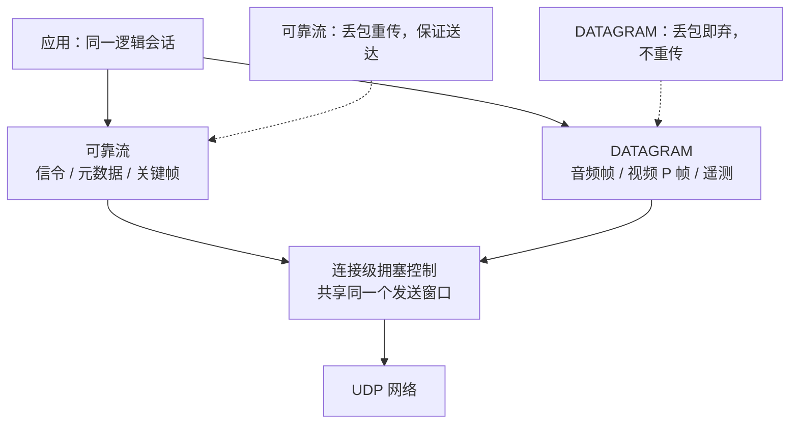

# 05 · Datagram：给 QUIC 开一条不可靠通道

> 📍 阶段四 · 知识整理 05 ｜ 建议配合概览页知识点清单打卡

## 问题：可靠传输对实时媒体是「帮倒忙」

第 03 章讲清楚了一个事实：QUIC 的流是可靠有序的，丢包会重传。但对实时音视频来说，**重传已经过期的帧不仅没用，还会加重拥塞**。

算一笔账：视频 30fps，一帧的展示窗口约 33ms。假设某帧的包丢了，RTT 是 80ms——等重传回来，这帧早就该显示了。此时：

- 重传包占用带宽 → 挤占后续新帧的发送；
- 接收端为了等这个包，jitter buffer 被迫加长 → 端到端延迟上升；
- 拥塞控制看到重传又占窗口 → 可能进一步降速。

所以实时媒体的工程原则是：**过期就丢，把带宽留给未来的帧**。这也正是阶段三 RTP 的设计哲学——RTP 本身不保证可靠，靠 RTCP/NACK「只重传来得及的包」，来不及就靠 PLC/FEC 兜。

## DATAGRAM 帧的语义

RFC 9221 在 QUIC 里加了一种新帧：**DATAGRAM**。它的语义边界必须精确：

| 属性 | DATAGRAM 帧 | STREAM 帧（对比） |
| --- | --- | --- |
| 可靠性 | **不重传**，丢了就丢了 | 可靠，丢包必重传 |
| 顺序 | **不保证有序** | 每条流内严格有序 |
| 流控 | **不受流级/连接级流控约束** | 受两层流控 |
| 拥塞控制 | **仍受连接级拥塞控制** | 同样受 |
| 大小 | 受路径 MTU 限制（通常约 1200B） | 可分片成多个包 |
| 帧边界 | **保留消息边界**（一个帧一个 datagram） | 字节流，无边界 |

理解要点：**DATAGRAM 只放弃「可靠性 + 有序性」，没有放弃「拥塞控制 + 加密」**。它和裸 UDP 的根本区别就在这里——裸 UDP 会把网络打爆，DATAGRAM 会跟着连接的拥塞窗口走。

## 与 RTP/SRTP 的对照：都是不可靠，为什么还要 QUIC

| 维度 | SRTP/RTP（阶段三） | QUIC DATAGRAM |
| --- | --- | --- |
| 可靠性 | 不可靠，过期即弃 | 不可靠，过期即弃 |
| 加密 | SRTP（DTLS-SRTP 协商密钥） | QUIC 内建 TLS 1.3 |
| 拥塞控制 | GCC/TWCC（另一套） | QUIC 的（NewReno/CUBIC/BBR） |
| 与可靠数据共存 | DataChannel 走 SCTP，另一条链路 | **同一条连接里可靠流 + datagram 并存** |
| 连接迁移 | ICE 重连（阶段三） | **Connection ID 原生迁移** |
| 浏览器 API | RTCPeerConnection | WebTransport（第 06 章） |

选择 QUIC 的理由不是「不可靠更好」，而是**省掉第二套栈**：你不需要同时维护 SRTP 加密、ICE 打洞、GCC 拥塞控制、SCTP 数据通道，只要一条 QUIC 连接，就能同时承载「可靠的信令/关键帧」和「不可靠的普通帧」。

代价也要说清楚：

- **没有 SFU 生态**：RTP 有成熟的 SFU、Simulcast、RTCP 反馈；QUIC datagram 的服务端转发与自适应还在早期。
- **MTU 限制**：单个 datagram 约 1.2KB，大帧必须自己切分，切分后仍是「每个 datagram 独立丢」。
- **无内置媒体同步**：RTP 的 timestamp/SSRC/RTCP SR 那套音画同步机制要自己重建。

## 半可靠：应用层的补充策略

DATAGRAM 给了「不可靠」的地基，但真实系统很少全丢，而是在应用层做**半可靠**：

| 策略 | 做法 | 代价 |
| --- | --- | --- |
| 选择性重传 | 只对关键帧（I 帧、SPS/PPS）走可靠流，普通帧走 datagram | 关键帧延迟略高 |
| 前向纠错（FEC） | 发冗余包，丢包时本地恢复，不等 RTT | 额外带宽（概念层，具体码率按丢包率调） |
| 冗余编码 | 同一帧发两份（低码率备份） | 带宽翻倍，适合极弱网 |
| 分层丢弃 | 弱网先丢增强层/高帧率帧 | 画质下降但不断流 |

> 注意：FEC 在 QUIC 里目前多是**应用层方案**（或在草案中探索），不是协议内置能力；不要假设「QUIC 自带 FEC」。

## 关键要点

- 实时媒体「过期就丢」，重传过期帧只会加重拥塞、拉高延迟。
- DATAGRAM 帧不重传、不保序、不受流控，但**仍受连接级拥塞控制与 MTU 限制**。
- 与 SRTP 相比，QUIC 的卖点是加密、迁移、拥塞控制与可靠流共享一条连接，而非「更不可靠」。
- 代价：媒体服务端生态不成熟、MTU 需自己切分、音画同步要自建。
- 半可靠靠应用层策略（关键帧走可靠流、FEC、冗余）补齐，协议本身不提供。

## 延伸阅读

- [RFC 9221：An Unreliable Datagram Extension to QUIC](https://datatracker.ietf.org/doc/html/rfc9221)
- [RFC 9002：QUIC 拥塞控制与丢包检测](https://datatracker.ietf.org/doc/html/rfc9002)
- [MDN：WebTransport.datagrams](https://developer.mozilla.org/en-US/docs/Web/API/WebTransport/datagrams)
- [RFC 3550：RTP](https://datatracker.ietf.org/doc/html/rfc3550) —— 对照不可靠媒体的原始设计

---

← 上一章：[04 HTTP/3](/rtc/stage-4/04-http3) ｜ 下一章：[06 WebTransport](/rtc/stage-4/06-webtransport)
