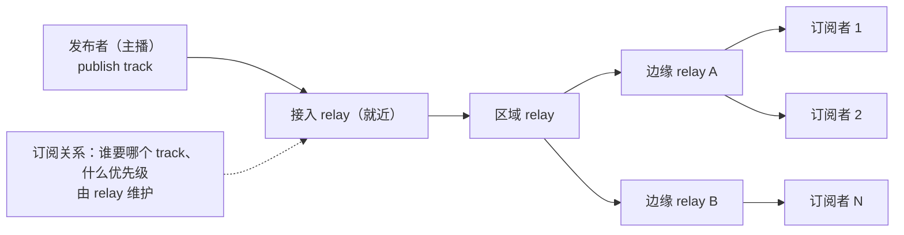
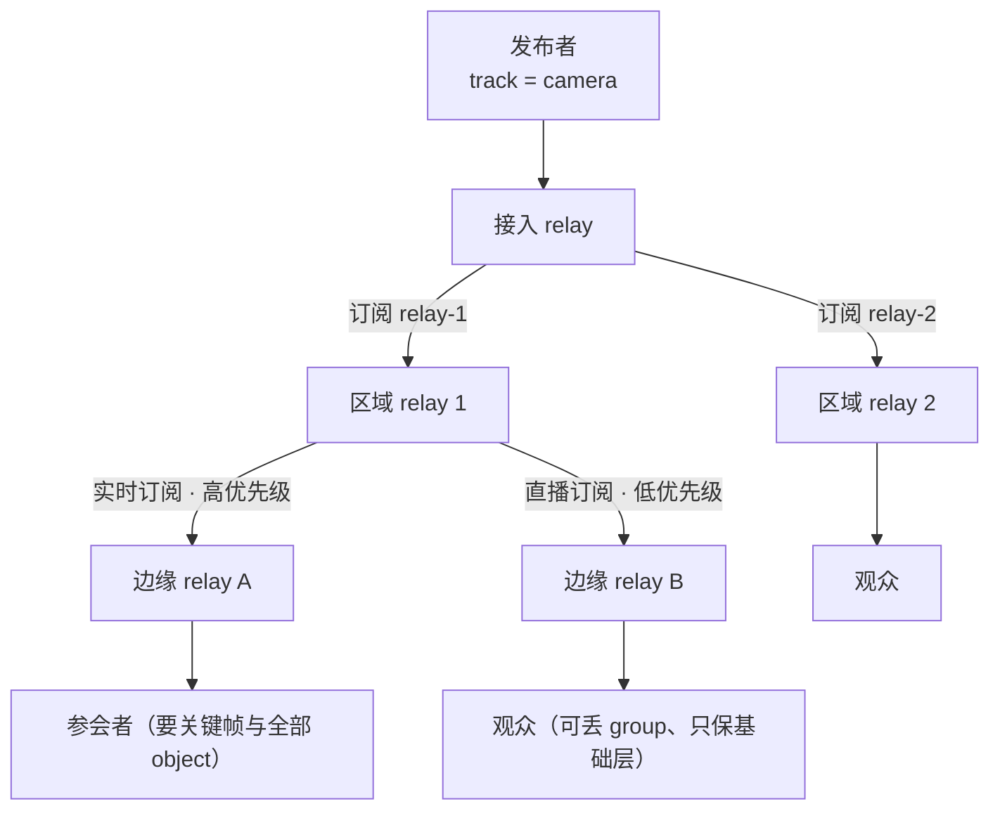

# 07 · MoQ：把实时媒体做成 pub/sub

> 📍 阶段四 · 知识整理 07 ｜ 建议配合概览页知识点清单打卡

## 问题：直播与实时通话，能不能用一套传输

阶段三的 SFU 用 RTP 做实时，阶段二的 HLS/DASH 用 HTTP 做分发，两套系统、两套协议、两套运维。MoQ（Media over QUIC）的野心是：**用同一条 QUIC 连接、同一套 pub/sub 模型，同时服务「大规模直播扇出」和「低延迟实时互动」**。本章讲它的模型与现状，注意大量内容仍处于草案阶段。

## IETF MoQ 工作组在做什么

目标可以概括为三条：

| 目标 | 含义 |
| --- | --- |
| 一个传输服务两类场景 | 直播（延迟可到秒级、规模大）与实时（延迟百毫秒级）共用 QUIC |
| 大规模扇出 | 一个源，经 relay 级联分发给海量订阅者 |
| 应用层可演进 | 媒体组织与优先级放在协议上层，编码/封装可替换 |

关键设计取向：**不做「点对点通话」的协议，而做「发布-订阅式媒体分发」的协议**。这决定了它天然是「经由服务器」的模型，而不是 P2P。

## pub/sub + relay 模型

三个角色：

- **发布者（publisher）**：把媒体组织成 track 并发布。
- **订阅者（subscriber）**：按 track 订阅，声明自己的优先级与需求。
- **relay**：只做「按订阅关系转发 object」，不做解码/转码。relay 之间可以级联形成树。

与阶段三的对照：**发布者 = 上行推流端，订阅者 = 观众/参会者，relay = SFU 的转发角色**，但控制面从「房间 + 订阅关系」变成了协议内的 pub/sub 语义。

## track / group / object 的数据组织

MoQ 草案里的媒体组织是三层（概念层，细节仍在演进）：

| 层级 | 含义 | 类比 |
| --- | --- | --- |
| **track** | 一条可持续的媒体流（如某人的视频） | RTP 的 SSRC / 一个媒体轨 |
| **group** | track 内的一组可独立解码的对象（如一个 GOP / 一个时间片） | 视频的 GOP |
| **object** | 最小的可寻址转发单位（如一个帧、一个切片） | 一个 RTP 包组 / 一帧 |

这套分层的作用：

- **group 是「可丢弃」的边界**：弱网时整组丢掉，不会破坏后续解码（类似丢 GOP）。
- **object 是「可优先级化」的单位**：关键帧/基础层优先发。
- **track 是订阅单位**：订阅者按 track 订阅，relay 按 group/object 做转发与丢弃决策。

> ⚠️ 以上是**概念层的组织方式**，具体字段、编码与信令在 draft 中仍在调整，不要按某一份草案写死实现。

## relay 与 SFU 的对照

| 维度 | WebRTC SFU（阶段三） | MoQ relay |
| --- | --- | --- |
| 转发单位 | RTP 包（按 SSRC/PT 路由） | **object / group**（应用层语义单位） |
| 是否解析媒体 | 基本不解析（只看 RTP 头） | 需理解 track/group/object 结构 |
| 扇出方式 | 每条订阅连接单独转发 | **relay 级联树**，天然支持大规模 |
| 延迟目标 | 100~400ms | 实时档百毫秒级，直播档可放宽 |
| 传输 | SRTP over UDP（ICE/DTLS） | **QUIC（流 + datagram）** |
| 拥塞/优先级 | Simulcast + 订阅带宽 | **基于 object 优先级的丢弃/调度** |
| 成熟度 | 生产成熟 | **草案阶段，生态早期** |

本质区别：**SFU 转发的是「包」，relay 转发的是「带语义的 object」**。后者能在应用层做更聪明的取舍（丢哪个 group、先发哪个 object），代价是 relay 必须理解媒体组织，CPU 与实现复杂度更高。

relay 级联的路径与订阅关系是解耦的——发布者只连接入 relay，订阅者只连边缘 relay，中间的转发树由 relay 之间协商：

注意：级联的每一跳都可以**按订阅优先级丢弃 object/group**，这是 relay 相比单纯「包转发」多出的决策空间，也是它能同时服务实时与直播的基础。

## 订阅与优先级：WARP 思想

WARP（Working group draft 中的订阅/优先级方案，**草案概念**）试图解决：一个 relay 同时服务「实时参会者」与「大规模观众」时，如何分配带宽。核心思想：

- 订阅者声明**优先级**（如「我要这个 track 的关键帧，其它可丢」）。
- relay 按订阅的优先级 + 可用带宽，决定**转发哪些 object、丢弃哪些 group**。
- 支持「订阅切换」：低优先级订阅者可以随时升降级。

这与阶段三 Simulcast 的「按订阅者带宽挑档」思路一致，但粒度更细（到 object），且把决策写进了协议语义。

## 生态现状（截至 2026）

| 事项 | 状态 |
| --- | --- |
| `draft-ietf-moq-transport` | 仍在迭代，**未定稿** |
| 实现 | quic-go 生态、部分开源 relay、Cloudflare 与 Meta 有公开实践/实验 |
| 在线 demo | [quic.video](https://quic.video/) 可体验 MoQ 的低延迟播放 |
| 浏览器路径 | 常借助 WebTransport 承载，标准化仍在推进 |

**明确结论：截至 2026 年 MoQ 仍未定稿，生产选型必须留退路**——

- 不要把 MoQ 作为唯一传输路径，保留 HLS/DASH 或 WebRTC 作为回退。
- 关注工作组 draft 版本号，接口按「可替换」设计。
- 若现在要做低延迟大规模分发，成熟方案仍是「WebRTC/SFU 承接互动 + HTTP 系承接观看」。

## 关键要点

- MoQ 的目标是「一套 QUIC 传输同时服务直播扇出与低延迟实时」。
- 模型是 pub/sub + relay，发布者/订阅者/relay 三角色，relay 可级联。
- 媒体按 track / group / object 三层组织，group 是可丢弃边界，object 是可优先级单位（草案概念）。
- relay 转发「语义 object」，与 SFU 转发「RTP 包」不同，扇出与丢弃策略更细。
- 截至 2026 仍未定稿，生产使用必须保留回退方案。

## 延伸阅读

- [IETF MoQ 工作组](https://datatracker.ietf.org/wg/moq/about/)
- [draft-ietf-moq-transport](https://datatracker.ietf.org/doc/draft-ietf-moq-transport/)
- [quic.video](https://quic.video/) —— MoQ 在线 demo
- [MoQ 工作组文档列表](https://datatracker.ietf.org/wg/moq/documents/)

---

← 上一章：[06 WebTransport](/rtc/stage-4/06-webtransport) ｜ 下一章：[08 实践](/rtc/stage-4/08-practice)
