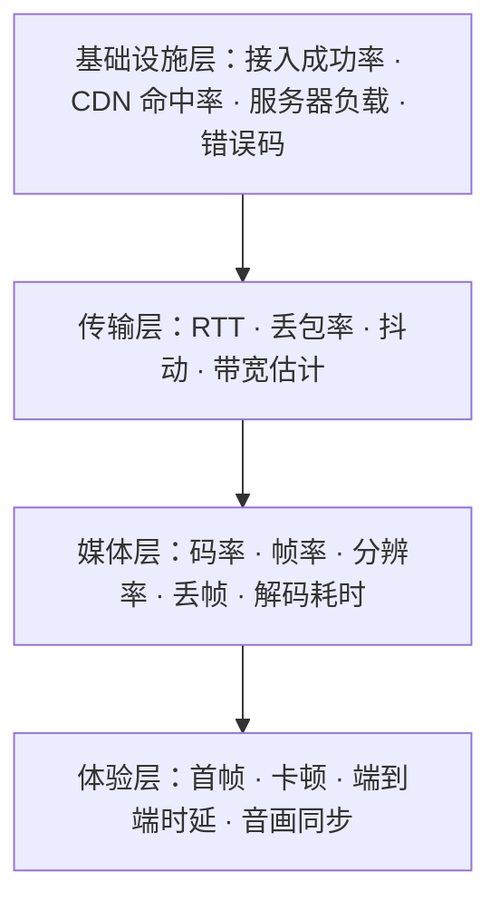

# 02 · QoE：把「卡不卡」变成可测量的指标

> 📍 阶段五 · 知识整理 02 ｜ 建议配合概览页知识点清单打卡

## 从「指标字典」到「指标体系」

阶段一 06 章给过一张指标字典：首开时间、秒开率、卡顿率、端到端时延、播放成功率，并立下了框架——**QoE 做北极星，QoS 做归因线索**。本章要把那张字典变成可落地的东西。

两者差在哪：

- **指标字典**回答「有哪些指标」；
- **指标体系**回答「用哪几个、怎么算、在哪采、出问题往哪查」。

没有后者，团队就会陷入两种典型困境：一是全都要，报表几百张没人看；二是只看平均值，长尾问题永远发现不了。

## 六个核心指标：定义与口径陷阱

| 指标 | 定义 | 测量思路 | 口径陷阱 |
| --- | --- | --- | --- |
| 首帧时间与秒开率 | 点击播放到第一帧上屏；秒开率 = 首帧时间低于 1s 的会话占比 | 客户端打点：起播请求时间戳 → 首帧真正呈现；秒开率用 P50 / P90 / P99 一起看 | 「解出首帧」与「上屏」差 1~2 帧；服务端看到的「起播」只是发出了第一个分片 |
| 卡顿率 / 卡顿次数 / 卡顿时长占比 | 卡顿 = 渲染中断超过阈值（如 200ms）或缓冲区耗尽 | 客户端记录每次卡顿的起止；卡顿率看会话占比，时长占比 = 卡顿时长 ÷ 总观看时长 | 阈值不统一就无法横向比较；「卡一次 5s」和「卡五次各 1s」体验不同，次数与时长必须分开统计 |
| 端到端时延 | 采集时刻到呈现时刻的差值 | 同一时钟源打点：采集端时间戳 → 渲染端时间戳；或做双向对时校准 | 用服务端时间减客户端时间是错的；跨设备时钟漂移必须校准 |
| 音画同步偏移 | 同一采集时刻的音视频呈现时间差 | 用 RTP 时间戳 + NTP 映射计算（阶段三 06 章），或用拍手测试人工校验 | 只看平均值会掩盖「个别时刻偏移极大」，要报分位数与超标占比 |
| 帧率与分辨率切换 | 切档次数、切换后恢复时间、分辨率波动幅度 | 客户端记录每次分辨率 / 帧率变化及其持续时长 | 「切换」不等于「体验差」：被动降档（网络差）与主动 ABR 跳档要分桶看 |
| 连接成功率 / 失败归因 | 成功建立可用会话的比例 | 客户端漏斗：鉴权 → 信令 → ICE → 媒体首帧；每步失败带错误码 | 只报总失败率不分类，等于没报——必须知道失败卡在哪一跳 |

> 💡 一条通用原则：**能报分布就不要只报均值**。音视频体验是典型的长尾问题——P50 很漂亮、P99 极差的产品，用户投诉量会远超指标看板给人的印象。

## QoS 与 QoE：网络指标 vs 用户感受

| 视角 | 典型指标 | 谁在看 | 能回答什么 |
| --- | --- | --- | --- |
| QoS（网络与服务） | 丢包率、抖动、RTT、可用带宽、CDN 命中率、服务器负载 | 传输与运维团队 | 「管道好不好」 |
| QoE（用户体验） | 首帧、卡顿、端到端时延、音画同步、成功率 | 产品与体验团队 | 「用户爽不爽」 |

三句必须记住的关系：

1. **QoS 差通常导致 QoE 差，但中间有延迟**：先抖动、再降码率、最后才卡顿。指标的时间顺序本身就是归因线索。
2. **QoS 好不等于 QoE 好**：阶段一 06 章的例子是「网络满分但 moov 后置，首开照样烂」；RTC 里同理——RTT 很低，但 jitter buffer 配得过深，时延一样超标。
3. **QoE 差也未必是网络问题**：解码性能不足、设备 CPU 降频、渲染线程被阻塞都会造成卡顿（`qualityLimitationReason` 会告诉你是 cpu 还是 bandwidth）。

所以「QoE 定目标，QoS 找原因」之间还差一步：**归因**。归因靠的不是单一指标，而是分层数据 + 时间顺序。

## 主观与客观：MOS 与 P.1203

- **MOS（Mean Opinion Score）**：ITU-T P.800 定义的 1~5 分主观评分。组织测试者按「差 / 中 / 良 / 优」打分再取平均。最接近真实感受，但贵、慢、无法在线实时采集。
- **客观模型**：不找人打分，用可测量输入预测分数。分两类：
  - **全参考**：手上有原始信号，算 PSNR / SSIM——适合评估编码方案，不适合线上监控。
  - **参数化 / 无参考**：ITU-T P.1203 就是流媒体视频质量的参数化预测模型（概念层）：输入码率、分辨率、卡顿、切换等参数，输出预测的 MOS 或分位数。不必展开公式，它的价值在于告诉你**哪些参数影响体验、影响有多大**。
- **RTC 的工程实践**：单场会话样本少，「对话感」也很难被视频质量模型刻画，常见做法是**工程指标打底 + 小规模主观打分做回归**，找出与自己产品 QoE 相关性最高的那几个指标，再用它们做日常监控。

## 怎么采集：四个数据源

分层是归因的地基：**下层是因，上层是果**。看到「卡顿率上升」，先往下一层看传输，再往下一层看基础设施；反过来，只看基础设施永远找不到根因。

四个采集点：

| 采集点 | 能拿到什么 | 局限 |
| --- | --- | --- |
| 客户端埋点 | 首帧、卡顿起止、切档、错误码、设备与网络类型、地区 | 依赖 SDK 版本与上报通道；丢失率高的场景要注意采样 |
| WebRTC `getStats()` | 丢包、抖动、RTT、帧率分辨率、丢帧、CPU 限制原因 | 字段口径随浏览器实现差异；需要定期轮询快照 |
| 服务端与 SFU 日志 | 订阅关系、转发丢包、NACK / PLI 计数、级联链路质量、房间维度聚合 | 看不到终端渲染结果，只能推断 |
| CDN 与边缘日志 | 命中率 / 回源率、分片下载耗时、4xx / 5xx | 只覆盖 HTTP 系分发，RTC 场景不适用 |

`getStats()` 里最该先记的几个字段：

- `inbound-rtp`：`packetsLost`、`jitter`、`framesDecoded`、`framesDropped`、`frameWidth`、`framesPerSecond`
- `remote-inbound-rtp`：`roundTripTime`、`fractionLost`
- `candidate-pair`：`currentRoundTripTime`、`availableOutgoingBitrate`
- `outbound-rtp`：`qualityLimitationReason`（none / bandwidth / cpu / other）
- `transport` / `codec`：选中的传输与编码参数

> 💡 这些字段在 `chrome://webrtc-internals` 里都能直接看到（阶段三 08 章用它做过观测）。先用手工观察建立直觉，再写进埋点。

### 指标、采集点与归因方向

| 指标异常 | 主采集点 | 先看什么 | 归因方向 |
| --- | --- | --- | --- |
| 首帧慢 | 客户端埋点 | 各阶段耗时：DNS / 连接 / 首包 / 首帧 | 握手慢 → CDN 未命中 → 首片过大或 GOP 太长 |
| 卡顿 | 客户端 + getStats | 卡顿时刻前后的 `jitter`、`packetsLost`、`framesDropped` | 网络抖动 → 码率超出带宽 → 解码性能不足 |
| 时延大 | 客户端同步打点 + getStats | `currentRoundTripTime`、jitter buffer 目标时长 | 物理链路远 → 缓冲过深 → 发送端排队 |
| 音画不同步 | 客户端 | 音视频呈现时间差及其分布 | 时间戳错乱 → 主时钟策略缺失 → 采集不同源 |
| 画质抖动 | 客户端 + SFU | 分辨率 / 帧率切换频次、`qualityLimitationReason` | 带宽估计不稳 → Simulcast 选层频繁 → CPU 受限 |
| 连接失败 | 客户端漏斗 + 服务端 | candidate 类型、ICE 状态迁移、TURN 使用率 | NAT 类型苛刻 → TURN 不可用 → 鉴权或证书问题 |

### 端到端采样与归因的基本思路

1. **会话维度聚合**：一行一个会话，带上地区、运营商、网络类型、设备、SDK 版本与所有关键指标。
2. **全量与采样结合**：成功率这类低频高价值事件全量上报；`getStats` 这类高频数据按比例采样。
3. **打点对齐**：用 session id 与时间窗口，把客户端事件、SFU 日志、CDN 日志串成一条时间线。
4. **先看分布再比均值**：按地区、机型、版本分桶，找到异常桶再下钻。
5. **按时间顺序归因**：抖动先起 → 码率后降 → 卡顿最后出现，谁先动谁就是上游原因。

## 示例：给「跨国 1v1 面试」选指标

假设要为一个跨国 1v1 视频面试产品设计看板，从上面的池子里选出这几个：

| 选择 | 为什么选它 |
| --- | --- |
| 连接成功率（按失败环节分类） | 面试只有一次机会，连不上就是事故；必须知道卡在 ICE、TURN 还是鉴权 |
| 首帧时间 | 面试开始前双方都在等，首帧慢直接影响第一印象 |
| 卡顿次数 + 卡顿时长占比 | 中途卡一次可能就打断了表达，长尾比均值重要 |
| 端到端时延（报 P90） | 双向对话靠它，超过 400ms 就会抢话；用分位数而不是均值 |
| 音画同步偏移 | 口型对不上在近景人脸上极其刺眼，必须单独监控 |
| 有效分辨率 / 码率下限 | 要看脸与白板，不能只统计「有画面」，要看画面是否够清楚 |

**不选**：秒开率（首帧时间已覆盖）、MOS（样本少、主观打分成本高）、CDN 命中率（RTC 不走 CDN，改看 SFU 级联质量）。

这一节其实也是阶段自测第 2 题的参考答案——关键不是选了哪几个，而是**每个选择都能说清「它对应哪种用户感受，以及不选它的替代品是什么」**。

## 关键要点

- 指标体系 = 定义 + 口径 + 采集点 + 归因方向；指标字典只解决了第一项。
- 六个核心指标：首帧与秒开率、卡顿（次数 / 时长占比）、端到端时延、音画同步偏移、帧率分辨率切换、连接成功率与失败归因。
- QoS 是管道，QoE 是感受；QoS 好不等于 QoE 好，归因要看分层数据与时间顺序。
- MOS 是主观评分，P.1203 是参数化客观预测；线上更常用「工程指标 + 小规模主观回归」。
- 能报分布就不只报均值——音视频体验是长尾问题。

## 延伸阅读

- [W3C：WebRTC Statistics API（identifiers 与字段定义）](https://www.w3.org/TR/webrtc-stats/)
- [MDN：RTCPeerConnection.getStats()](https://developer.mozilla.org/en-US/docs/Web/API/RTCPeerConnection/getStats)
- [ITU-T P.1203：流媒体视频质量参数化模型](https://www.itu.int/rec/T-REC-P.1203/en)
- [ITU-T P.800：主观质量评定方法（MOS）](https://www.itu.int/rec/T-REC-P.800/en)
- [《WebRTC for the Curious》第 9 章：Debugging](https://webrtcforthecurious.com/docs/09-debugging/)

---

← 上一章：[01 全链路时延拆解](/rtc/stage-5/01-latency-decomposition) ｜ 下一章：[03 行业视角](/rtc/stage-5/03-industry-architecture)
