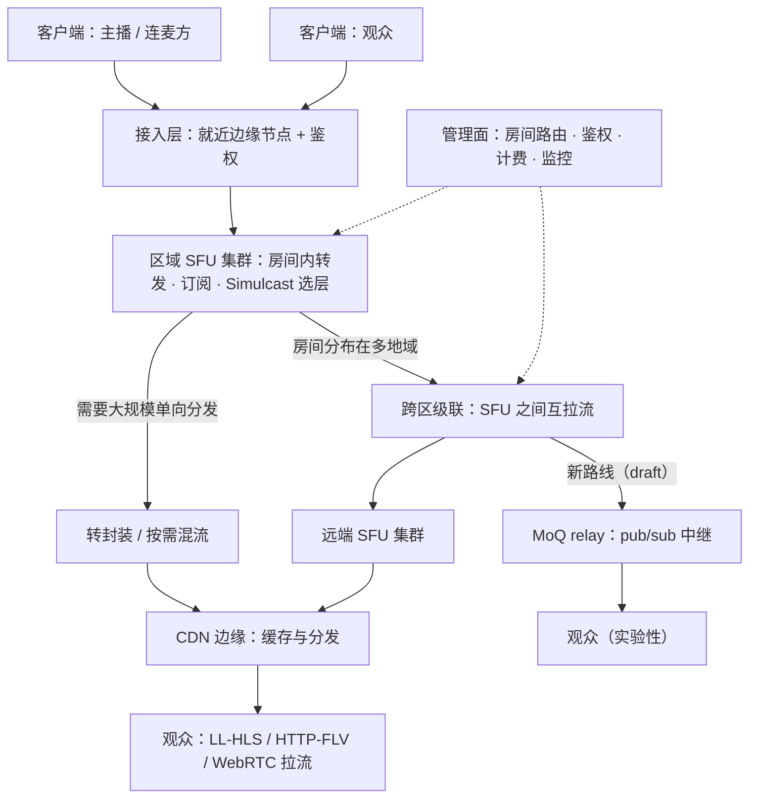

# 03 · 行业视角：RTC 云、SFU 选型与直播融合

> 📍 阶段五 · 知识整理 03 ｜ 建议配合概览页知识点清单打卡

## 从「我的 demo」到「别人的机房」

前四个阶段你搭的是单机：一个 SFU、一条链路、两个浏览器 tab。真实产品要面对的是多地域、多运营商、百万级并发，以及「主播和观众在同一场直播里但要求完全不同」的混合场景。

这一章不教你搭更大规模的系统（那需要工程实践），只做一件事：**给你一套看行业架构的坐标系**。有了它，看任何一家厂商的架构文档、任何一个开源项目的 README，你都能迅速把它归位。

> ⚠️ 本章只写**公开可查的架构特征**。节点数量、单集群容量、SLA 数值这类参数各家不公开或经常变动，一律不写；厂商产品线更新很快，具体能力以官方文档为准。凡是不确定的，我会写成「公开资料常见做法」。

## 看架构的六个维度

| 维度 | 为什么重要 | 在公开资料里怎么找 |
| --- | --- | --- |
| 全球边缘接入 | 决定物理传播时延的下限，以及跨国通话的起点质量 | 官网「全球网络 / 节点分布」页、接入点城市列表 |
| SFU 选型与级联 | 决定单房间容量、跨区房间如何互拉、故障时怎么切换 | 架构白皮书、技术博客里的「级联 / 多集群」章节 |
| 传输协议栈 | 决定丢包恢复、拥塞控制与弱网表现 | 是否标注兼容 WebRTC；是否有私有 UDP 协议；是否支持 QUIC 系 |
| WebTransport / MoQ 支持情况 | 决定未来能否统一「直播」与「实时」的传输 | 开发者文档里是否有实验性功能、更新日志、公开 demo |
| SVC / Simulcast 策略 | 决定下行带宽如何适配：端上多档，还是单流分层 | SDK 文档中的 `sendEncodings`、`scalabilityMode` 等配置项 |
| 端侧 SDK 能力 | 3A、弱网对抗、设备适配往往才是体验差异的真正来源 | SDK 更新日志与能力矩阵，而不是架构图 |

## 公开架构特征对比

| 方案 | 接入与网络 | 媒体服务器定位 | 传输栈（公开口径） | 新协议动向 |
| --- | --- | --- | --- | --- |
| 声网 Agora | 自建全球实时网（公开称 SD-RTN），就近接入 | 自研 SFU 网络，房间内转发与跨区调度 | 私有低延迟传输协议，客户端 SDK 兼容主流端 | 公开资料强调实时网与 AI 能力结合 |
| 腾讯云 TRTC | 多地域接入点，就近接入 | 自研 SFU，房间路由与跨区级联 | WebRTC 兼容 + 私有优化 | 与云直播互通，连麦 / 低延迟直播是标准组合 |
| 阿里云 ARTC / 视频直播 | 接入层与 CDN 生态结合 | RTC SFU + 向直播转推 | WebRTC 兼容 + 私有优化 | 超低延迟直播产品线，多协议播放并存 |
| 火山引擎 RTC | 与直播、点播体系同源 | 自研 SFU | WebRTC 兼容 + 私有优化 | 与实时音视频、直播产品线打通 |
| Cloudflare（Calls 等） | 依托全球边缘网络 | 托管 SFU 与媒体分发 | WebRTC；边缘同时支持 HTTP/3 | 公开推进 WebTransport 与 MoQ 相关实验 |
| 自建（mediasoup / LiveKit / SRS / Pion） | 取决于自己的机房与云主机分布 | 单集群起步，多集群靠自组级联 | WebRTC（SRS 同时支持 RTMP 系） | 多数项目在跟进 WebTransport / MoQ |

从这张表里能读出一条共同规律：**头部的 RTC 云厂商几乎都同时具备「私有传输优化 + 全球边缘 + 自研 SFU 级联」三件套**，差异更多体现在端侧 SDK、垂直场景方案与生态整合上，而不是「用不用 SFU」。

## 自建 vs 云服务

| 维度 | 自建 | 云服务 |
| --- | --- | --- |
| 起步成本 | 高：选型、部署、监控都要自己做 | 低：接 SDK 即可跑通 |
| 覆盖与弹性 | 取决于自己布点的能力，跨国是硬门槛 | 边缘节点现成，扩容按量 |
| 可控性 | 完全可控：协议、编码、录制、数据流向 | 受限于厂商能力与配置项 |
| 成本结构 | 前期低并发时不划算，规模上来后边际成本下降 | 按用量计费，规模越大越需要谈价 |
| 运维复杂度 | 高：级联、容量、故障演练、值班 | 低：SLA 由厂商兜底 |
| 数据与合规 | 可满足数据驻留、私有化部署要求 | 需确认数据落地区域与合规条款 |
| 锁定风险 | 无 | 存在：SDK、私有协议、运维工具链 |

一个务实的判断：**早期用云验证产品，规模与合规压力上来后考虑混合**——互动方走自建或专有网络，大规模单向观看继续走 CDN。这正好对应下一节的融合架构。

## 直播与 RTC 的融合：三条路线

| 路线 | 典型时延 | 成本结构 | 互动性 | 成熟度 |
| --- | --- | --- | --- | --- |
| 低延迟直播（LL-HLS / LL-DASH） | 2~5s | CDN 静态分发，最便宜 | 弱（单向 + 弹幕） | 高，标准成熟 |
| 连麦直播（SFU + CDN 混合） | 互动方 200~400ms，观众 2~5s | SFU 承接互动 + CDN 承接观看，中等 | 强（主播连麦、PK） | 高，行业标准做法 |
| MoQ（Media over QUIC） | 目标亚秒级 | relay + 缓存，介于两者之间 | 强（pub/sub 模型） | 低，仍在 draft 阶段 |

三条路的定位其实很清晰：

- **LL-HLS** 是把「直播」这条路走到极致：切片更小、阻塞请求、部分分片——但终究受 HTTP 与 CDN 缓存模型约束。
- **连麦直播**是当下唯一大规模验证过的混合方案：SFU 服务互动方，同时把流**转封装**（不转码，阶段二 06 章算过账）推给 CDN 服务海量观众。阶段三 07 章的伏笔在这里收口。
- **MoQ** 想做的事是把两者统一：一套 pub/sub 传输同时服务直播与实时，relay 承担类似 CDN 与 SFU 的角色。方向诱人，但目前是「值得跟踪」而不是「可以押注」。

## 分层视角：接入 → SFU → 级联 → CDN / relay

这张图里最值得记住的是**管理面与数据面分离**：转发 RTP 的数据面追求极低时延，房间路由、鉴权、计费、监控这些管理面追求一致性与可观测性，两者的设计目标完全不同。阶段二 06 章的「接入层 / 源站 / CDN」分层思想，到这里升级成了「接入层 / SFU 集群 / 级联 / CDN 或 relay」。

## 标准与开源生态：你的参照系

厂商架构会变，标准和开源实现相对稳定，是更好的参照系：

- **标准面**：W3C 的 WebRTC API 与 Statistics 规范定义了浏览器能力边界；IETF 的 RFC 覆盖 RTP/RTCP、ICE/TURN、QUIC 系列，MoQ 工作组负责新一代媒体传输。遇到「某厂商到底支持不支持」的争议，先回到标准原文看它定义了没有。
- **开源面**：

| 项目 | 语言 | 定位 | 读它能解决什么 |
| --- | --- | --- | --- |
| SRS | C++ | 流媒体服务器，4.x 起支持 WebRTC | 看清「直播链路 + RTC 接入」如何在同一个进程里共存 |
| mediasoup | C++ / Node | SFU 库，常见商用底座 | 看转发、Simulcast 选层、级联的具体实现 |
| LiveKit | Go | 云原生 SFU | 看管理面与数据面如何做工程分层 |
| Pion / webrtc-rs | Go / Rust | 纯实现的 WebRTC 协议栈 | 按协议分层读源码，逐层对照本站概念 |

读源码的正确姿势：**带着具体问题去读**（例如「PLI 在哪一层触发」「Simulcast 选层发生在哪个函数」），找到答案就撤，不要从第一行通读。

## 判断框架（而不是结论）

遇到「我们该用哪家」「要不要自建」「要不要上 MoQ」这类问题，按顺序问自己五个问题：

1. **时延预算是多少？** 需要 400ms 以内 → 只有 RTC 系；2~5s 可接受 → LL-HLS + CDN 最经济。
2. **互动方与观看方的比例是多少？** 全是互动方 → 纯 SFU；互动方极少、观众百万 → SFU + CDN 混合。
3. **观众在地域上有多分散？** 跨国跨洲 → 边缘接入与级联能力是硬指标，自建门槛极高。
4. **团队能长期运维什么？** 没有 7×24 值班与容量规划能力，自建 SFU 集群是负债而不是资产。
5. **新协议的风险承受度如何？** MoQ 还在 draft，适合做预研与小流量试点，不适合作为核心链路。

五个问题答完，答案通常已经浮现。如果还没浮现，说明缺的不是结论，而是数据——回去补第一章的时延拆解与第二章的 QoE 指标。

## 关键要点

- 看架构的六个维度：边缘接入、SFU 与级联、传输协议栈、WebTransport / MoQ、SVC / Simulcast 策略、端侧 SDK 能力。
- 头部 RTC 云的共同点是「私有传输 + 全球边缘 + 自研 SFU 级联」，差异主要在端侧能力与生态整合。
- 自建 vs 云不是信仰问题：早期用云验证，规模化后走向混合（互动走专有网络、观看走 CDN）。
- 直播与 RTC 融合的三条路线：LL-HLS（便宜）、SFU + CDN 混合（当下主流）、MoQ（未来方向）。
- 管理面与数据面分离是多地域架构的分水岭；不确定的厂商参数不要当作事实引用。

## 延伸阅读

- [quic.video：MoQ 的在线 demo 与介绍](https://quic.video/)
- [IETF MoQ 工作组（draft 与会议材料）](https://datatracker.ietf.org/wg/moq/about/)
- [mediasoup 文档（SFU 与级联设计参考）](https://mediasoup.org/documentation/)
- [LiveKit 文档（云原生 SFU 的架构与部署）](https://docs.livekit.io/)
- [SRS 官方文档（含 WebRTC 与直播转推）](https://ossrs.net/)

---

← 上一章：[02 QoE 指标体系](/rtc/stage-5/02-qoe-metrics) ｜ 下一章：[04 收官产出](/rtc/stage-5/04-capstone)
