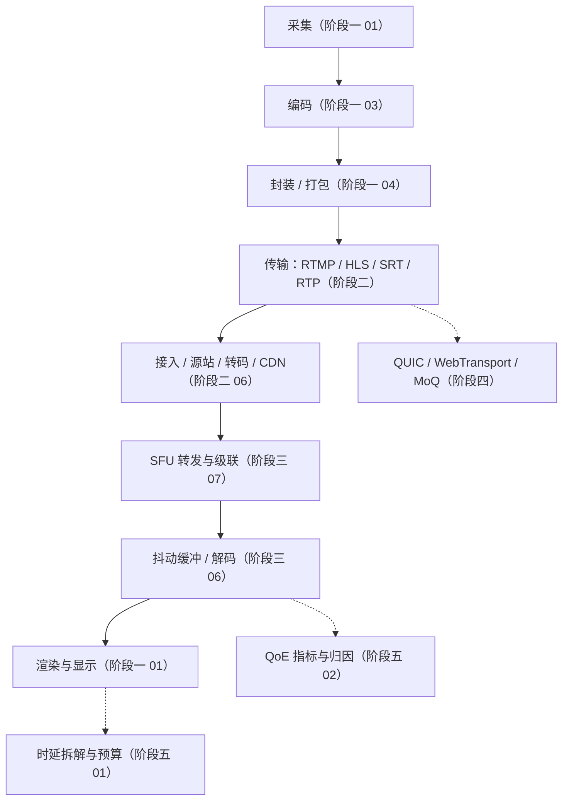

# 04 · 收官：一篇综述、一张全景图

> 📍 阶段五 · 知识整理 04 ｜ 建议配合概览页知识点清单打卡

## 为什么以「输出」收官

前 17 周你一直在输入：协议、机制、架构。但「看懂了」和「能讲清楚」之间隔着一条很宽的沟——最典型的信号是：合上文档，画不出那张图；被人追问一句「为什么」，就开始重复定义。

所以本阶段不给新知识，只给两个**输出模板**：

- **产出 A**：一篇学习综述（适合喜欢写作、想把判断沉淀成文字的人）；
- **产出 B**：一张全链路全景图（适合视觉型学习者，也适合讲课/分享）。

两个都做当然最好，至少完成一个。判断标准很简单：**能否不看资料，从空白页开始写/画出来**。

## 产出 A：学习综述模板

六个小节，每节都给出「该写什么」和一条可直接改写的示范句。总量控制在 2000~4000 字，超过说明在抄书，不足说明没串起来。

### 1. 范围与边界

**该写什么**：你学的到底是什么、刻意不学什么、以及为什么这样划界。这一段决定了整篇综述的可信度——把边界说清楚，读者才知道你的结论适用范围。

> 示范句：本站的学习范围是音视频的传输与架构，编码算法只作为概念层黑盒出现；因为这个视角下，时延与卡顿的瓶颈几乎都在缓冲、分发与调度，而不是压缩算法本身。

### 2. 单链路全景

**该写什么**：用一段话 + 一张图描述「采集 → 编码 → 封装 → 传输 → 分发 → 缓冲 → 解码 → 渲染」，并说明每个环节的核心矛盾。这是全文的骨架。

> 示范句：一条实时链路可以拆成八段，其中发送端占四段、接收端占三段、只有网络这一段不可控——所以优化的主战场其实在自己手里。

### 3. 协议选型矩阵

**该写什么**：把 RTMP / HLS / LL-HLS / DASH / RTSP-RTP / SRT / WebRTC / QUIC 系放进一张表，维度固定为「时延 / 传输层 / CDN 友好度 / 穿透性 / 典型场景」，再用两三句话总结规律。

> 示范句：推流端高度统一在 RTMP，播放端百花齐放，本质是「一个信源」与「亿级异构终端」的成本结构差异；而 CDN 友好度与时延是一对天生的反义词。

### 4. 时延与 QoE

**该写什么**：把阶段五前两章压缩成两段——时延怎么分段、怎么定预算；QoE 用哪几个指标、怎么归因。最好给出一个具体业务形态的指标选择。

> 示范句：时延不是越低越好，而是在业务预算内让时延、流畅、画质三者都不越界；因此 QoE 看板要报分位数而不是均值，并用 QoS 指标做分层归因。

### 5. 架构演进

**该写什么**：从 Mesh / MCU / SFU 讲到多地域级联，再到直播与 RTC 融合、MoQ 的可能位置。重点不是罗列名词，而是说清「每次演进在解决什么成本或约束」。

> 示范句：SFU 胜出的本质是把「智能」放回终端、让服务器只做便宜的路由；而多地域级联与 CDN 混合，则是在「就近」与「规模」之间继续分摊成本。

### 6. 未解决问题

**该写什么**：诚实列出你还没搞懂的、行业还没定论的。这一节最能体现水平——能提出问题，说明你知道边界在哪。

> 示范句：MoQ 的 relay 能否在成本上替代「SFU + CDN」的混合架构，目前没有公开的大规模答案；而端侧 SVC 的编码开销与画质收益，在不同芯片上的差异也缺少统一口径。

## 产出 B：全景图模板

下面这张图可以直接复制，替换成你自己的理解后再发出去。节点文字里的章节标注是**索引**，方便你回头补课。

画完自查三件事：

1. **每个节点都能讲出「它在等什么」**——讲不出，说明这个环节你只是记住了名字。
2. **能标出时延占比最大的两段**——这是阶段自测第 1 题，也是面试最常追问的点。
3. **能说出哪条支线可以不要**——比如纯点播场景去掉 SFU 支线，纯会议场景去掉 CDN 支线。能删，才算真懂。

## 五阶段复习清单

每条都是「必须能不看资料讲清」的检查项，讲不清就回去重读对应章节。

**阶段一 · 音视频基础**

- [ ] 一条链路的八个环节，以及压缩依赖的三类冗余（空间 / 时间 / 感知）
- [ ] 会现场估算：48kHz / 16bit / 双声道一分钟多大；YUV420 相比 RGB24 省在哪
- [ ] 时延谱系表能默写，且能解释「缓冲深度为什么是时延与流畅的交换」

**阶段二 · 流媒体与传输协议**

- [ ] 推流为什么统一在 RTMP、播放端为什么百花齐放
- [ ] HLS 的切片 / 索引 / ABR 机制，以及 LL-HLS 靠什么把时延压到 2~5s
- [ ] 直播全链路（接入 → 源站 → 转码 / 转封装 → CDN）与选型三问

**阶段三 · RTC 与 WebRTC**

- [ ] 1v1 通话四阶段时序：信令 → ICE → DTLS → SRTP，各阶段失败会看到什么现象
- [ ] RTP/RTCP 反馈族（NACK / PLI / REMB / TWCC）与 GCC 的双估计器
- [ ] SFU 为什么是主流，Simulcast 与 SVC 的差别，jitter buffer 为什么要自适应

**阶段四 · QUIC 与新一代传输**

- [ ] QUIC 的握手 / 0-RTT / 连接迁移，以及多路流消除了哪种队头阻塞
- [ ] HTTP/3 对媒体分发的意义；Datagram 与 WebTransport 各自补上了什么能力
- [ ] MoQ 的 pub/sub 模型与 relay，和 SFU 的本质异同

**阶段五 · 综合串联**

- [ ] 八段时延拆解 + 三种业务形态的预算表
- [ ] 六个 QoE 指标 + 一张「指标 → 采集点 → 归因方向」的表
- [ ] 自建 vs 云、LL-HLS vs 混合 vs MoQ 的判断框架

## 常见「自以为懂了」的陷阱

1. **「SFU 不转码，所以没有成本。」** SFU 省掉的是 CPU，不是钱——成本转移到了带宽、网卡、内存与跨区级联流量上。转发 1 路变 N 路，出流量随房间人数平方级增长，这才是账单的大头。
2. **「QUIC 消除了所有队头阻塞。」** 它消除的是**跨流**的队头阻塞：一条流丢了包，其他流照常推进。但**单条流内部**仍然有序，丢包后该流照样要等；拥塞控制也依然存在。对音视频来说，真正的解法是 Datagram 这类不可靠通道，而不是「换成 QUIC」。
3. **「时延越低，QoE 越好。」** 把缓冲压到极限能换来漂亮时延数字，代价是弱网下频繁卡顿。QoE 是多指标权衡，压时延必须同时看卡顿与画质是否越界。
4. **「加密了就等于安全。」** DTLS-SRTP 保护的是媒体内容，但信令鉴权、房间权限、SDP 泄露、TURN 被滥用、媒体服务器被扫描，都是独立的安全面。安全是一条链，不是某一个协议。
5. **「用了 WebRTC 就是 RTC 产品。」** WebRTC 只是一套协议栈；体验由架构决定——有没有就近接入、SFU 会不会选层、TURN 够不够、有没有 QoE 观测与归因。反过来，HLS 也不必然慢，LL-HLS 一样能进 2s。

## 后续路标（仅指路，不在本站范围）

| 方向 | 为什么继续 | 具体起点 |
| --- | --- | --- |
| 编解码深入：H.264 / HEVC / AV1 / Opus 原理 | 想调画质、码率、SVC 分层时，黑盒模型不够用 | AV1 规范（AOMedia AV1 Spec）；Opus 从 RFC 6716 读起；H.264 读 ITU-T 建议书的语法章节 |
| 引擎与客户端：WebRTC 源码、FFmpeg 实战 | 想改弱网策略、调 3A、做端侧优化 | FFmpeg 官方文档 + `libavcodec` 源码；WebRTC 从 `modules/video_coding`、`modules/audio_processing` 这类模块入手 |
| 服务端：SRS / mediasoup / Pion / webrtc-rs 源码 | 想自建或改造 SFU、做级联与录制 | mediasoup 的 `worker/` 与 C++ 目录；SRS 的 `trunk/src`；Pion 的示例仓库（Go，读起来最轻） |

三条路的共同点：**先带着一个具体问题去读源码**（比如「PLI 到底在哪一层触发」），而不是从第一行开始通读。本站的概念地图正好用来做索引。

## 关键要点

- 收官的标准是「能不看资料重画全景图、并解释每个环节为什么存在」，而不是读完了多少篇文档。
- 综述六节：范围与边界、单链路全景、协议选型矩阵、时延与 QoE、架构演进、未解决问题。
- 全景图的价值在于「能删能讲」：能删掉不需要的支线，能讲清每个节点在等什么。
- 五个陷阱的共同根源是「把局部结论当成全局结论」——成本、队头阻塞、时延、安全、协议，都要放回整条链路看。
- 下一步不是继续收集资料，而是选一个方向读源码，用具体问题驱动。

## 延伸阅读

- [《WebRTC for the Curious》（重读一遍，体会完全不同）](https://webrtcforthecurious.com/)
- [quic.video：MoQ 与未来趋势](https://quic.video/)
- [mediasoup 源码仓库（SFU 实现）](https://github.com/versatica/mediasoup)
- [SRS 官方文档与源码](https://ossrs.net/)
- [FFmpeg 文档（引擎与工具链入口）](https://ffmpeg.org/documentation.html)

---

← 上一章：[03 行业视角](/rtc/stage-5/03-industry-architecture) ｜ [返回总览](/rtc/)
